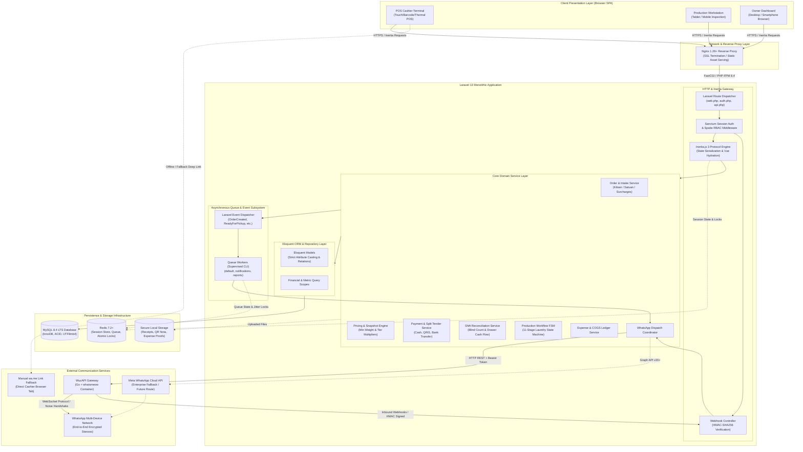
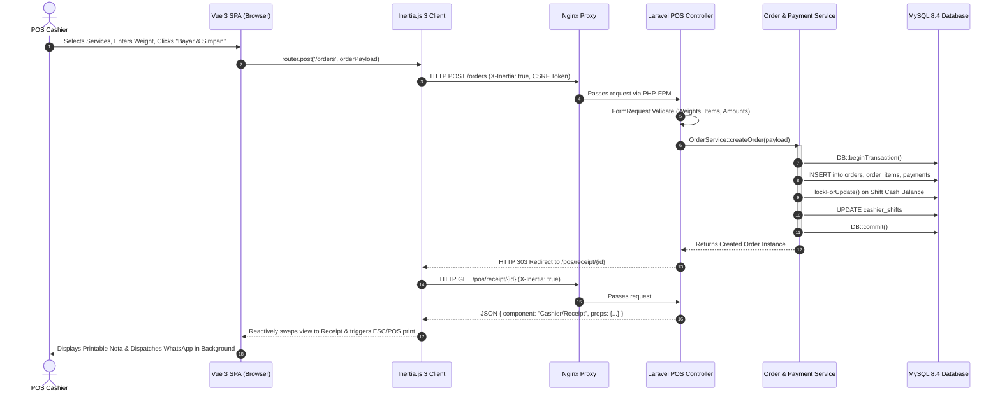

# LMS-AndikLaundry System Architecture Document

**Document Version:** 1.0.0  
**Status:** Approved Architecture Specification  
**Target Platform:** Laravel 13, Inertia.js 3, Vue 3, Tailwind CSS 4, MySQL 8.4 LTS  
**System Topology:** Single-Store Monolithic Web Application  
**Primary Reference:** `docs/PRD.md`, `docs/business-requirements.md`, `docs/database-schema.md`

---

## 1. Executive Summary & Architectural Mission

The Laundry Management System for **Andik Laundry** (`LMS-AndikLaundry`) is designed as a single-store, production-grade, monolithic web application. It unifies three distinct operational interfaces—**Point of Sale (POS) Cashier**, **Owner Analytics & Management Dashboard**, and **Production Operator Tracking UI**—within a single coherent codebase, deployment artifact, and relational database.

### 1.1 Core Architectural Principles
1. **Single Monolith (No Microservices Overhead):** All domain operations (order lifecycle, pricing snapshots, multi-tender payments, shift reconciliation, expense tracking, and security) reside entirely within a single Laravel 13 application. There is no microservices sprawl, no distributed transaction coordinator, and no multi-tenant isolation overhead.
2. **Single-Store Scope:** Built exclusively for one physical operational facility. No multi-branch routing, no tenant schemas, and no cross-store logistics abstractions.
3. **Inertia.js Monolithic Reactivity:** Leverages Inertia.js 3 to bridge Laravel's server-driven controllers directly with Vue 3 single-page frontend components. Eliminates the overhead of maintaining a separate REST/GraphQL client API while delivering instant, client-side SPA navigation.
4. **Decoupled Messaging Boundary:** The only external process integrated into the architecture is **WuzAPI** (a lightweight Go + `whatsmeow` WhatsApp companion service). WuzAPI is treated strictly as an external messaging socket behind a unified adapter interface (`WhatsAppGatewayInterface`), fully decoupled from the core laundry business rules.
5. **ACID Financial Rigor:** Complete database transaction wrapping (`DB::transaction`) for order intake, payments, refunds, and cashier cash drawer closures with pessimistic row-locking (`lockForUpdate()`) to prevent race conditions in money movements.

---

## 2. High-Level System Architecture

The following diagram illustrates the complete end-to-end topology of LMS-AndikLaundry, showing client devices, application tiers, persistence layers, and external integration points.



---

## 3. Module Structure & Codebase Organization

The codebase follows a Domain-Driven, Modular Monolith architecture within the standard Laravel 13 directory layout. Business logic is strictly kept out of Controllers and Eloquent Models, encapsulated inside dedicated Domain Services.

### 3.1 Logical Directory Tree
```
app/
├── Domain/
│   ├── Customer/
│   │   ├── Actions/ (CreateCustomerAction, NormalizePhoneAction)
│   │   ├── Models/Customer.php
│   │   └── Repositories/CustomerRepository.php
│   ├── Order/
│   │   ├── Actions/ (CalculateOrderTotalsAction, SnapshotOrderItemsAction)
│   │   ├── Enums/ (ProductionStatusEnum, ServicePricingUnitEnum, FragranceEnum)
│   │   ├── Events/ (OrderIntakeCompleted, OrderReadyForPickup, OrderDelivered)
│   │   ├── Models/ (Order.php, OrderItem.php, OrderItemTreatment.php)
│   │   ├── Services/ (OrderService.php, PricingEngine.php, StagingRackService.php)
│   │   └── StateMachines/ProductionStateMachine.php
│   ├── Payment/
│   │   ├── Actions/ (RecordSplitPaymentAction, CalculateCustomerChangeAction)
│   │   ├── Enums/ (PaymentStatusEnum, PaymentMethodEnum, RefundStatusEnum)
│   │   ├── Events/ (PaymentRecorded, OrderFullySettled, RefundIssued)
│   │   ├── Models/ (Payment.php, Refund.php)
│   │   ├── Services/ (PaymentService.php, DebtLedgerService.php)
│   │   └── StateMachines/PaymentStateMachine.php
│   ├── Shift/
│   │   ├── Actions/ (OpenShiftAction, CloseShiftBlindCountAction)
│   │   ├── Models/ (CashierShift.php, ShiftCashMovement.php, ShiftDenomination.php)
│   │   └── Services/ShiftReconciliationService.php
│   ├── Expense/
│   │   ├── Enums/ExpenseCategoryEnum.php
│   │   ├── Models/Expense.php
│   │   └── Services/ExpenseLedgerService.php
│   └── WhatsApp/
│       ├── Contracts/WhatsAppGatewayInterface.php
│       ├── DTOs/ (WhatsAppMessageDto.php, WebhookPayloadDto.php)
│       ├── Enums/ (MessageLogStatusEnum, GatewayProviderEnum)
│       ├── Gateways/ (WuzApiGateway.php, MetaCloudApiGateway.php, ManualLinkGateway.php)
│       ├── Jobs/SendWhatsAppNotificationJob.php
│       ├── Middleware/VerifyWuzApiHmacSignature.php
│       ├── Models/WhatsAppMessageLog.php
│       └── Services/WhatsAppManager.php
├── Http/
│   ├── Controllers/
│   │   ├── Cashier/ (POSController.php, ShiftController.php, CustomerLookupController.php)
│   │   ├── Operator/ (ProductionBoardController.php, RewashController.php)
│   │   ├── Owner/ (AnalyticsController.php, FinancialReportController.php, ExpenseController.php)
│   │   └── Webhooks/WhatsAppWebhookController.php
│   ├── Middleware/ (HandleInertiaRequests.php, EnsureShiftIsOpen.php)
│   └── Requests/ (StoreOrderRequest.php, RecordPaymentRequest.php, CloseShiftRequest.php)
└── Support/
    ├── Audit/AuditLogger.php
    └── Formatter/PhoneFormatter.php
```

---

## 4. Request-Response Lifecycle & Inertia.js 3 Architecture

LMS-AndikLaundry utilizes **Inertia.js 3** as its client-server communication mechanism. Inertia eliminates client-side routing and client-side REST state boilerplate while maintaining a snappy Vue 3 Single Page Application (SPA) user experience.

### 4.1 Inertia.js 3 Interaction Flow
1. **Initial Page Visit:**
   - User navigates to `/pos` or `/dashboard`.
   - Nginx passes the request to PHP-FPM.
   - Laravel routes the request through web middleware (`EncryptCookies`, `StartSession`, `ShareErrorsFromSession`, `HandleInertiaRequests`).
   - The controller returns `Inertia::render('Cashier/POS', $props)`.
   - Laravel delivers a full HTML envelope (`app.blade.php`) containing the root div (`#app`) with a serialized `data-page` JSON attribute containing component name, props, and CSRF token.
   - Vue 3 mounts and boots the page instantaneously.
2. **Subsequent In-App Transitions:**
   - When the user clicks an Inertia Link or submits an order form (`router.post('/orders', form)`), Inertia intercepts the request.
   - Inertia issues an `XHR` request with the header `X-Inertia: true` and the current `X-Inertia-Version`.
   - The controller executes the domain transaction and issues a redirect or returns `Inertia::render()`.
   - Laravel intercepts the response via `HandleInertiaRequests` middleware and returns a pure JSON payload containing only updated props.
   - Vue 3 swaps or updates the target page component without a full page reload or destroying application state.
3. **Partial Reloads & Lazy Evaluation:**
   - For POS search operations (e.g. searching 5,000 customers by phone or name), Inertia partial reloads (`only: ['customers']`) fetch only the matching records, preventing redundant serialization of service catalogs, shift balances, and user permissions.



---

## 5. Database Transactions & Concurrency Architecture

### 5.1 ACID Transaction Boundaries
Every multi-table state transition in the system must be executed within an explicit database transaction block (`DB::transaction(function() { ... }, $attempts = 3)`). If any query or business assertion fails, the entire transaction is rolled back cleanly.

#### Critical Transaction Scenarios:
1. **Order Intake & Price Freezing:**
   - Inserting row into `orders`.
   - Inserting $N$ rows into `order_items` with frozen snapshots (`unit_price_snapshot`, `billed_quantity`, `subtotal_snapshot`).
   - Inserting optional rows into `order_item_treatments`.
   - Creating initial `payments` record if paid upfront or down payment provided.
   - Updating customer lifetime stats (`total_orders_count`, `outstanding_receivables`).
2. **Cashier Mid-Shift Movements & Drawer Closure:**
   - Inserting record into `shift_cash_movements` (drops or petty cash expenses).
   - Locking active `cashier_shifts` row via `lockForUpdate()`.
   - Computing exact cash drawer balance.
   - Verifying that cash drops do not exceed available drawer cash.
3. **Refund Processing:**
   - Validating original payment record.
   - Inserting row into `refunds`.
   - Updating `orders.payment_status` deterministically based on net settled balance.
   - Recording reverse cash entry in `shift_cash_movements` if cash was disbursed from drawer.

### 5.2 Concurrency & Pessimistic Row Locking
In high-throughput laundry environments (e.g. rush hours with simultaneous walk-in payments, phone inquiries, and courier status updates), race conditions can compromise financial balances.
- **Pessimistic Locking (`lockForUpdate()`):**
  When updating order payment status or cashier shift drawer balances, the application applies `lockForUpdate()` on the target record:
  ```php
  DB::transaction(function () use ($orderId, $paymentDto) {
      $order = Order::where('id', $orderId)->lockForUpdate()->firstOrFail();
      $shift = CashierShift::where('id', $paymentDto->shift_id)->lockForUpdate()->firstOrFail();
      
      // Calculate remaining due and execute payment insertion
      ...
  });
  ```
- **Transaction Isolation Level:** Standard MySQL 8.4 `REPEATABLE READ`. Prevents dirty reads and non-repeatable reads.
- **Idempotency Keys:** Every payment request and webhook callback requires an `idempotency_key` (UUID v5 / SHA-256) backed by a `UNIQUE` database index to eliminate double-taps on POS touchscreens or duplicate network transmissions.

---

## 6. Asynchronous Queue Pipeline & WhatsApp Architecture

WhatsApp messaging is completely asynchronous. Outbound notification requests are never executed in the synchronous HTTP request-response thread.

### 6.1 WhatsApp Pipeline Topology

```mermaid
flowchart LR
    %% Subgraph 1: Trigger
    subgraph TriggerStage ["1. Domain Event Generation"]
        DomainEvent["Domain Event Raised\n(OrderCreated, ReadyForPickup)"]
        Listener["Notification Event Listener"]
        DomainEvent --> Listener
    end

    %% Subgraph 2: Queue & Broker
    subgraph QueueStage ["2. Asynchronous Queue Processing"]
        QueueDispatcher["Queue Dispatcher\n(Redis Broker)"]
        AtomicLock{"Redis Atomic Lock\n& Idempotency Check"}
        Worker["Supervisor Queue Worker\n(Job: SendWhatsAppNotificationJob)"]
        
        Listener --> QueueDispatcher
        QueueDispatcher --> AtomicLock
        AtomicLock -->|Lock Acquired| Worker
        AtomicLock -->|Duplicate Key| SkipDrop["Drop Duplicate & Log"]
    end

    %% Subgraph 3: Gateway Resolution
    subgraph GatewayStage ["3. Gateway Adapter Layer"]
        CircuitBreaker{"Circuit Breaker\n(Healthy?)"}
        WuzApiAdapter["WuzAPI Adapter\n(Go / whatsmeow REST)"]
        MetaCloudAdapter["Meta Cloud API Adapter\n(Graph API v20+)"]
        ManualLinkGen["Manual Fallback Link\n(wa.me URL Generator)"]
        
        Worker --> CircuitBreaker
        CircuitBreaker -->|Closed / Healthy| WuzApiAdapter
        CircuitBreaker -->|Migrated / Option| MetaCloudAdapter
        CircuitBreaker -->|Open / Tripped| ManualLinkGen
    end

    %% Subgraph 4: Transmission & Webhook
    subgraph NetworkStage ["4. Transmission & Feedback Loop"]
        WuzApiContainer["WuzAPI Docker Service"]
        WhatsAppNet["WhatsApp Multi-Device Network"]
        CustomerDevice["Customer Mobile Phone"]
        WebhookEndpoint["POST /api/webhooks/wuzapi\n(Verify HMAC-SHA256)"]
        LogDB[("whatsapp_message_logs\n(Status: sent / delivered / read)")]

        WuzApiAdapter -->|HTTP POST + Bearer Token| WuzApiContainer
        WuzApiContainer -->|E2EE WebSocket Stanza| WhatsAppNet
        WhatsAppNet --> CustomerDevice
        
        CustomerDevice -.->|Delivery / Read Ack| WhatsAppNet
        WhatsAppNet -.->|Raw Webhook Stanza| WuzApiContainer
        WuzApiContainer -->|HTTP POST + x-hmac-signature| WebhookEndpoint
        WebhookEndpoint --> LogDB
        ManualLinkGen -.->|Cashier One-Click Screen| CustomerDevice
    end
```



### 6.2 Sequence Execution & Failure Recovery
1. **Trigger:** When an order transitions to `ready_for_pickup`, `OrderService` dispatches the `OrderReadyForPickup` domain event.
2. **Serialization & Enqueueing:** `SendWhatsAppNotificationJob` is pushed to the Redis `whatsapp-notifications` queue.
3. **Worker Dequeue:** A background worker picks up the job. It evaluates an atomic cache lock based on the idempotency key:
   `wa:notify:{entity_type}:{entity_id}:{event_type}` (e.g. `wa:notify:order:1042:ready_for_pickup`).
4. **Anti-Ban Jitter & Rate Limiting:**
   To comply with WhatsApp heuristic anti-spam filters, the job passes through a Redis sliding-window rate limiter:
   - Max **12 messages per minute**.
   - A randomized sleep jitter of **1,500 to 3,500 milliseconds (1.5s–3.5s)** between consecutive requests.
5. **Gateway Dispatch:**
   - The job calls `WhatsAppGatewayInterface::sendTextMessage()`.
   - In production MVP, this resolves to `WuzApiGateway`, sending an HTTP POST to `http://wuzapi:8080/chat/send/text`.
   - The gateway returns an immediate HTTP `200 OK` containing WuzAPI's internal message ID (`wuzapi_msg_id`), logged as `sent`.
6. **Inbound Webhook Status Reconciliation:**
   - When the customer's phone acknowledges receipt, WuzAPI sends an HTTP POST to `/api/webhooks/wuzapi`.
   - Middleware `VerifyWuzApiHmacSignature` computes `hash_hmac('sha256', $rawBody, $secret)` and compares it against header `x-hmac-signature`.
   - The status in `whatsapp_message_logs` is updated from `sent` to `delivered`.
   - When the message is opened, status transitions to `read` (monotonic update; state cannot regress).
7. **Circuit Breaker & Fallback:**
   - If WuzAPI fails with 5 consecutive timeouts or 5xx errors, Redis increments `wa_gateway_failure_count`.
   - Once threshold reaches 5, the circuit trips to **OPEN** for 10 minutes.
   - Outbound automated jobs fail gracefully to `failed` status, and the POS UI lights up an orange indicator with the **Manual WhatsApp Link (`wa.me`)** button.

---

## 7. System Boundaries, Constraints & Anti-Corruption Layers

### 7.1 Single Monolith Boundary Guarantees
- **No Shared Database with External Systems:** WuzAPI maintains its own internal SQLite database (`/app/dbdata/`) purely for WhatsApp cryptographic session keys and Noise handshake data. It has **zero direct access** to the Laravel MySQL 8.4 database.
- **Communication Solely via Defined Contracts:** Laravel interacts with WuzAPI exclusively over standard HTTP/JSON contracts authenticated with `Authorization: Bearer <WUZAPI_TOKEN>`.
- **Business Domain Encapsulation:** All pricing calculations, tax rules, invoice number sequences, and debt ledgers are 100% computed inside Laravel. No logic is delegated to client-side scripts, database triggers, or third-party gateways.

### 7.2 Hardware & POS Integration Boundaries
- **ESC/POS Thermal Receipt Printing:**
  - Standard 58mm / 80mm thermal printers are supported via browser direct raw print dialogs or local client-side WebSocket print services. The server renders lightweight, monospace thermal templates (`text/plain` or high-contrast HTML).
- **Digital Scale Integration:**
  - POS cashier scales connect to the cashier terminal via USB/Serial (RS-232). Input is captured via Web Serial API in the Vue 3 component or entered manually via cashier keypad with strict range validation (`0.01 kg` to `100.00 kg`).

---

## 8. Summary of Architectural Attributes

| Dimension | Architectural Specification | Rationalization |
|---|---|---|
| **Architecture Style** | Modular Monolith | Eliminates distributed systems complexity; optimal for single-store retail. |
| **Backend Framework** | Laravel 13 (PHP 8.4) | Full-featured ecosystem (Eloquent, Queues, Sanctum, FormRequests, Transactions). |
| **Frontend Framework** | Vue 3 + Inertia.js 3 | Reactive SPA speed without API duplication; instant form validations. |
| **Styling Framework** | Tailwind CSS 4 | Utility-first design tokens, zero runtime CSS overhead, accessible touch targets. |
| **Relational Database** | MySQL 8.4 LTS | Native ACID compliance, `DECIMAL` precision, enterprise reliability. |
| **In-Memory Cache & Queue** | Redis 7.2+ | High-throughput async queue broker, atomic idempotency locks, session storage. |
| **WhatsApp Companion** | WuzAPI (Go container) | Zero-cost WhatsApp Web integration, 100MB RAM footprint, REST API abstraction. |
| **Fallback Messaging** | `wa.me` Universal Deep-Link | 100% operational resilience when gateway is offline or network fails. |
