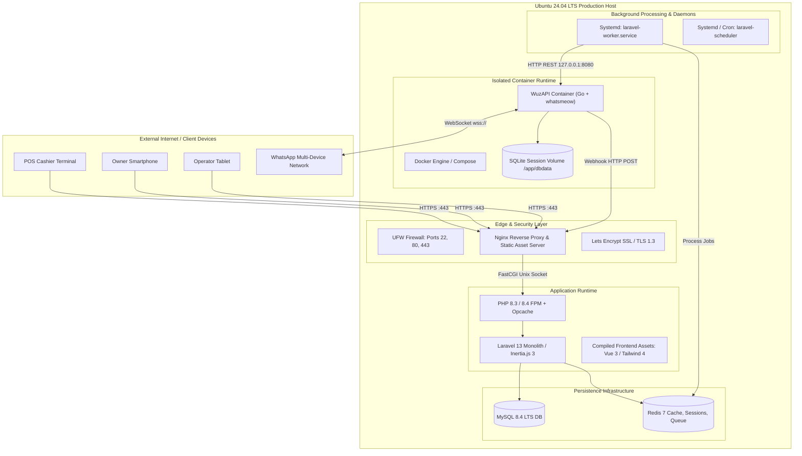

# Production Deployment & Operations Guide

**Project:** LMS Andik Laundry (Single-Store Laundry Management System)  
**Document Version:** 1.0.0  
**Status:** Approved Operations Standard  
**Deployment Model:** Single-Node Bare Metal / VPS Architecture (Ubuntu 24.04 LTS)  
**Notice:** *This document is an architectural and operational guide. No deployment commands are to be executed during Phase 0.*

---

## 1. System Topology & Architecture Overview

LMS Andik Laundry is deployed as a high-performance single-node monolith. The host machine runs Nginx, PHP 8.3/8.4 FPM, MySQL 8.4 LTS, Redis 7, and a localized Docker container for the WuzAPI WhatsApp companion gateway.



---

## 2. Target Environment Specifications

### 2.1 Hardware Requirements (Single-Store Sizing)

| Resource | Minimum Requirement | Recommended Specification |
| :--- | :--- | :--- |
| **CPU Architecture** | 2 vCPU (x86_64) | 4 vCPU (Intel Xeon or AMD EPYC) |
| **System RAM** | 4 GB | 8 GB ECC DDR4/DDR5 |
| **Storage / Disk** | 40 GB SSD (NVMe preferred) | 80 GB NVMe SSD (Enterprise Grade) |
| **Network Interface** | 100 Mbps Public Interface | 1 Gbps with Static Public IPv4 |
| **Target OS** | Ubuntu Server 24.04 LTS | Ubuntu Server 24.04 LTS (Noble Numbat) |

---

### 2.2 Host Software Stack Prerequisites

```bash
# Ubuntu 24.04 LTS Core Package Installation Reference
sudo apt update && sudo apt upgrade -y
sudo apt install -y software-properties-common curl git unzip ufw fail2ban logrotate htop

# Add PHP PPA (Ondřej Surý)
sudo add-apt-repository ppa:ondrej/php -y
sudo apt update

# Install PHP 8.3 and Extensions
sudo apt install -y php8.3 php8.3-fpm php8.3-cli php8.3-common php8.3-mysql \
    php8.3-mbstring php8.3-xml php8.3-curl php8.3-zip php8.3-bcmath php8.3-gd \
    php8.3-redis php8.3-intl php8.3-opcache

# Install MySQL 8.4 LTS Server
sudo apt install -y mysql-server

# Install Redis 7
sudo apt install -y redis-server

# Install Nginx and Certbot
sudo apt install -y nginx certbot python3-certbot-nginx

# Install Docker & Docker Compose Plugin
sudo apt install -y docker.io docker-compose-v2
sudo systemctl enable --now docker
```

---

## 3. Web Server & PHP-FPM Configuration

### 3.1 Nginx Site Server Block (`/etc/nginx/sites-available/lms-andiklaundry.conf`)

```nginx
# Upstream PHP-FPM Socket
upstream php_handler {
    server unix:/run/php/php8.3-fpm.sock;
}

# HTTP to HTTPS Redirect
server {
    listen 80;
    listen [::]:80;
    server_name lms.andiklaundry.com;
    return 301 https://$host$request_uri;
}

# HTTPS Primary Virtual Host
server {
    listen 443 ssl http2;
    listen [::]:443 ssl http2;
    server_name lms.andiklaundry.com;

    root /var/www/lms-andiklaundry/public;
    index index.php index.html;

    # SSL Certificates (managed via Certbot)
    ssl_certificate /etc/letsencrypt/live/lms.andiklaundry.com/fullchain.pem;
    ssl_certificate_key /etc/letsencrypt/live/lms.andiklaundry.com/privkey.pem;
    ssl_protocols TLSv1.2 TLSv1.3;
    ssl_ciphers HIGH:!aNULL:!MD5;
    ssl_prefer_server_ciphers on;
    ssl_session_cache shared:SSL:10m;
    ssl_session_timeout 1d;

    # Security Headers
    add_header X-Frame-Options "SAMEORIGIN" always;
    add_header X-Content-Type-Options "nosniff" always;
    add_header X-XSS-Protection "1; mode=block" always;
    add_header Referrer-Policy "strict-origin-when-cross-origin" always;
    add_header Strict-Transport-Security "max-age=31536000; includeSubDomains; preload" always;

    # Client Payload Limits
    client_max_body_size 10M;
    client_body_buffer_size 128k;

    # Gzip Compression
    gzip on;
    gzip_vary on;
    gzip_proxied any;
    gzip_comp_level 6;
    gzip_types text/plain text/css text/xml application/json application/javascript application/rss+xml application/atom+xml image/svg+xml;

    # Static Assets Caching (Vite build artifacts)
    location ~* \.(jpg|jpeg|png|gif|ico|css|js|woff2|woff|ttf|svg)$ {
        expires 1y;
        add_header Cache-Control "public, no-transform, immutable";
        access_log off;
    }

    # Core Laravel Routing
    location / {
        try_files $uri $uri/ /index.php?$query_string;
    }

    # PHP-FPM FastCGI Handler
    location ~ \.php$ {
        include snippets/fastcgi-php.conf;
        fastcgi_pass php_handler;
        fastcgi_param SCRIPT_FILENAME $realpath_root$fastcgi_script_name;
        include fastcgi_params;
        fastcgi_read_timeout 60;
        fastcgi_buffer_size 128k;
        fastcgi_buffers 4 256k;
        fastcgi_busy_buffers_size 256k;
    }

    # Block Access to Hidden Files
    location ~ /\.(?!well-known).* {
        deny all;
    }
}
```

---

### 3.2 PHP 8.3 FPM & Opcache Tuning (`/etc/php/8.3/fpm/php.ini` & `pool.d/www.conf`)

#### Tuning Directives in `php.ini`:
```ini
memory_limit = 256M
upload_max_filesize = 10M
post_max_size = 12M
max_execution_time = 30
date.timezone = Asia/Jakarta
expose_php = Off

; OPcache High-Performance Tuning
opcache.enable = 1
opcache.memory_consumption = 128
opcache.interned_strings_buffer = 16
opcache.max_accelerated_files = 10000
opcache.revalidate_freq = 0
opcache.validate_timestamps = 0 ; In production, set to 0 and reload PHP-FPM on deploy
opcache.save_comments = 1
opcache.fast_shutdown = 1
```

#### Tuning Directives in `/etc/php/8.3/fpm/pool.d/www.conf`:
```ini
pm = dynamic
pm.max_children = 20
pm.start_servers = 5
pm.min_spare_servers = 3
pm.max_spare_servers = 8
pm.max_requests = 1000
```

---

## 4. WuzAPI Docker Container Configuration

WuzAPI runs as an isolated companion service managed via Docker Compose.

### 4.1 Production `docker-compose.yml` (`/opt/wuzapi/docker-compose.yml`)

```yaml
services:
  wuzapi:
    image: asternic/wuzapi:latest
    container_name: lms_wuzapi
    restart: unless-stopped
    ports:
      # Bound strictly to localhost loopback to prevent public exposure
      - "127.0.0.1:8080:8080"
    environment:
      - WUZAPI_ADMIN_TOKEN=wuzapi_master_admin_token_super_secret_2026
      - WUZAPI_PORT=8080
      # SQLite persistent storage (default)
      - DB_TYPE=sqlite
      # Log level: info, debug, error
      - LOG_LEVEL=info
    volumes:
      # Persistent storage mount for SQLite WhatsApp session keys & Signal protocol identities
      - ./wuzapi_data:/app/dbdata
    deploy:
      resources:
        limits:
          cpus: '0.50'
          memory: 256M
    logging:
      driver: "json-file"
      options:
        max-size: "10m"
        max-file: "3"
```

---

## 5. Systemd Daemons: Queue Worker & Scheduler

### 5.1 Laravel Queue Worker Service (`/etc/systemd/system/laravel-worker.service`)

```ini
[Unit]
Description=LMS Andik Laundry Queue Worker
After=network.target redis-server.service mysql.service

[Service]
Type=simple
User=www-data
Group=www-data
Restart=always
RestartSec=5
WorkingDirectory=/var/www/lms-andiklaundry
ExecStart=/usr/bin/php8.3 /var/www/lms-andiklaundry/artisan queue:work redis --queue=default,whatsapp-notifications --sleep=3 --tries=3 --max-time=3600 --memory=128
StandardOutput=append:/var/www/lms-andiklaundry/storage/logs/queue-worker.log
StandardError=append:/var/www/lms-andiklaundry/storage/logs/queue-worker.log

[Install]
WantedBy=multi-user.target
```

#### Activation Commands:
```bash
sudo systemctl daemon-reload
sudo systemctl enable --now laravel-worker.service
```

---

### 5.2 Laravel Cron Scheduler Service (`/etc/cron.d/laravel-scheduler`)

```cron
# /etc/cron.d/laravel-scheduler
* * * * * www-data /usr/bin/php8.3 /var/www/lms-andiklaundry/artisan schedule:run >> /dev/null 2>&1
```

---

## 6. Network Security & Firewall (UFW)

The server enforces strict firewall rules using UFW:

```bash
# Reset UFW
sudo ufw default deny incoming
sudo ufw default allow outgoing

# Allow Essential Services
sudo ufw allow 22/tcp comment 'SSH'
sudo ufw allow 80/tcp comment 'HTTP Let’s Encrypt'
sudo ufw allow 443/tcp comment 'HTTPS Secure Traffic'

# Enable Firewall
sudo ufw --force enable
```

**Port Security Verification:**
- Port `3306` (MySQL) must listen on `127.0.0.1:3306`, NOT `0.0.0.0:3306`.
- Port `6379` (Redis) must listen on `127.0.0.1:6379`, protected by `requirepass`.
- Port `8080` (WuzAPI) is bound to `127.0.0.1:8080` only.

---

## 7. Backup & Disaster Recovery Playbook

### 7.1 Automated Daily Backup Script (`/opt/scripts/backup-lms.sh`)

```bash
#!/usr/bin/env bash
set -euo pipefail

BACKUP_DIR="/var/backups/lms-andiklaundry"
TIMESTAMP=$(date +"%Y%m%d_%H%M%S")
RETENTION_DAYS=30

mkdir -p "${BACKUP_DIR}"

echo "[${TIMESTAMP}] Starting LMS Andik Laundry automated backup..."

# 1. MySQL Database Dump
echo "Dumping MySQL 8.4 database..."
mysqldump --defaults-file=/etc/mysql/debian.cnf \
    --single-transaction \
    --quick \
    --routines \
    --triggers \
    lms_andiklaundry | gzip > "${BACKUP_DIR}/db_lms_${TIMESTAMP}.sql.gz"

# 2. WuzAPI SQLite Session Backup
echo "Backing up WuzAPI SQLite volume..."
tar -czf "${BACKUP_DIR}/wuzapi_session_${TIMESTAMP}.tar.gz" -C /opt/wuzapi wuzapi_data

# 3. Laravel Storage Public Assets (Receipts & Photos)
echo "Backing up uploaded documents and receipts..."
tar -czf "${BACKUP_DIR}/storage_uploads_${TIMESTAMP}.tar.gz" -C /var/www/lms-andiklaundry/storage/app/public .

# 4. Enforce Retention Policy (Delete backups older than 30 days)
echo "Pruning backups older than ${RETENTION_DAYS} days..."
find "${BACKUP_DIR}" -type f -name "*.tar.gz" -mtime +${RETENTION_DAYS} -delete
find "${BACKUP_DIR}" -type f -name "*.sql.gz" -mtime +${RETENTION_DAYS} -delete

echo "[$(date +"%Y%m%d_%H%M%S")] Backup completed successfully."
```

#### Crontab Schedule:
```cron
# Run daily at 02:00 AM WIB
0 2 * * * root /opt/scripts/backup-lms.sh >> /var/log/lms-backup.log 2>&1
```

---

### 7.2 Disaster Recovery RTO / RPO Targets

| Metric | Target Window | Rationale |
| :--- | :---: | :--- |
| **Recovery Point Objective (RPO)** | $\le 24$ Hours | Daily midnight database snapshot + binary log replication |
| **Recovery Time Objective (RTO)** | $\le 2$ Hours | Time required to provision host, restore dump, and restart services |

---

### 7.3 Step-by-Step Restoration Playbook

In the event of a catastrophic server hardware failure:

1. **Provision New Host:** Boot fresh Ubuntu 24.04 LTS instance, install Nginx, PHP 8.3, MySQL 8.4, Redis, Docker.
2. **Restore Database:**
   ```bash
   gunzip < /var/backups/lms-andiklaundry/db_lms_YYYYMMDD_HHMMSS.sql.gz | mysql -u root -p lms_andiklaundry
   ```
3. **Restore WuzAPI Session:**
   ```bash
   mkdir -p /opt/wuzapi
   tar -xzf /var/backups/lms-andiklaundry/wuzapi_session_YYYYMMDD_HHMMSS.tar.gz -C /opt/wuzapi
   cd /opt/wuzapi && docker compose up -d
   ```
4. **Deploy Application Code:** Clone git repo to `/var/www/lms-andiklaundry`, copy production `.env`, restore `storage/app/public`.
5. **Run Migrations & Caches:**
   ```bash
   php artisan migrate --force
   php artisan config:cache
   php artisan route:cache
   php artisan view:cache
   ```
6. **Restart Systemd Services:**
   ```bash
   sudo systemctl restart laravel-worker.service
   sudo systemctl restart php8.3-fpm
   sudo systemctl restart nginx
   ```

---

## 8. Log Rotation & System Monitoring

### 8.1 Logrotate Configuration (`/etc/logrotate.d/lms-andiklaundry`)

```
/var/www/lms-andiklaundry/storage/logs/*.log {
    daily
    missingok
    rotate 14
    compress
    delaycompress
    notifempty
    create 0664 www-data www-data
    su www-data www-data
}
```

---

### 8.2 Application Health Check Endpoint (`GET /api/health`)

Laravel provides an authenticated or internal health probe returning JSON:
```json
{
  "status": "ok",
  "timestamp": "2026-11-13T12:00:00Z",
  "services": {
    "database": "connected",
    "redis": "connected",
    "wuzapi_gateway": "connected",
    "queue_pending_jobs": 0
  }
}
```

---

## 9. Zero-Downtime Deployment Playbook (`deploy.sh`)

The deployment script executes atomic code upgrades without interrupting cashier counter checkout:

```bash
#!/usr/bin/env bash
set -euo pipefail

DEPLOY_PATH="/var/www/lms-andiklaundry"
cd "${DEPLOY_PATH}"

echo "Starting zero-downtime deployment for LMS Andik Laundry..."

# 1. Enter Maintenance Mode with bypass secret
php artisan down --secret="andik-lms-deploy-bypass-token" --render="errors.503"

# 2. Pull latest release branch
git fetch origin main
git reset --hard origin/main

# 3. Install/Update PHP Dependencies
composer install --no-interaction --prefer-dist --optimize-autoloader --no-dev

# 4. Install/Update NPM & Build Production Assets
npm ci
npm run build

# 5. Execute Database Migrations
php artisan migrate --force

# 6. Rebuild Application Caches
php artisan config:cache
php artisan route:cache
php artisan view:cache
php artisan event:cache

# 7. Restart Queue Workers (graceful shutdown of active jobs)
php artisan queue:restart
sudo systemctl restart laravel-worker.service

# 8. Reload PHP-FPM to flush Opcache
sudo systemctl reload php8.3-fpm

# 9. Exit Maintenance Mode
php artisan up

echo "Deployment finished successfully at $(date)!"
```
