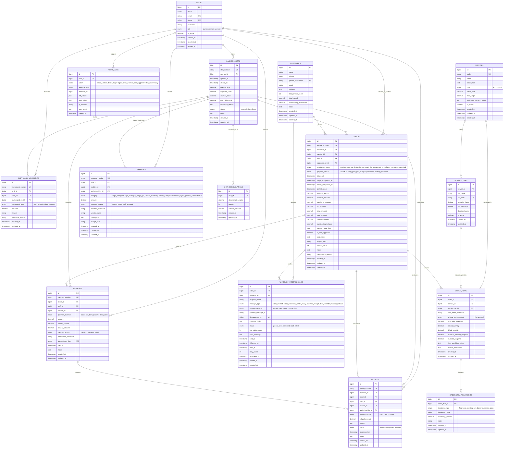

# LMS-AndikLaundry Entity Relationship Diagram (ERD)

**Document Version:** 1.0.0  
**Target Platform:** MySQL 8.4 LTS  
**Primary Reference:** `docs/database-schema.md`, `docs/architecture.md`, `docs/financial-logic.md`

---

## 1. Overview & Diagrammatic Scope

This document provides the complete Entity Relationship Diagram (ERD) for **LMS-AndikLaundry** in standard Mermaid `erDiagram` syntax. It models the operational, financial, and messaging entities of the single-store laundry management system, illustrating all primary keys, foreign keys, unique keys, and relationship cardinalities.

### Cardinality Legend
- `||--o{` : Exactly one parent relates to zero, one, or many children ($1 : 0..N$)
- `||--|{` : Exactly one parent relates to one or many children ($1 : 1..N$)
- `|o--o{` : Zero or one parent relates to zero, one, or many children ($0..1 : 0..N$)
- `||--||` : Exactly one parent relates to exactly one child ($1 : 1$)

---

## 2. Complete Mermaid Entity Relationship Diagram

---

## 3. Entity Relationship Dictionary & Cardinality Matrix

| Parent Entity | Relationship | Child Entity | Cardinality | Foreign Key Column | On Delete Rule | Business Logic & Integrity Invariant |
|---|---|---|---|---|---|---|
| `USERS` | opens | `CASHIER_SHIFTS` | $1 : 0..N$ | `cashier_id` | `RESTRICT` | User must hold the role `cashier` or `owner` to open a shift session. |
| `USERS` | executes | `SHIFT_CASH_MOVEMENTS` | $1 : 0..N$ | `user_id` | `RESTRICT` | Tracks cashier responsible for drawer drops, cash-ins, and petty cash logs. |
| `USERS` | intakes | `ORDERS` | $1 : 0..N$ | `cashier_id` | `RESTRICT` | Identifies which staff member created the order invoice. |
| `USERS` | authorizes debt | `ORDERS` | $0..1 : 0..N$ | `approved_by_id` | `SET NULL` | Required when an unpaid order is released on credit to a customer. |
| `USERS` | collects | `PAYMENTS` | $1 : 0..N$ | `cashier_id` | `RESTRICT` | Identifies staff member receiving the money tender. |
| `USERS` | authorizes | `REFUNDS` | $1 : 0..N$ | `authorized_by_id` | `RESTRICT` | Owner or Manager level authorization required for any cash/transfer refund. |
| `USERS` | records | `EXPENSES` | $1 : 0..N$ | `cashier_id` | `RESTRICT` | Tracks staff member inputting the expense invoice or voucher. |
| `USERS` | triggers | `AUDIT_LOGS` | $0..1 : 0..N$ | `user_id` | `SET NULL` | Records the responsible actor; set to null for automated system background jobs. |
| `CASHIER_SHIFTS` | tracks | `SHIFT_CASH_MOVEMENTS` | $1 : 0..N$ | `shift_id` | `RESTRICT` | All cash movements directly affect `expected_cash` in the active shift drawer. |
| `CASHIER_SHIFTS` | contains count | `SHIFT_DENOMINATIONS`| $1 : 0..N$ | `shift_id` | `CASCADE` | Detailed bill/coin counts submitted during blind count shift closing. |
| `CASHIER_SHIFTS` | settles | `ORDERS` | $1 : 0..N$ | `shift_id` | `RESTRICT` | Associates intake transaction with the active operational shift. |
| `CASHIER_SHIFTS` | reconciles | `PAYMENTS` | $1 : 0..N$ | `shift_id` | `RESTRICT` | Physical cash payments increment shift drawer; non-cash logged separately. |
| `CASHIER_SHIFTS` | disburses | `REFUNDS` | $1 : 0..N$ | `shift_id` | `RESTRICT` | Cash refunds decrease expected cash drawer balance. |
| `CASHIER_SHIFTS` | funds petty cash | `EXPENSES` | $0..1 : 0..N$ | `shift_id` | `SET NULL` | Drawer expenses reduce cash in register; bank expenses omit `shift_id`. |
| `CUSTOMERS` | places | `ORDERS` | $1 : 0..N$ | `customer_id` | `RESTRICT` | Customer profile aggregates total spend, order counts, and receivables. |
| `CUSTOMERS` | receives | `WHATSAPP_MESSAGE_LOGS`| $1 : 0..N$ | `customer_id` | `RESTRICT` | Direct notification recipient for ready notices and receipts. |
| `SERVICES` | offers | `SERVICE_TIERS` | $1 : 0..N$ | `service_id` | `CASCADE` | Defines turnaround speeds (Regular, Kilat, Express) per master service. |
| `SERVICES` | cataloged in | `ORDER_ITEMS` | $1 : 0..N$ | `service_id` | `RESTRICT` | Master catalog reference for pricing snapshot creation. |
| `SERVICE_TIERS` | applies speed | `ORDER_ITEMS` | $0..1 : 0..N$ | `service_tier_id` | `SET NULL` | Specific speed tier multiplier applied to the line item. |
| `ORDERS` | contains | `ORDER_ITEMS` | $1 : 1..N$ | `order_id` | `CASCADE` | Frozen line-item snapshots. An order must possess at least one item. |
| `ORDERS` | paid by | `PAYMENTS` | $1 : 0..N$ | `order_id` | `RESTRICT` | Supports split tenders (e.g. Cash + QRIS) and down payment deposits. |
| `ORDERS` | reimburses | `REFUNDS` | $1 : 0..N$ | `order_id` | `RESTRICT` | Reversals from cancellation or claims linked directly to the parent order. |
| `ORDERS` | notifies | `WHATSAPP_MESSAGE_LOGS`| $0..1 : 0..N$ | `order_id` | `SET NULL` | Outbound WhatsApp notifications dispatched for specific order events. |
| `ORDER_ITEMS` | includes | `ORDER_ITEM_TREATMENTS`| $1 : 0..N$ | `order_item_id` | `CASCADE` | Optional add-ons such as perfume scents, anti-bacterial wash, and spotting. |
| `PAYMENTS` | reverses | `REFUNDS` | $1 : 0..N$ | `payment_id` | `RESTRICT` | Links refund record to the specific original tender transaction. |

---

## 4. Cross-Document Consistency Matrix

This schema and ERD specification is guaranteed 100% consistent with the system architecture and business requirements:
1. **Financial Types:** All monetary columns in `ORDERS`, `ORDER_ITEMS`, `ORDER_ITEM_TREATMENTS`, `PAYMENTS`, `REFUNDS`, `EXPENSES`, `CASHIER_SHIFTS`, and `CUSTOMERS` strictly use `DECIMAL(12, 2)`.
2. **Weight Precision:** All physical quantity and weight columns (`actual_quantity`, `billed_quantity`, `min_weight`) strictly use `DECIMAL(8, 2)`.
3. **Decoupled FSMs:** `ORDERS` features separate `production_status` and `payment_status` ENUMs with zero coupling between production processing and payment settlement.
4. **Auditability:** Critical actions and financial updates log JSON deltas into `AUDIT_LOGS`, while message retries and idempotency keys in `WHATSAPP_MESSAGE_LOGS` prevent duplicate customer alerts.
