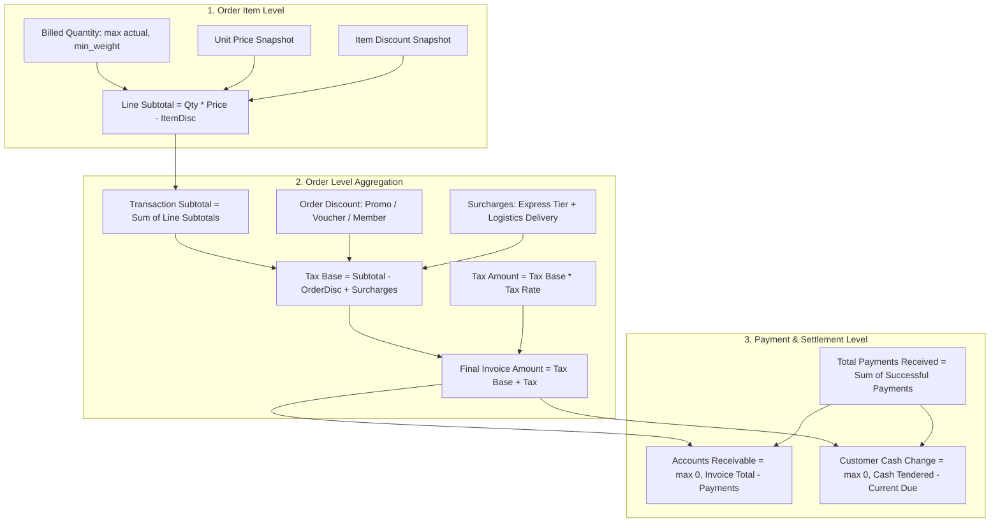
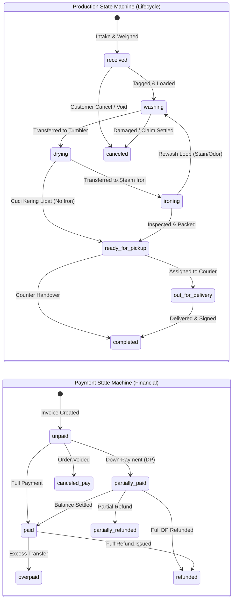
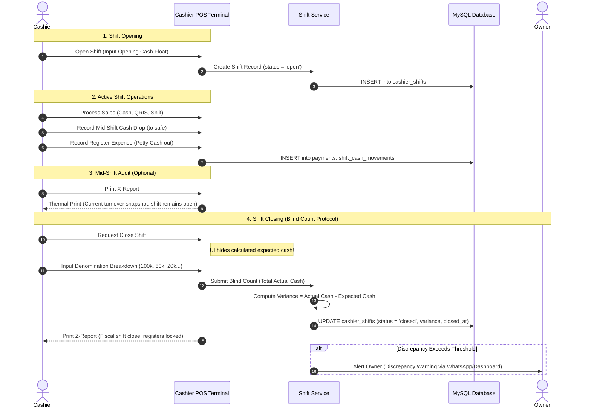

# Financial & Accounting Logic Specification

**Document Version:** 1.0.0  
**Project:** Laundry Management System (LMS Andik Laundry)  
**Status:** Approved Architecture Specification  
**Classification:** Phase 0 Discovery & Planning Deliverable  
**Date:** 2026-11-13  

---

## 1. Executive Summary

This document defines the mathematical, architectural, and financial logic governing LMS Andik Laundry. As a commercial single-store laundry operation handling retail cash, electronic transfers (QRIS/EDC), customer credit (piutang), down payments, supplier expenses, and cashier shifts, the system requires strict mathematical determinism, immutable pricing histories, and compliant accounting segregation.

### Core Architectural Principles
1. **Precision Standard:** All monetary amounts are stored and calculated using MySQL `DECIMAL(12, 2)`. Quantities, unit counts, and scale weights are stored using `DECIMAL(8, 2)`. Rates and tax percentages are stored using `DECIMAL(5, 2)`. Floating-point arithmetic is strictly prohibited to eliminate binary rounding errors.
2. **Price Snapshotting:** Master service catalog modifications never alter existing transactions. Every order item freezes its unit price, applied discount, and subtotal at the exact moment of order intake.
3. **Orthogonal State Decoupling:** Production progress (`production_status`) and payment settlement (`payment_status`) operate as independent finite state machines. Orders can be in production while unpaid, but physical customer release is protected by release guard policies.
4. **Accounting Segregation:** The system strictly separates **Cash Basis Accounting** (cash drawer liquidity and physical cash reconciliation) from **Accrual Basis Accounting** (earned service revenue recognized upon completion per Indonesian SAK EMKM standards).
5. **Loss Prevention:** Cashier shift management mandates the **Blind Count Audit Protocol** at shift closing to prevent skimming and enforce transparent discrepancy logging.

---

## 2. Mathematical Formulas & Invoicing Logic



### 2.1 Precision and Data Type Standards

| Dimension | Database Column Type | PHP / Casting Type | Permitted Value Range | Description |
|:---|:---|:---|:---|:---|
| **Monetary Value** | `DECIMAL(12, 2)` | `string` / `bcmath` | `-9,999,999,999.99` to `9,999,999,999.99` | Currency values in Indonesian Rupiah (IDR). Handles up to Rp 9.99 Billion. |
| **Physical Weight** | `DECIMAL(8, 2)` | `string` / `bcmath` | `0.00` to `999,999.99` | Digital scale laundry weight in kilograms (kg). |
| **Piece Quantity** | `DECIMAL(8, 2)` | `string` / `bcmath` | `0.00` to `999,999.99` | Item count for satuan or square meters ($m^2$) for carpets/curtains. |
| **Tax / Promo Rate** | `DECIMAL(5, 2)` | `string` / `bcmath` | `0.00` to `100.00` | Percentage rates (e.g., `11.00` for 11% PPN, `10.00` for 10% promo). |

### 2.2 Order Intake & Line Item Pricing

#### A. Kiloan (Scale-Based Weight) with Minimum Weight Threshold
Single-store laundries enforce a minimum weight threshold (e.g., minimum 3.00 kg) to maintain operational machine efficiency.
- Let $W_{\text{actual}}$ be the measured physical scale weight.
- Let $W_{\text{min}}$ be the configured service minimum threshold (e.g., 3.00 kg).
- Let $P_{\text{unit}}$ be the frozen unit price snapshot per kilogram.
- The billable quantity $Q_{\text{billed}}$ is derived as:
  $$Q_{\text{billed}} = \max(W_{\text{actual}}, W_{\text{min}})$$

*Example:* Customer brings 1.65 kg on a service with $W_{\text{min}} = 3.00\text{ kg}$ and $P_{\text{unit}} = \text{Rp } 8.000/\text{kg}$.
$$Q_{\text{billed}} = \max(1.65, 3.00) = 3.00\text{ kg}$$
$$\text{Line Gross} = 3.00 \times 8.000 = \text{Rp } 24.000$$
*(The invoice documents both $W_{\text{actual}} = 1.65\text{ kg}$ and $Q_{\text{billed}} = 3.00\text{ kg}$ for transparency).*

#### B. Satuan (Per-Piece / Unit Dry Cleaning)
- Let $N$ be the verified count of discrete garments (e.g., 2 Bedcovers, 1 Jas Pria).
- Let $P_{\text{unit}}$ be the frozen unit price snapshot per piece.
$$Q_{\text{billed}} = N$$
$$\text{Line Gross} = N \times P_{\text{unit}}$$

#### C. Line Item Subtotal Formula
For any line item $i \in \{1, \dots, n\}$ with item-level discount $D_{\text{item}, i}$:
$$\text{Line Subtotal}_i = \text{round}\left((Q_{\text{billed}, i} \times P_{\text{unit}, i}) - D_{\text{item}, i}, 2\right)$$
Where $\text{round}(x, 2)$ represents standard commercial half-up rounding to two decimal places.

### 2.3 Transaction-Level Invoicing Formulas

#### A. Transaction Subtotal
$$\text{Subtotal} = \sum_{i=1}^{n} \text{Line Subtotal}_i$$

#### B. Order-Level Discounts (Promotions, Vouchers, Membership)
Order-level discounts may be structured as a flat amount ($D_{\text{flat}}$), a percentage ($R_{\text{disc}}\%$), or a combination capped at a maximum ceiling ($D_{\text{max}}$):
$$D_{\text{calc}} = D_{\text{flat}} + \text{round}\left(\text{Subtotal} \times \frac{R_{\text{disc}}}{100}, 2\right)$$
$$\text{Order Discount} = \min\left(\text{Subtotal}, \min\left(D_{\text{calc}}, D_{\text{max}}\right)\right)$$
*Constraint:* Total order discount can never exceed the transaction subtotal; invoice subtotal cannot be discounted below Rp 0.00.

#### C. Surcharges (Express Turnaround & Logistics)
Surcharges account for expedited machine priority and delivery services:
$$\text{Surcharges} = S_{\text{express}} + S_{\text{delivery}} + S_{\text{special\_care}}$$
- **$S_{\text{express}}$ (Turnaround Tier Surcharge):**
  - Regular (48-72h): $\text{Rp } 0.00$
  - Kilat (24h): Flat surcharge (e.g. Rp 3,000/kg or flat Rp 10,000)
  - Express (6-8h): Flat surcharge or percentage multiplier (+50% to +80%)
  - Flash / Super Express (2-3h): Priority queue surcharge (+100%)
- **$S_{\text{delivery}}$ (Pickup & Delivery Logistics):** Flat courier distance fee (e.g. Rp 10,000).
- **$S_{\text{special\_care}}$ (Spotting / Heavy Stain Treatment):** Add-on chemical treatment charge.

#### D. Tax Base & Tax Calculation (PPN)
- In Indonesian tax compliance, value-added tax (PPN) applies to the net taxable base after discounts plus applicable surcharges:
  $$\text{Tax Base} = \max\left(0, \text{Subtotal} - \text{Order Discount} + \text{Surcharges}\right)$$
  $$\text{Tax Amount} = \text{round}\left(\text{Tax Base} \times \frac{R_{\text{tax}}}{100}, 2\right)$$
- *Default Policy:* Small-scale laundry operations operating below the Indonesian MSME threshold (< Rp 4.8 Billion annual turnover) are non-PKP and configure $R_{\text{tax}} = 0.00\%$. If the store registers as a taxable entity (PKP), $R_{\text{tax}} = 11.00\%$ or $12.00\%$ activates without code alterations.

#### E. Final Invoice Amount (Total Tagihan Akhir)
$$\text{Final Invoice Amount} = \text{Tax Base} + \text{Tax Amount}$$

---

## 3. Payment Processing, Debt (Piutang) & Refunds

### 3.1 Payment Records & Multi-Tender Split Payments
LMS Andik Laundry supports multi-tender split payments (e.g., paying Rp 50,000 via QRIS and Rp 25,000 via Cash). Each tender is recorded as an immutable entity in `payments`.

$$\text{Total Payments Received} = \sum_{j=1}^{m} \text{PaymentRecord}_j\text{.amount} \quad \text{where status} = \text{'success'}$$

### 3.2 Outstanding Receivables (Piutang Pelanggan)
Accounts receivable represent uncollected balances on orders that have been rendered or released:
$$\text{Outstanding Receivables} = \max\left(0, \text{Final Invoice Amount} - \text{Total Payments Received}\right)$$

### 3.3 Cash Tender & Customer Change Formula
When a payment transaction is settled via physical cash:
- Let $A_{\text{due}}$ be the remaining unpaid balance on the invoice: $A_{\text{due}} = \text{Final Invoice Amount} - \text{Total Payments Received}$.
- Let $C_{\text{tendered}}$ be the physical currency bills handed by customer.
- If $C_{\text{tendered}} < A_{\text{due}}$:
  - Recorded Cash Payment $= C_{\text{tendered}}$
  - Customer Change $= \text{Rp } 0.00$
  - Order Status transitions to `partially_paid`.
- If $C_{\text{tendered}} \ge A_{\text{due}}$:
  - Recorded Cash Payment $= A_{\text{due}}$
  - Customer Change $= C_{\text{tendered}} - A_{\text{due}}$
  - Order Status transitions to `paid`.

*Indonesian Commercial Rounding Rule:* Cash change in physical bills is rounded to the nearest Rp 100 or Rp 500 when coins are unavailable. Any rounding difference is recorded as `rounding_adjustment` in the shift drawer log. Electronic payments (QRIS, EDC, Transfer) are settled to the exact single Rupiah with zero rounding.

### 3.4 Refunds & Cancellations
Refunds occur upon order cancellation prior to processing or compensation claims:
$$\text{Net Collected Cash} = \sum \text{Cash Payments Received} - \sum \text{Cash Refunds Issued}$$
- A refund record links to the specific parent `payment_id` or `order_id`.
- If paid in cash, the refund must be disbursed from the active cashier shift drawer, decrementing `expected_cash`.
- If paid via QRIS or Bank Transfer, refunds are disbursed via manual bank transfer or cash with explicit audit notes.

---

## 4. Orthogonal State Machine Architecture



### 4.1 Production State Machine (`production_status`)
1. `received`: Clothes received, weighed, inspected, and tagged.
2. `washing`: Loaded into washer drum with detergent and water cycle active.
3. `drying`: Transferred to gas tumbler dryer.
4. `ironing`: High-pressure steam boiler pressing and quality inspection.
5. `ready_for_pickup`: Folded, perfumed, packed in plastic, staged on outlet storage rack.
6. `out_for_delivery`: Handed to store courier with delivery manifest.
7. `completed`: Customer handover complete, digital receipt acknowledged.
8. `canceled`: Order voided or terminated.

### 4.2 Payment State Machine (`payment_status`)
Payment status is derived deterministically from the ledger of payment records:
$$\text{Net Paid} = \sum \text{Payment(amount)} - \sum \text{Refund(amount)}$$

- `unpaid`: $\text{Net Paid} = 0$ and $\sum \text{Refund} = 0$.
- `partially_paid`: $0 < \text{Net Paid} < \text{Final Invoice Amount}$.
- `paid`: $\text{Net Paid} = \text{Final Invoice Amount}$.
- `overpaid`: $\text{Net Paid} > \text{Final Invoice Amount}$ (excess held as customer deposit).
- `refunded`: $\text{Net Paid} = 0$ and $\sum \text{Refund} > 0$.
- `partially_refunded`: $0 < \text{Net Paid} < \sum \text{Payment}$ due to partial compensation payout.

### 4.3 The Counter Release Guard (Aturan Pengambilan Pesanan)
To prevent inventory loss and uncollected receivables, the POS interface enforces a strict release guard:
- **Rule:** Transition of `production_status` to `completed` is **BLOCKED** by default if `payment_status != 'paid'`.
- **Authorized Credit Override (Persetujuan Piutang):**
  If a customer is unable to pay upon pickup, the release guard can only be bypassed if an authorized user (`owner` or `cashier` with `allow_credit_release` permission) provides:
  1. `is_debt_approved = true`
  2. `debtor_name` (Verified customer name)
  3. `due_date` (Mandatory promised settlement date, e.g. within 7 days)
  4. `approval_notes` (Reason for credit release)
- When approved, `production_status` updates to `completed`, `payment_status` remains `unpaid` or `partially_paid`, and the transaction is indexed into the Customer Accounts Receivable Ledger.

---

## 5. Accrual Basis vs Cash Basis Accounting

LMS Andik Laundry maintains strict accounting segregation between liquidity management (Cash Basis) and commercial performance evaluation (Accrual Basis).

```
+-------------------------------------------------------------------------------+
|                             INVOICE LIFECYCLE                                 |
|                                                                               |
|   Order Created         Laundry In Production         Order Ready & Completed |
|   (DP Paid)                                           (Customer Final Pay)    |
|        |                                                         |            |
|        v                                                         v            |
|  [ Cash Basis ]                                            [ Cash Basis ]     |
|  Cash Inflow: +DP Amount                                   Cash Inflow: +Bal  |
|        |                                                         |            |
|        v                                                         v            |
| [ Accrual Basis ]                                         [ Accrual Basis ]   |
| Liability: Unearned Revenue                               Revenue: RECOGNIZED |
| (Not yet earned!)                                         (Earned in full!)   |
+-------------------------------------------------------------------------------+
```

### 5.1 Segregation Matrix

| Dimension | Cash Basis (Aliran Kas / Liquidity) | Accrual Basis (Pendapatan Diakui / SAK EMKM) |
|:---|:---|:---|
| **Primary Purpose** | Cash register reconciliation, physical drawer audit, daily liquidity monitoring. | Measuring true monthly business profitability and operational performance. |
| **Timing of Recognition** | At the exact second currency, QRIS settlement, or bank transfer enters the account. | At the timestamp when laundry processing is complete (`ready_for_pickup` or `completed`). |
| **Down Payment (Uang Muka)** | Recognized immediately as cash inflow (+Cash). | Held as Current Liability (`Unearned Revenue / Liabilitas Uang Muka`) until service is completed. |
| **Accounts Receivable (Piutang)** | Ignored completely until physical cash is collected. | Recognized as Current Asset (`Piutang Usaha`) upon service completion while unpaid. |
| **Operational Expenses** | Recognized when cash is physically disbursed from drawer or bank. | Matched against the period in which the consumables/utilities were consumed. |
| **Primary Report** | Cash Flow Statement & Shift Z-Report. | Income Statement (Laporan Laba Rugi Operasional). |

### 5.2 Operating Expenses Categorization
Operating expenses are logged in the `expenses` table and categorized into four standardized cost centers:
1. **COGS / Direct Consumables (Beban Bahan Baku & Operasional Langsung):**
   - Laundry detergent (liquid/powder)
   - Fabric softener & sour conditioner
   - Chemical stain removers (alkali, rust remover, blood remover)
   - Fragrance / perfume variants & alcohol base
   - Gas LPG 3kg / 12kg for tumble dryers and steam boilers
   - Packaging plastic rolls, handle bags, garment bags, hangers, cable ties
2. **Utilities (Beban Utilitas Toko):**
   - Electricity (PLN token/postpaid)
   - Water supply (PDAM bill or deep-well pump maintenance)
   - Store Wi-Fi & Internet subscription
   - Machine preventive maintenance & spare parts (washer belts, bearings, solenoid valves)
3. **Payroll & Labor (Beban Gaji & Upah):**
   - Cashier monthly salary / shift allowance
   - Wash & iron production operator wage (hourly, daily, or per-kg piece rate)
   - Courier delivery incentive
4. **General & Administrative (Beban Umum & Administrasi):**
   - Store premises rental amortization
   - Thermal receipt paper rolls & packaging markers
   - Store cleaning supplies & petty administrative expenses

### 5.3 Financial Performance Formulas
For any selected reporting period $[T_{\text{start}}, T_{\text{end}}]$:

1. **Gross Recognized Revenue (Pendapatan Usaha Diakui):**
   $$\text{Recognized Revenue} = \sum \text{Final Invoice Amount} \quad [\text{for orders entering 'ready\_for\_pickup' or 'completed'}]$$

2. **Cost of Goods Sold (COGS / Harga Pokok Penjualan):**
   $$\text{COGS} = \sum \text{Expenses}(\text{category} = \text{'cogs'})$$

3. **Gross Profit (Laba Kotor):**
   $$\text{Gross Profit} = \text{Recognized Revenue} - \text{COGS}$$

4. **Net Operating Profit (Laba Bersih Operasional):**
   $$\text{Operating Expenses} = \sum \text{Expenses}(\text{category} \in \{\text{'utilities'}, \text{'payroll'}, \text{'general\_admin'}\})$$
   $$\text{Net Operating Profit} = \text{Gross Profit} - \text{Operating Expenses}$$

5. **Net Cash Flow (Arus Kas Bersih):**
   $$\text{Net Cash Flow} = \sum \text{Payments Received} - \sum \text{Refunds Issued} - \sum \text{Cash Expenses Disbursed}$$

*Audit Note:* In monthly performance reviews, the Owner must never evaluate business viability solely by Net Cash Flow. A high Net Cash Flow with substantial unearned deposits or unpaid supplier bills disguises impending liabilities, whereas Accrual Net Operating Profit accurately captures true commercial performance.

---

## 6. Cashier Shift Management & Cash Drawer Reconciliation



### 6.1 Shift Lifecycle States
Every cash transaction in LMS Andik Laundry must be tied to an active `shift_id`. Cashiers cannot operate the POS without opening a shift.
1. `Shift Closed`: Initial state. Terminal locked for billing.
2. `Shift Open`: Cashier verified physical opening float (modal kembalian). Transacting enabled.
3. `Shift Closing`: Blind count entered, calculations executed.
4. `Shift Closed & Audited`: Shift finalized, Z-report generated, records sealed against edits.

### 6.2 Mid-Shift Cash Drawer Movements (`shift_cash_movements`)
Cash in the physical register drawer fluctuates beyond sales transactions:
- **`cash_drop` (Setoran Kas ke Brankas / Penarikan Owner):** When cash in the drawer exceeds a security threshold (e.g. Rp 1,500,000), cashier transfers cash to the back-office safe. Requires authorized signature or reason note. Decrements drawer cash.
- **`expense` (Kas Kecil Kasir / Petty Cash Out):** Emergency store expense paid directly from register cash (e.g., Rp 22,000 for emergency 3kg LPG gas, Rp 15,000 for drinking water refill). Requires category, description, and attached receipt photo. Decrements drawer cash.
- **`cash_in` (Penambahan Modal Kasir):** Additional small change bills injected by Owner into the drawer during peak hours. Increments drawer cash.

### 6.3 Expected Cash in Drawer Formula
$$\text{Expected Cash} = \text{Opening Float} + \sum \text{Cash Sales} - \sum \text{Cash Refunds} + \sum \text{Cash In} - \sum \text{Cash Drops} - \sum \text{Cash Petty Expenses}$$

*Strict Segregation Notice:* Non-cash payments (QRIS, EDC Debit/Credit, Bank Transfer) are tracked in payment audit summaries but are **strictly excluded** from physical cash drawer reconciliation.

### 6.4 The Blind Count Audit Protocol (Audit Hitung Buta)
To prevent register skimming, cashier fraud, and collusion, LMS Andik Laundry implements a mandatory Blind Count protocol:
1. **Masked Interface:** When the cashier initiates "Tutup Shift", the POS system deliberately **hides** the system-calculated `Expected Cash in Drawer`. The cashier cannot view what amount the system expects.
2. **Denomination Counting:** The cashier physically counts the cash in the register drawer and enters the quantity of each standard Bank Indonesia currency denomination:
   - $N_{100\text{k}}$: Lembar Rp 100.000
   - $N_{50\text{k}}$: Lembar Rp 50.000
   - $N_{20\text{k}}$: Lembar Rp 20.000
   - $N_{10\text{k}}$: Lembar Rp 10.000
   - $N_{5\text{k}}$: Lembar Rp 5.000
   - $N_{2\text{k}}$: Lembar Rp 2.000
   - $N_{1\text{k}}$: Lembar Rp 1.000
   - $N_{\text{coin}}$: Total Koin (Rp 1.000, 500, 200, 100)
3. **Total Actual Cash Counted:**
   $$\text{Actual Cash} = (100000 \times N_{100\text{k}}) + (50000 \times N_{50\text{k}}) + (20000 \times N_{20\text{k}}) + (10000 \times N_{10\text{k}}) + (5000 \times N_{5\text{k}}) + (2000 \times N_{2\text{k}}) + (1000 \times N_{1\text{k}}) + N_{\text{coin}}$$
4. **Variance Calculation (Selisih Kas):**
   $$\text{Variance} = \text{Actual Cash} - \text{Expected Cash}$$

### 6.5 Variance Classification & Accounting Treatment

| Variance Condition | Status Flag | Operational & Accounting Meaning | System Action |
|:---|:---|:---|:---|
| **$\text{Variance} = \text{Rp } 0.00$** | `balanced` | Perfect reconciliation. Physical cash exactly matches system transactions. | Shift closes cleanly. |
| **$\text{Variance} > \text{Rp } 0.00$** | `surplus` (Kas Lebih) | Physical cash exceeds system ledger. Typically caused by unrecorded sales or customer leaving small change. | Credited to accounting account `Pendapatan Selisih Kas (Other Operating Income)`. Cashier is prohibited from pocketing surplus. |
| **$\text{Variance} < \text{Rp } 0.00$** | `shortage` (Kas Kurang) | Physical cash is less than expected. Indicates wrong change handed out, unrecorded register expense, or theft. | Recorded as `Beban Selisih Kas (Cash Shortage Expense)` and flagged as Cashier Receivable/Liability. Shift flagged `closed_with_shortage`. |

*Owner Notification Gate:* If $|\text{Variance}| > \text{Rp } 5.000$, the system automatically dispatches an instant WhatsApp alert to the Store Owner specifying the cashier name, shift hours, expected cash, actual counted cash, and variance amount.

### 6.6 Shift X-Report and Z-Report Specifications

#### A. X-Report (Laporan Kas Sementara)
- **Purpose:** Mid-shift auditing tool. Used by owner or cashier during shift rotation to verify current progress without closing the shift.
- **State Impact:** Non-fiscal. Does not close the shift; does not reset drawer accumulators; does not lock transactions.
- **Printed Layout Header:** `*** LAPORAN X (MID-SHIFT AUDIT) ***`

#### B. Z-Report (Laporan Kas Final / Penutupan Shift)
- **Purpose:** Permanent fiscal closure of cashier shift.
- **State Impact:** Irreversible. Locks all transactions under the shift ID; resets terminal session; prints comprehensive reconciliation ledger.
- **Thermal Receipt Layout Specification (58mm / 80mm):**

```text
========================================
             ANDIK LAUNDRY              
     Jl. Merdeka No. 45, Surabaya       
         Telp: 0812-3456-7890           
========================================
LAPORAN Z (PENUTUPAN SHIFT)
No. Shift   : SHF-20261113-0002
Kasir       : Siti Aminah (ID: KSR-03)
Waktu Buka  : 13/11/2026 07:00:15 WIB
Waktu Tutup : 13/11/2026 15:02:44 WIB
----------------------------------------
RINGKASAN PENJUALAN
Total Transaksi Nota        : 28 Nota
Total Berat Kiloan          : 94.50 kg
Total Item Satuan           : 12 pcs

Subtotal Penjualan          : Rp  756.000
Diskon Promo                : Rp   25.000
Biaya Kilat / Express       : Rp   45.000
Biaya Antar / Jemput        : Rp   15.000
Pajak (PPN 0%)              : Rp        0
----------------------------------------
TOTAL OMSET TRANSAKSI       : Rp  791.000
----------------------------------------
METODE PEMBAYARAN MASUK
1. Kas Tunai (Cash)         : Rp  480.000
2. QRIS (Midtrans/Static)   : Rp  210.000
3. Transfer Bank BCA        : Rp   60.000
4. Piutang (Bayar Nanti)    : Rp   41.000
----------------------------------------
TOTAL PEMBAYARAN DITERIMA   : Rp  750.000
----------------------------------------
REKONSILIASI KAS LACI (CASH DRAWER)
Modal Awal (Opening Float)  : Rp  150.000
(+) Pembayaran Tunai Masuk  : Rp  480.000
(-) Pengembalian Kas (Refund): Rp        0
(+) Tambah Modal (Cash In)  : Rp        0
(-) Setor Brankas (Cash Drop): Rp  300.000
(-) Kas Kecil (Shift Expense): Rp   22.000
    [Beli LPG 3kg Darurat]
----------------------------------------
TOTAL EKSPEKTASI KAS        : Rp  308.000
----------------------------------------
HASIL HITUNG FISIK (BLIND COUNT)
Lembar Rp 100.000 x 2       : Rp  200.000
Lembar Rp  50.000 x 1       : Rp   50.000
Lembar Rp  20.000 x 2       : Rp   40.000
Lembar Rp  10.000 x 1       : Rp   10.000
Lembar Rp   5.000 x 1       : Rp    5.000
Lembar Rp   2.000 x 1       : Rp    2.000
Koin Rp       500 x 2       : Rp    1.000
----------------------------------------
TOTAL KAS FISIK DIHITUNG    : Rp  308.000
----------------------------------------
SELISIH KAS (VARIANCE)      : Rp        0
STATUS                      : SEIMBANG (OK)
========================================
Tanda Tangan Kasir,   Tanda Tangan Supervisor,


( Siti Aminah )       ( Bpk. Andik / Owner )
========================================
```

---

## 7. Operational Edge Cases & Handling Rules

### 7.1 Minimum Weight Billing Enforcement
- **Scenario:** Customer drops off 1.40 kg of mixed clothes on a service with a 3.00 kg minimum weight requirement at Rp 7,000/kg.
- **Handling:**
  - `actual_weight = 1.40`
  - `billed_weight = 3.00`
  - `unit_price_snapshot = 7000.00`
  - `subtotal_snapshot = 21000.00`
  - Receipt line item explicitly renders: `Cuci Kering Setrika (Min. 3 kg) | 1.40 kg [Dihitung 3.00 kg] | Rp 21.000`.

### 7.2 Post-Sorting Weight Adjustment
- **Scenario:** Customer brings damp laundry weighing 4.50 kg at intake. During sorting, operator removes two dry-clean-only wool blankets and dirt dries, reducing actual wash weight to 3.80 kg.
- **Handling:**
  - If order status is still `received`, Cashier triggers "Penyesuaian Timbangan Intake" with mandatory reason logging (`reason_code = 'wet_garment_weight_drop'`).
  - System recalculates order subtotal and invoice amount.
  - If customer already paid via down payment, the revised balance due updates automatically.
  - A revised WhatsApp notification is sent: "Info Andik Laundry: Berat cucian No. Nota ORD-1042 disesuaikan setelah sortir menjadi 3.80 kg. Total tagihan baru: Rp 30.400."

### 7.3 Garment Loss or Damage Compensation Claim
- **Scenario:** Luxury garment damaged in washer drum. Store Terms of Service establish liability capped at 10x washing charge (e.g. 10 x Rp 25,000 = Rp 250,000) or replacement value agreed by Owner.
- **Handling:**
  - Owner creates a `Loss Incident Claim`.
  - System generates a negative adjustment or refund record.
  - Payout is logged in `expenses` under category `general_admin` (sub-code `loss_compensation`).
  - Production status updates to `completed (claimed)` and order item flagged `damaged`.

### 7.4 Split Tender with Cash Change
- **Scenario:** Order invoice is Rp 75,000. Customer pays Rp 50,000 via QRIS, and hands a Rp 50,000 cash note for the remaining Rp 25,000.
- **Handling:**
  - Payment 1 (QRIS): Amount = Rp 50,000, Method = `qris`, Status = `success`. Remaining Due = Rp 25,000.
  - Payment 2 (Cash): Amount Due = Rp 25,000, Cash Tendered = Rp 50,000.
  - System records Cash Payment = Rp 25,000, Cash Change = Rp 25,000.
  - Drawer physical cash increases by net Rp 25,000. Order marked `paid`.

### 7.5 Bank Transfer Overpayment
- **Scenario:** Customer transfers Rp 100,000 via mobile banking for an invoice of Rp 98,500.
- **Handling:**
  - Payment recorded for Rp 98,500 settling invoice to `paid`.
  - Excess Rp 1,500 is credited to `customer_deposits` (Deposit Saldo Pelanggan) linked to customer phone number.
  - Deposit is automatically suggested as tender discount on customer's next intake.

### 7.6 Mid-Shift Register Expense
- **Scenario:** Dryer runs out of gas during evening shift. Cashier takes Rp 22,000 from drawer cash to buy 3kg LPG cylinder from local warung.
- **Handling:**
  - Cashier opens POS "Pengeluaran Kas Laci".
  - Selects Category: `COGS / Gas LPG`, Amount: `22000.00`, Notes: `Beli gas 3kg warung Bu Joko`.
  - Cashier attaches receipt photo via terminal camera/upload.
  - System logs `shift_cash_movement` with type `expense`.
  - `expected_cash` instantly decreases by Rp 22,000.
  - When closing shift, blind cash count balances with the reduced drawer cash.

### 7.7 Month-End Accrual Period Crossing
- **Scenario:** Order #105 (Rp 150,000) intake on November 28, washed, dried, ironed, and marked `ready_for_pickup` on November 30. Customer picks up and pays on December 2.
- **Handling:**
  - **November Financial Ledger:**
    - Earned Service Revenue: `+Rp 150,000` (Recognized in November upon service completion).
    - Accounts Receivable: `+Rp 150,000` (Current asset at Nov 30 close).
    - Cash Flow: `Rp 0.00`.
  - **December Financial Ledger:**
    - Earned Service Revenue: `Rp 0.00` (Not double-counted!).
    - Accounts Receivable: `-Rp 150,000` (Cleared upon payment).
    - Cash Flow: `+Rp 150,000` (Liquid cash entry).

---

## 8. Verification & Audit Trail Requirements

To ensure forensic auditor satisfaction and regulatory compliance:
1. **Audit Log Table (`financial_audit_logs`):** Any modification to prices, discounts, invoice statuses, shift variances, or credit overrides generates an append-only row containing:
   - `user_id`: Operator executing change
   - `action`: E.g. `credit_release_approved`, `intake_weight_adjusted`, `shift_variance_logged`
   - `entity_type` & `entity_id`: Related order or shift record
   - `old_values` & `new_values`: JSON payload of altered fields
   - `ip_address` & `user_agent`: Terminal client metadata
   - `created_at`: High-precision UTC timestamp
2. **Immutability Invariant:** Direct SQL updates to financial columns in `orders`, `order_items`, and `payments` are strictly prohibited without an accompanying journal event.
3. **Daily Executive Digest:** Every night at 23:59 WIB, an automated scheduled job compiles store financial metrics and archives the day's Cash Basis and Accrual Basis balance summaries.
