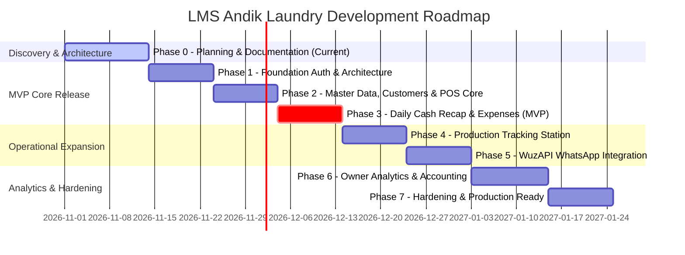
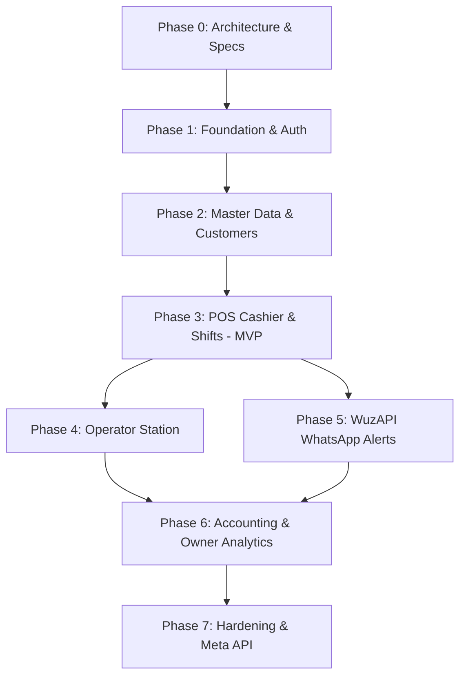

# Phased Development Roadmap: Phase 0 to Phase 7

**Project:** LMS Andik Laundry (Single-Store Laundry Management System)  
**Document Version:** 1.0.0  
**Status:** Approved Roadmap Specification  
**Architecture:** Monolithic Laravel 13, Inertia.js 3, Vue 3, Tailwind CSS 4, MySQL 8.4 LTS, WuzAPI  
**Target Delivery Horizon:** Greenfield Planning through Production Hardening  

---

## 1. Executive Strategy & Release Milestones

The LMS Andik Laundry development roadmap is organized into **8 structured, sequential engineering phases (Phase 0 through Phase 7)**. This phased approach mitigates delivery risk, enforces strict quality gates, and delivers an operational Minimum Viable Product (MVP) rapidly to automate front-desk counter transactions before adding background WhatsApp automation and advanced analytics.

### 1.1 Milestone Definitions & Release Gates

| Milestone | Target Phases | Scope Summary | Operational Release Capability |
| :--- | :--- | :--- | :--- |
| **Milestone 0: Blueprint** | Phase 0 | 14 Architectural & Planning Specifications | Complete engineering blueprint ready for code implementation |
| **Milestone 1: MVP Core** | Phases 1–3 | Auth, Customer CRM, Service Catalog, POS Intake, Thermal Receipt, Daily Cash Recap, Expense Tracker | Full family counter operations: Owner can intake orders, print receipts, accept multi-tender payments, log store expenses, and view daily net cash |
| **Milestone 2: Operations** | Phases 4–5 | Operator Washing/Drying/Ironing Station, Shelf Staging, Automated WuzAPI WhatsApp Alerts | Back-of-house tracking: Machine timers, rewash loops, and automated WhatsApp notifications to customers |
| **Milestone 3: Enterprise** | Phases 6–7 | Store Expenses, Accrual vs Cash P&L, Owner Analytics, Meta Cloud API Adaptor, Security Audit | Full financial accounting, profit analytics, disaster recovery, and production hardening |

---

## 2. Detailed Phase Specifications

---

### Phase 0: Discovery, Architecture & Planning (Current Phase)

#### 1. Objective & Strategic Rationale
Establish complete, implementation-ready architectural blueprints, database schemas, financial formulas, threat models, and testing strategies before writing application code. Eliminate architectural ambiguity, prevent schema regressions, and align technical choices with single-store laundry operations.

#### 2. Granular Deliverables
- [x] `docs/PRD.md`: Personas, feature scope, operational constraints.
- [x] `docs/business-requirements.md`: Unit pricing, minimum weight thresholds, turnarounds.
- [x] `docs/user-flows.md`: Complete operator, cashier, and owner workflows.
- [x] `docs/architecture.md`: Laravel monolith architecture and gateway topology.
- [x] `docs/database-schema.md`: Strict MySQL 8.4 LTS schema with `DECIMAL(12,2)`.
- [x] `docs/erd.md`: Valid Mermaid Entity-Relationship Diagram.
- [x] `docs/design-system.md`: 3-layer design tokens, Tailwind CSS 4, POS touch targets.
- [x] `docs/security.md`: STRIDE threat model, RBAC policies, Sanctum, HMAC verification.
- [x] `docs/whatsapp-integration.md`: WuzAPI vs Meta Cloud API, queue idempotency.
- [x] `docs/financial-logic.md`: Accrual vs cash basis formulas, blind shift count.
- [x] `docs/roadmap.md`: 8-phase development roadmap from MVP to production.
- [x] `docs/test-plan.md`: Unit, feature, integration, and E2E test plan.
- [x] `docs/assumptions-and-decisions.md`: ADR catalog with 4-tier classification.
- [x] `docs/deployment.md`: Single-store Linux/Nginx/MySQL/Redis/WuzAPI deployment guide.

#### 3. Scope Boundaries
- **In-Scope:** Comprehensive documentation authoring in `docs/` only.
- **Out-of-Scope:** Any source code implementation, database migration generation, composer/npm installs.

#### 4. Acceptance Criteria
- [x] All 14 Markdown documents authored in `docs/` with zero placeholder sections.
- [x] All Mermaid diagrams validate with 100% syntactical correctness.
- [x] Financial formulas explicitly distinguish recognized revenue from cash flow.
- [x] Zero application source code files created or modified outside `docs/`.

---

### Phase 1: Foundation, Auth & Base Architecture

#### 1. Objective & Strategic Rationale
Bootstrap the greenfield repository into a modern Laravel 13, Inertia.js 3, and Vue 3 application. Establish base layout, database connectivity, Sanctum session authentication, and Role-Based Access Control (RBAC) middleware.

#### 2. Granular Deliverables
- **Backend:**
  - Initialize Laravel 13 project scaffolding with PHP 8.3/8.4 and MySQL 8.4 LTS.
  - Setup Redis connection for cache and session driver (`config/session.php`).
  - Create database migration for `users` and `audit_logs` tables.
  - Implement `Role` enum (`owner`, `cashier`, `operator`) and authorization gates in `AppServiceProvider`.
  - Implement `AuthenticatedSessionController` with brute-force rate limiting (5 attempts/min).
  - Seed initial administrator (`owner`) and staff test accounts.
- **Frontend:**
  - Setup Vite with Vue 3, Inertia.js 3, and Tailwind CSS 4.
  - Bind 3-layer design tokens into Tailwind CSS config (`primary`, `surface`, `status`).
  - Build responsive authenticated layout (`AppLayout.vue`) with top-bar staff status and sidebar navigation.
  - Implement `Login.vue` page with clean, touch-friendly inputs and validation error displays.
- **Tests:**
  - Unit tests for user role checks and permission evaluation.
  - Feature tests for login, session regeneration, logout, and rate limiting.

#### 3. Scope Boundaries
- **In-Scope:** User authentication, role middleware, base layout, security headers.
- **Out-of-Scope:** POS transactions, service catalogs, or WhatsApp integration.

#### 4. Acceptance Criteria
- [ ] Successful user login via Sanctum session cookie with `SameSite=Lax` and `HttpOnly`.
- [ ] Role middleware intercepts unauthorized route attempts with HTTP 403.
- [ ] Rate limiter blocks login after 5 failed attempts with friendly timeout countdown.
- [ ] Vite compiles Vue 3 assets cleanly without bundling warnings.

---

### Phase 2: Master Data & Customer Management

#### 1. Objective & Strategic Rationale
Build the core data management foundation: customer CRM, pricing catalogs, turnaround tiers, and perfume variants. Provide cashiers with fast customer lookup and management capabilities.

#### 2. Granular Deliverables
- **Backend:**
  - Migrations: `customers`, `services`, `perfume_variants`.
  - Eloquent models with strict `$casts`: `DECIMAL(12, 2)` base prices, `DECIMAL(8, 2)` min weights.
  - Form Requests: `StoreCustomerRequest`, `UpdateCustomerRequest`, `StoreServiceRequest`.
  - Phone normalization utility (`PhoneFormatter::normalizeToE164`) attached to customer saving event.
  - Controllers: `CustomerController`, `ServiceCatalogController`.
- **Frontend:**
  - Customer directory page (`Customers/Index.vue`) with instant phone/name search (debounced 300ms).
  - Customer create/edit modal (`CustomerModal.vue`) with mobile keyboard optimization (`type="tel"`).
  - Master Service Catalog editor (`Services/Index.vue`) restricted to `owner` role.
- **Tests:**
  - Unit test for phone number normalizer covering diverse Indonesian formats.
  - Feature tests for customer CRUD operations and unique phone number constraints.
  - Authorization barrier tests: Cashiers cannot modify service pricing.

#### 3. Scope Boundaries
- **In-Scope:** Customer CRM, service pricing catalog, perfume scents, search endpoints.
- **Out-of-Scope:** Order transactions or cart calculations.

#### 4. Acceptance Criteria
- [ ] Phone numbers automatically normalized to canonical `628xxxxxxxx` format upon saving.
- [ ] Customer search returns matching results in under 100ms.
- [ ] Services support both `kg` (with minimum billable weight) and `pcs` units.
- [ ] Cashiers can create a new customer inline in under 15 seconds.

---

### Phase 3: Daily Cash Recap, Operational Expense Management & Owner Hub (MVP Release)

#### 1. Objective & Strategic Rationale
**The Core Minimum Viable Product (MVP).** Deliver full front-desk counter transaction and daily cash management capability for the family-run home laundry. The owner acts as primary cashier and operator. Enable immediate order intake, weighing, multi-tender payments (cash, QRIS, transfer), thermal receipt printing, daily store expense recording (detergent, LPG gas, plastic packaging), and automated Daily Cash Recap (Rekap Kas Harian) calculating net daily cash on hand without artificial shift locks.

#### 2. Granular Deliverables
- **Backend:**
  - Migrations: `expenses` (amount, category, description, payment_method, receipt_image_path).
  - Domain Services: `ExpenseService`, `DailyCashRecapService`.
  - Form Requests: `StoreExpenseRequest`.
  - Daily cash recap calculations: Total Cash In, Non-cash In (QRIS/Transfer), Total Expenses, Net Cash on Hand.
  - End-of-day summary receipt generator (58mm / 80mm).
- **Frontend:**
  - Expense Tracker modal & page (`Expenses/Index.vue`): Quick expense entry (Gas LPG, Deterjen, Plastik, etc.).
  - Daily Cash Recap View (`Dashboard/DailyRecap.vue` or Modal): Real-time breakdown of cash intake, digital payments, expenses, and net cash.
  - Daily summary thermal slip printout.
  - Quick 1-click navigation bar across POS (`/pos`), Production Queue (`/production/station`), Expenses, and Dashboard.
- **Tests:**
  - Unit tests for daily cash calculations, expense deductions, and net cash formulas.
  - Feature tests for expense recording and daily cash recap endpoints.
  - E2E tests for complete intake -> payment -> expense -> daily recap flow.

#### 3. Scope Boundaries
- **In-Scope:** Direct expense tracking, daily cash summary, thermal summary slip, seamless owner-as-cashier hub.
- **Out-of-Scope:** Complex accrual multi-year depreciation accounting, corporate payroll tax modules.

#### 4. Acceptance Criteria
- [ ] POS terminal is continuously accessible without requiring shift opening float entry.
- [ ] Store expenses can be logged in under 15 seconds with category and payment method.
- [ ] Daily Cash Recap accurately calculates Net Cash on Hand = Cash Sales - Cash Expenses.
- [ ] Thermal summary slip prints cleanly on 58mm and 80mm printers.
- [ ] **MVP GO-LIVE READY:** Outlet can conduct full commercial counter operations and track daily profits cleanly.

---

### Phase 4: Production Tracking & Operator Station

#### 1. Objective & Strategic Rationale
Provide back-of-house staff (washers, dryers, ironers, packers) with a dedicated touch-friendly interface to track garment processing stages, manage washer/dryer drum assignments, handle rewash loops for stained clothes, and assign packaged bundles to storage shelves/racks.

#### 2. Granular Deliverables
- **Backend:**
  - Migration: `production_logs` (tracking operator ID, machine ID, status, timestamps).
  - Form Requests: `UpdateProductionStatusRequest`, `FlagRewashRequest`, `AssignRackRequest`.
  - State machine transition guards enforcing valid sequence: `received -> washing -> drying -> ironing -> ready_for_pickup`.
  - Rewash loop limit logic (maximum 2 rewash cycles with mandatory operator reason codes).
- **Frontend:**
  - Operator Station UI (`Production/Station.vue`): Large touch buttons (min 48x48px), high-contrast badges.
  - Production Stage Kanban / Queue columns (`Washing`, `Drying`, `Ironing`, `Packing`).
  - Rewash Modal (`RewashModal.vue`) with quick-select reasons (*Noda Kerah, Bau Apek, Serat Bulu*).
  - Ready Staging Dialog: Prompts operator to input storage shelf/rack coordinate (e.g., `R-02-B`).
- **Tests:**
  - Unit tests for production state machine transitions and rewash loop limits.
  - Feature tests: Status bump updates order and logs operator timestamp; operator cannot view financial totals.

#### 3. Scope Boundaries
- **In-Scope:** Back-of-house production queue, status bump, rewash handling, rack staging.
- **Out-of-Scope:** WhatsApp event dispatching (prepared as domain events for Phase 5).

#### 4. Acceptance Criteria
- [ ] Operators can advance order status with a single tap on tablet/mobile screens.
- [ ] Operator interface displays zero financial data, prices, or customer contact numbers.
- [ ] Rewash loop increments counter and halts at 2 attempts with manager alert.
- [ ] Orders staged to `ready_for_pickup` require a shelf/rack location input.

---

### Phase 5: WuzAPI WhatsApp Notification Integration

#### 1. Objective & Strategic Rationale
Integrate the self-hosted WuzAPI Go gateway to automate customer communications. Dispatch automated notifications upon order creation, order completion (`ready_for_pickup`), and payment receipt, while providing cashier manual `wa.me` fallback links if gateway disconnects.

#### 2. Granular Deliverables
- **Backend:**
  - `WhatsAppGatewayInterface` abstraction contract with `WuzapiGateway` implementation.
  - Job: `SendWhatsAppNotificationJob` running on dedicated Redis queue `whatsapp-notifications`.
  - Atomic idempotency locks preventing duplicate notifications across retries.
  - Sliding-window rate limiter with randomized jitter (max 12 messages/min) to prevent number bans.
  - Circuit Breaker pattern tripping after 5 consecutive gateway failures.
  - Webhook ingestion route (`/api/webhooks/wuzapi`) protected by `VerifyWuzapiWebhook` HMAC-SHA256 middleware.
  - Event listener mapping order events to WhatsApp notification templates.
- **Frontend:**
  - Settings Page: WhatsApp Gateway status indicator (Connected / Disconnected / QR Scan required).
  - QR Code Pairing Modal: Fetches base64 QR code from `GET /session/qr` for easy initial pairing.
  - POS Manual Fallback Button: One-click "Kirim Manual WA" opening `https://wa.me/{phone}?text={encoded}`.
- **Tests:**
  - Unit tests for HMAC signature verification and payload builders.
  - Integration tests using `Http::fake()` to verify WuzAPI REST contracts.
  - Feature tests asserting webhook signature rejection on tampered payloads.

#### 3. Scope Boundaries
- **In-Scope:** WuzAPI REST integration, Redis queue workers, HMAC middleware, QR pairing UI, manual `wa.me` fallback.
- **Out-of-Scope:** Meta Cloud API deployment (deferred to Phase 7).

#### 4. Acceptance Criteria
- [ ] Order creation triggers automated WhatsApp intake receipt with invoice breakdown.
- [ ] Order entering `ready_for_pickup` dispatches readiness notification with rack number and outstanding balance.
- [ ] Webhook HMAC signature middleware rejects unsigned or invalid requests with HTTP 401.
- [ ] If WuzAPI is offline, cashier can click manual fallback link to send pre-formatted text instantly.

---

### Phase 6: Financial Accounting, Expenses & Owner Analytics

#### 1. Objective & Strategic Rationale
Provide the business owner with complete financial clarity and control. Implement store expense tracking (COGS and operational overhead), customer debt ledgers (`Piutang Pelanggan`), and an executive dashboard distinguishing Cash Flow (liquidity) from Recognized Revenue (SAK EMKM Accrual Basis).

#### 2. Granular Deliverables
- **Backend:**
  - Migrations: `expenses`, `expense_categories`.
  - Financial Services: `AccountingReportService`, `ReceivablesService`.
  - Accrual revenue recognition logic (revenue recognized upon service completion).
  - Expense recording with receipt image upload and optional link to cashier shift drawer.
  - Controllers: `ExpenseController`, `OwnerDashboardController`, `ReceivablesController`.
- **Frontend:**
  - Owner Dashboard (`Reports/Dashboard.vue`): Key metrics (Gross Revenue, Net Profit, Cash Inflow, Receivables).
  - Expense Ledger (`Expenses/Index.vue`): Add expense modal with receipt upload preview.
  - Customer Receivables Page (`Reports/Receivables.vue`): List of outstanding customer balances with one-click WhatsApp reminder trigger.
  - Shift Discrepancy Audit Log: Review all closed shifts and investigate cash shortages/surpluses.
- **Tests:**
  - Unit tests for Gross Profit, Net Operating Profit, and Cash Flow formulas.
  - Feature tests: Owner can record expenses; Cashier cannot view P&L metrics.

#### 3. Scope Boundaries
- **In-Scope:** Store expenses, receivables ledger, owner analytics, accrual vs cash reporting.
- **Out-of-Scope:** Multi-outlet consolidated reporting.

#### 4. Acceptance Criteria
- [ ] Dashboard explicitly shows both Accrual Revenue and Cash Flow side-by-side.
- [ ] Unpaid completed orders are tracked in the customer debt ledger with due dates.
- [ ] Petty cash expenses disbursed from cashier drawer immediately update expected drawer cash.
- [ ] Owner can export monthly financial reports to Excel / PDF.

---

### Phase 7: Production Hardening, Meta Cloud API Adaptor & Polish

#### 1. Objective & Strategic Rationale
Prepare LMS Andik Laundry for rock-solid long-term production operations. Implement the alternative Meta WhatsApp Business Cloud API adaptor, conduct automated vulnerability audits, optimize database indexes, setup automated backups, and execute end-to-end stress tests.

#### 2. Granular Deliverables
- **Architecture & Gateways:**
  - Implement `MetaCloudApiGateway` complying with `WhatsAppGatewayInterface`.
  - Dynamic gateway configuration toggle in Owner Settings (`WuzAPI` vs `Meta Cloud API`).
  - Webhook verification challenge handler (`GET hub.challenge`) and signature verifier (`X-Hub-Signature-256`).
- **Performance & Security Hardening:**
  - Execute `composer audit` and `npm audit` to verify zero known CVEs.
  - Run PHPStan / Larastan static analysis at Level 8 with 0 errors.
  - Database index optimization and slow-query audit on `orders`, `payments`, and `customers`.
  - Configure production Nginx security headers, gzip/brotli compression, and rate limiters.
- **DevOps & Backup Automation:**
  - Configure automated daily MySQL dump script with gzip compression.
  - Configure SQLite backup script for WuzAPI session volume.
  - Setup systemd service for Laravel Queue Worker with auto-restart.
  - Test disaster recovery restoration playbook.
- **Final Polish:**
  - UI/UX polish across all viewports (mobile, tablet, desktop POS).
  - Offline network detection banner in Vue 3 layout.

#### 3. Scope Boundaries
- **In-Scope:** Meta Cloud API adaptor, security audit, database optimization, backup scripts, production deployment guide.
- **Out-of-Scope:** Multi-store franchising features.

#### 4. Acceptance Criteria
- [ ] System passes all automated Pest/PHPUnit tests with $\ge 85\%$ coverage.
- [ ] Zero static analysis errors at Larastan Level 8.
- [ ] Switching gateway to Meta Cloud API transmits approved utility templates successfully.
- [ ] Automated backup script runs cleanly via cron and produces verifiable database archives.

---

## 3. Cross-Phase Dependency & Risk Matrix

### Risk Assessment & Mitigation Strategies

| Risk Description | Severity | Probability | Affected Phases | Architectural Mitigation Strategy |
| :--- | :---: | :---: | :---: | :--- |
| **WhatsApp Number Ban via WuzAPI** | High | Medium | Phase 5 | Implement strict sliding-window rate limiting (max 12 msg/min) with randomized sleep jitter; provide manual `wa.me` fallback on POS screen. |
| **Cash Drawer Discrepancies / Thefts** | High | Low | Phase 3 | Enforce Blind Count shift closing; system hides expected drawer cash from cashier; log all discrepancies to Owner audit log. |
| **Historical Price Corruption** | Critical | Low | Phase 3 | Implement immutable price snapshots on order items at checkout time; catalog edits never affect past records. |
| **Premature Scope Creep (Multi-Store)** | Medium | High | Phase 1–7 | Strict architectural enforcement of single-store modular monolith boundary per `R2`. |
| **Database Lock Contention at Peak POS** | Medium | Low | Phase 3, 5 | Strict index design on `orders(customer_id, status)` and `payments(order_id)`; asynchronous queue offloading for WhatsApp jobs. |

---

## 4. Phase Completion Sign-Off Protocol

A development phase is considered **Complete** and ready for handoff to the next phase only when:
1. All granular deliverables for the phase are implemented and committed.
2. 100% of acceptance criteria checkboxes are satisfied and empirically validated.
3. Automated unit and feature tests pass with zero regressions.
4. Static analysis passes with zero type errors.
5. Code passes review against the project's engineering, UI/UX, and security standards.
