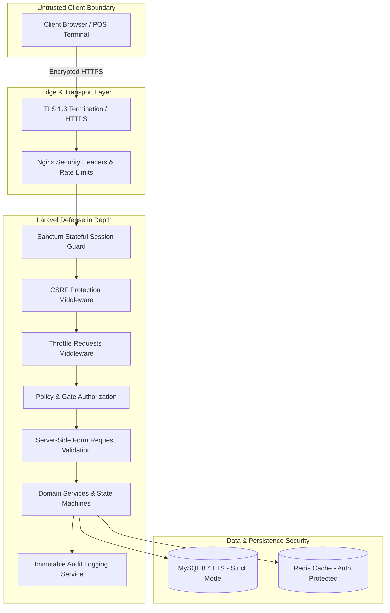
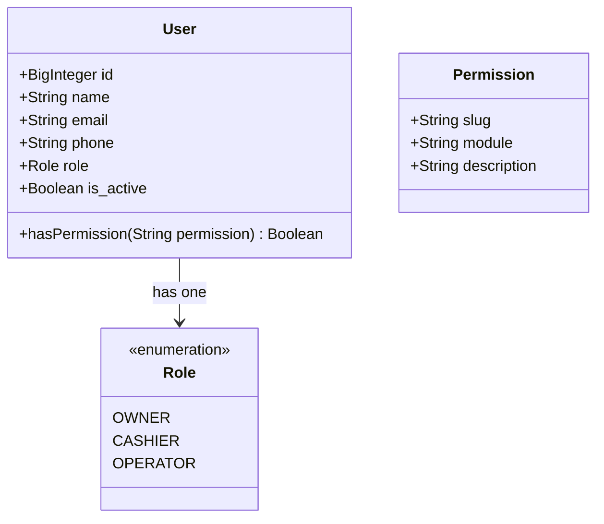
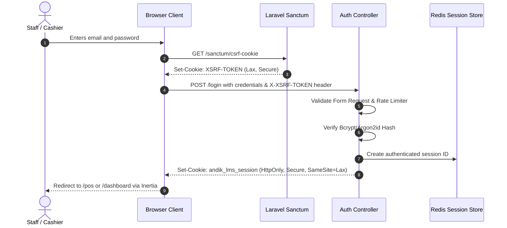
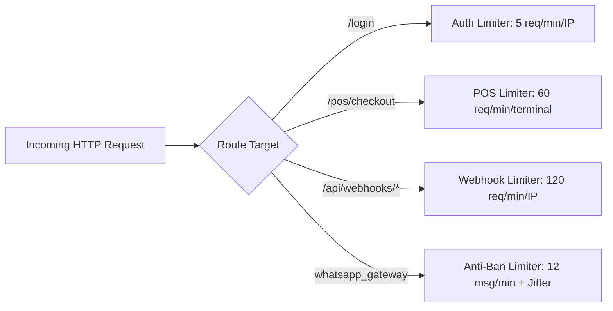
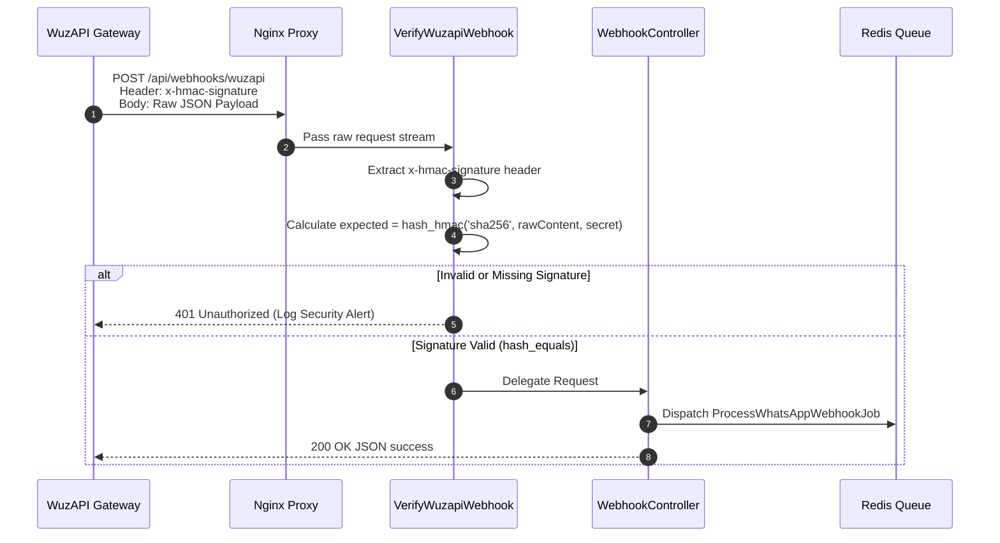

# Security Specification & Threat Model

**Project:** LMS Andik Laundry (Single-Store Laundry Management System)  
**Document Version:** 1.0.0  
**Status:** Approved Specification  
**Target Architecture:** Monolithic Laravel 13, Inertia.js 3, Vue 3, Tailwind CSS 4, MySQL 8.4 LTS, WuzAPI (Go/whatsmeow)  
**Security Classification:** Confidential — Internal Engineering Standard  

---

## 1. Executive Summary & Security Philosophy

The Laundry Management System (LMS Andik Laundry) is a mission-critical commercial application responsible for daily retail transactions, physical garment tracking, financial accounting, customer personally identifiable information (PII), and automated customer communications.

The system adheres to the **Principle of Defense in Depth (DiD)** and **Zero Trust Architecture (ZTA)** at internal service boundaries:
1. **Never Trust the Client:** The client-side Vue 3 SPA is treated as an untrusted presentation layer. All financial calculations, state transitions, permissions, and validation rules are strictly enforced server-side within Laravel Form Requests, Policies, and Services.
2. **Explicit Role-Based Authorization (RBAC):** Privileges are assigned to roles (`owner`, `cashier`, `operator`) with granular permissions. Route-level middleware and model-level policies prevent Broken Object Level Authorization (BOLA/IDOR).
3. **Financial Immutability & Traceability:** Payment records, price snapshots, and shift reconciliation logs cannot be updated or deleted. Every critical state mutation creates an immutable audit trail entry.
4. **Cryptographic Perimeter Integrity:** External communications with auxiliary micro-services (WuzAPI) and webhooks require HMAC-SHA256 signature verification over raw byte streams.
5. **Session-Based SPA Security:** Statefulness is maintained via encrypted, HTTP-only, SameSite session cookies powered by Laravel Sanctum, eliminating local storage token theft vectors (XSS token extraction).



---

## 2. Threat Modeling: STRIDE & OWASP Top 10 Analysis

### 2.1 STRIDE Threat Analysis Matrix

| Threat Category | Potential Threat Vector in LMS | Real-World Impact | Architectural Countermeasures & Mitigations |
| :--- | :--- | :--- | :--- |
| **Spoofing** (Identity) | Attacker mimics cashier or owner session; attacker impersonates WuzAPI webhook dispatcher. | Unauthorized drawer access, fictitious cash drops, fake payment status updates. | - Laravel Sanctum HTTP-only session cookies with session rotation upon login.<br>- Webhook HMAC-SHA256 signature validation with shared secret.<br>- Strong password hashing using Argon2id/Bcrypt with minimum 12-character policy. |
| **Tampering** (Data) | Cashier intercepts HTTP request to alter service prices, line subtotals, or discount rates; database direct mutation. | Financial fraud, unreported cash sales, undercharging acquaintances. | - Client-sent prices are strictly ignored; prices are recalculated server-side from master catalog and frozen in immutable price snapshots.<br>- Database foreign key constraints with strict foreign key checks.<br>- Immutable ledger tables without `UPDATE`/`DELETE` permissions for application users. |
| **Repudiation** | Cashier claims cash discrepancy in drawer was system error; operator denies marking wrong order completed. | Loss of financial accountability, disputed employee shortages. | - Mandatory Blind Count cash reconciliation at shift closing.<br>- Append-only `audit_logs` capturing `user_id`, `ip_address`, `user_agent`, `event`, `old_values`, and `new_values`.<br>- Shift reports locked immediately upon generation. |
| **Information Disclosure** | Leak of customer WhatsApp numbers, order history, or store profit margins via unauthenticated API routes or XSS. | Customer privacy violation (PDP Indonesia Law compliance breach), competitive data loss. | - Contextual authorization policies on all order and customer resources.<br>- Financial reporting endpoints restricted exclusively to `owner` role.<br>- Sanitized Inertia response props preventing accidental Eloquent model serialization leaks (hiding sensitive fields like password hashes, internal notes). |
| **Denial of Service** (DoS) | Attacker floods login endpoint or POS order creation route; spamming WhatsApp outbound queue to drain API or trigger number ban. | Register freeze during peak intake hours; WhatsApp business phone number blocked/banned by Meta. | - IP-based and user-based sliding window rate limiting via Redis (`throttle:login`, `throttle:pos`).<br>- WhatsApp outbound queue throttling (max 12 msgs/min with randomized jitter).<br>- Circuit breaker pattern on external gateway integrations. |
| **Elevation of Privilege** | Cashier or operator sends crafted payload with `role=owner` or accesses `/admin/reports` directly. | Full system compromise, unauthorized viewing of owner net profit, store expense manipulation. | - Strict role guard middleware (`role:owner`).<br>- Form Request mass assignment protection via explicit `$fillable` Eloquent definitions.<br>- Sensitive actions (order cancellation, credit handover without payment) require secondary Owner PIN authorization. |

---

### 2.2 OWASP Top 10 (2021/2026) Mitigations for Laravel & Inertia.js

#### A01:2021 — Broken Access Control
- **Mitigation:** Centralized Laravel Authorization Policies (`OrderPolicy`, `ShiftPolicy`, `ExpensePolicy`, `CustomerPolicy`). Inertia routes are protected by `auth:sanctum` and role middleware. Every controller action invokes `$this->authorize('action', $model)`.

#### A02:2021 — Cryptographic Failures
- **Mitigation:** Strict TLS 1.3 in transit. Sensitive third-party secrets (`WUZAPI_ADMIN_TOKEN`, `WUZAPI_HMAC_SECRET`, `META_APP_SECRET`) encrypted at rest using Laravel's `Crypt` (AES-256-GCM) or managed through protected environment variables. Database backups encrypted using GPG/AES-256 before offsite replication.

#### A03:2021 — Injection (SQLi, Command Injection, Template Injection)
- **Mitigation:** Exclusively use Eloquent ORM and PDO prepared statements with parameterized queries. Raw SQL (`DB::raw()`) is banned from dynamic user input interpolation. No shell execution (`exec()`, `shell_exec()`, `system()`) is permitted on user inputs.

#### A04:2021 — Insecure Design
- **Mitigation:** Orthogonal state machines separate production status from payment status. Business logic forbids marking an order as `completed` without full payment or an explicit, authorized debtor record. The Blind Count closing protocol prevents cash register skimming.

#### A05:2021 — Security Misconfiguration
- **Mitigation:** Production environment enforces `APP_DEBUG=false`, secure headers (HSTS, CSP, X-Frame-Options: SAMEORIGIN, X-Content-Type-Options: nosniff), hardened Nginx fastcgi parameters, and error pages that never expose stack traces or SQL snippets to clients.

#### A06:2021 — Vulnerable and Outdated Components
- **Mitigation:** Automated CI/CD dependency vulnerability scans via `composer audit` and `npm audit`. Pinned dependency versions in `composer.lock` and `package-lock.json`. Routine automated patch workflows.

#### A07:2021 — Identification and Authentication Failures
- **Mitigation:** Stateful session authentication using Laravel Sanctum with cryptographically secure session IDs stored in Redis. Brute force mitigation on login (5 attempts per minute per IP/username). Session invalidation on password change. Session timeout set to 480 minutes (8-hour standard retail shift) with idle logout.

#### A08:2021 — Software and Data Integrity Failures
- **Mitigation:** Webhooks from WuzAPI or Meta require cryptographic HMAC signature verification over the raw, unparsed payload. Signed URLs for sensitive external links (receipt verification, customer tracking).

#### A09:2021 — Security Logging and Monitoring Failures
- **Mitigation:** Centralized, structured JSON application logging via Monolog (daily log rotation). Critical business actions logged to the `audit_logs` database table. Alerts dispatched to Owner on repeated authentication failures, cash drawer discrepancies > Rp 10,000, or webhook verification failures.

#### A10:2021 — Server-Side Request Forgery (SSRF)
- **Mitigation:** Webhook destinations and WuzAPI service endpoints are statically configured in `.env`. The application does not fetch arbitrary external URLs specified by user input.

---

## 3. Role-Based Access Control (RBAC) Architecture

### 3.1 Role Hierarchy & Personas

The system defines three mutually exclusive staff roles:

1. **Owner (`owner`):**
   - Store proprietor and executive administrator.
   - Unrestricted access across master data, user accounts, system configuration, all shifts, expense approvals, full financial analytics (profit/loss, gross revenue, receivables), and audit log inspection.
   - Authorized to approve order cancellations, apply ad-hoc discounts, approve debtor credit releases, and investigate cashier shift cash discrepancies.

2. **Cashier (`cashier`):**
   - Front-of-house staff operating the POS terminal.
   - Authorized to manage customer records, initiate intake orders, weigh laundry, print receipts, collect multi-tender payments, open and close own cash shifts, disburse emergency petty cash (up to store threshold, e.g., Rp 100,000), and trigger WhatsApp notifications.
   - **Restricted:** Cannot view owner financial reports (net profit, COGS, store-wide totals), cannot alter completed transactions, cannot delete records, and cannot close another cashier's shift.

3. **Production Operator (`operator`):**
   - Back-of-house laundry processing staff (washers, dryers, ironers, packers).
   - Authorized to view production queues, update production stage transitions (`washing`, `drying`, `ironing`, `ready_for_pickup`), assign orders to staging shelves/racks, and flag garments for rewash cycles with reason codes.
   - **Restricted:** Absolutely zero access to financial data, pricing catalogs, customer phone contact lists, cash drawer functions, or payment intake.



---

### 3.2 Granular Permissions Matrix

| Permission Slug | Module | Description | Owner | Cashier | Operator |
| :--- | :--- | :--- | :---: | :---: | :---: |
| `pos.orders.create` | POS Intake | Create new laundry orders & weigh items | ✅ | ✅ | ❌ |
| `pos.orders.view` | POS Intake | View order queue and basic customer details | ✅ | ✅ | ✅ (No Financials) |
| `pos.orders.cancel` | POS Intake | Cancel unstarted/received orders | ✅ | ⚠️ (Requires Owner PIN) | ❌ |
| `pos.orders.override_price` | POS Intake | Apply custom discounts or adjust prices | ✅ | ❌ | ❌ |
| `pos.orders.release_unpaid` | POS Intake | Release completed laundry on credit (Piutang) | ✅ | ⚠️ (Requires Owner PIN) | ❌ |
| `payments.create` | Cashier | Accept payments (Cash, QRIS, Transfer) | ✅ | ✅ | ❌ |
| `payments.refund` | Cashier | Issue partial or full payment refunds | ✅ | ⚠️ (Requires Owner PIN) | ❌ |
| `shifts.open` | Cashier Shift | Open active cashier shift with opening float | ✅ | ✅ (Own Shift) | ❌ |
| `shifts.close` | Cashier Shift | Perform blind count and close shift | ✅ | ✅ (Own Shift) | ❌ |
| `shifts.cash_drop` | Cashier Shift | Log mid-shift cash drop to store safe | ✅ | ✅ | ❌ |
| `shifts.petty_expense` | Cashier Shift | Disburse drawer cash for emergency supplies | ✅ | ✅ (Max Rp 100k) | ❌ |
| `shifts.view_all` | Cashier Shift | View shift histories and audit variance logs | ✅ | ❌ | ❌ |
| `production.status.update`| Production | Bump order status (Washing, Drying, Ironing) | ✅ | ✅ | ✅ |
| `production.rewash.flag` | Production | Route order back to washing drum with reason | ✅ | ❌ | ✅ |
| `production.rack.assign` | Production | Assign packaged laundry to shelf/bin rack | ✅ | ✅ | ✅ |
| `customers.manage` | Customers | Create, edit, and search customer profiles | ✅ | ✅ | ❌ |
| `catalog.manage` | Master Data | Create/update services, pricing, turnarounds | ✅ | ❌ | ❌ |
| `expenses.create` | Accounting | Record store operating expenses & invoices | ✅ | ⚠️ (Petty Cash Only) | ❌ |
| `expenses.manage` | Accounting | Edit, approve, and categorize all expenses | ✅ | ❌ | ❌ |
| `reports.financial.view` | Analytics | View Net Profit, Gross Revenue, COGS, P&L | ✅ | ❌ | ❌ |
| `reports.operational.view`| Analytics | View turnaround speed, volume kg, machine use | ✅ | ✅ | ❌ |
| `system.settings.manage` | Settings | Edit store profile, printer config, WuzAPI token | ✅ | ❌ | ❌ |
| `system.audit.view` | Audit Logs | View tamper-evident audit log trail | ✅ | ❌ | ❌ |

---

### 3.3 Laravel Policy & Gate Implementation Patterns

Authorization is declared cleanly in dedicated Policy classes and registered in `AppServiceProvider` / `AuthServiceProvider`.

#### Example: `OrderPolicy.php`
```php
namespace App\Policies;

use App\Models\Order;
use App\Models\User;
use Illuminate\Auth\Access\HandlesAuthorization;
use Illuminate\Auth\Access\Response;

class OrderPolicy
{
    use HandlesAuthorization;

    public function view(User $user, Order $order): Response
    {
        // All authenticated staff can view the order overview
        return Response::allow();
    }

    public function create(User $user): Response
    {
        return in_array($user->role, ['owner', 'cashier'])
            ? Response::allow()
            : Response::deny('Hanya Kasir dan Owner yang berhak menerima pesanan baru.');
    }

    public function updateProduction(User $user, Order $order): Response
    {
        // All staff can advance production stages
        return Response::allow();
    }

    public function cancel(User $user, Order $order): Response
    {
        if ($order->production_status === 'completed') {
            return Response::deny('Pesanan yang sudah selesai tidak dapat dibatalkan.');
        }

        if ($user->role === 'owner') {
            return Response::allow();
        }

        // Cashier requires owner authorization flag in request context
        return Response::deny('Pembatalan pesanan oleh Kasir memerlukan otorisasi PIN Owner.');
    }

    public function release(User $user, Order $order): Response
    {
        if ($order->payment_status === 'paid') {
            return Response::allow();
        }

        // Releasing an unpaid order creates customer debt (Piutang)
        if ($user->role === 'owner') {
            return Response::allow();
        }

        return Response::deny('Penyerahan pakaian yang belum lunas (Piutang) memerlukan persetujuan Owner.');
    }
}
```

---

## 4. Authentication Architecture: Laravel Sanctum Stateful Sessions

### 4.1 Stateful Cookie Authentication for Inertia.js

LMS Andik Laundry runs as a single-origin monolithic web application where the Vue 3 frontend is delivered via Inertia.js. Rather than using Bearer tokens (which risk XSS exposure when stored in `localStorage` or `sessionStorage`), the system uses **Laravel Sanctum's SPA / Stateful Session Authentication**.



### 4.2 Session Configuration Security Parameters

In `config/session.php`:
```php
return [
    'driver' => env('SESSION_DRIVER', 'redis'),
    'lifetime' => (int) env('SESSION_LIFETIME', 480), // 8 hours (standard retail shift)
    'expire_on_close' => false,
    'encrypt' => true, // Encrypt session data payload at rest in Redis
    'path' => '/',
    'domain' => env('SESSION_DOMAIN', null),
    'secure' => env('SESSION_SECURE_COOKIE', true), // HTTPS only in production
    'http_only' => true, // Prevents JavaScript document.cookie access
    'same_site' => 'lax', // CSRF defense while allowing top-level navigation
];
```

### 4.3 Brute-Force Defense: Rate-Limited Login

The authentication controller leverages Laravel's `RateLimiter` facade:
```php
namespace App\Http\Controllers\Auth;

use App\Http\Controllers\Controller;
use App\Http\Requests\Auth\LoginRequest;
use Illuminate\Http\RedirectResponse;
use Illuminate\Support\Facades\Auth;
use Illuminate\Support\Facades\RateLimiter;
use Illuminate\Support\Str;
use Illuminate\Validation\ValidationException;

class AuthenticatedSessionController extends Controller
{
    public function store(LoginRequest $request): RedirectResponse
    {
        $throttleKey = Str::transliterate(Str::lower($request->input('email')).'|'.$request->ip());

        if (RateLimiter::tooManyAttempts($throttleKey, 5)) {
            $seconds = RateLimiter::availableIn($throttleKey);
            throw ValidationException::withMessages([
                'email' => "Terlalu banyak percobaan login. Silakan coba lagi dalam {$seconds} detik.",
            ]);
        }

        if (!Auth::attempt($request->only('email', 'password'), $request->boolean('remember'))) {
            RateLimiter::hit($throttleKey, 300); // 5-minute decay window
            throw ValidationException::withMessages([
                'email' => 'Kredensial yang diberikan tidak cocok dengan data kami.',
            ]);
        }

        RateLimiter::clear($throttleKey);
        $request->session()->regenerate(); // Mitigates Session Fixation attacks

        return redirect()->intended(route('dashboard'));
    }
}
```

---

## 5. Server-Side Validation: Form Requests & Data Sanitization

All incoming payloads are intercepted and validated using strict, dedicated Laravel Form Requests before hitting domain services. Zero business logic relies on frontend client-side validation.

### 5.1 Order Creation Form Request (`StoreOrderRequest.php`)
```php
namespace App\Http\Requests\Pos;

use Illuminate\Foundation\Http\FormRequest;
use Illuminate\Validation\Rule;

class StoreOrderRequest extends FormRequest
{
    public function authorize(): bool
    {
        return $this->user()->can('create', \App\Models\Order::class);
    }

    public function rules(): array
    {
        return [
            'customer_id' => ['required', 'integer', 'exists:customers,id'],
            'perfume_variant_id' => ['nullable', 'integer', 'exists:perfume_variants,id'],
            'service_tier' => ['required', 'string', Rule::in(['regular', 'kilat', 'express', 'super_express'])],
            'notes' => ['nullable', 'string', 'max:500'],
            'items' => ['required', 'array', 'min:1'],
            'items.*.service_id' => ['required', 'integer', 'exists:services,id'],
            'items.*.quantity' => ['required', 'numeric', 'gt:0', 'max:999.99'],
            'items.*.item_condition_notes' => ['nullable', 'string', 'max:255'],
            'items.*.special_treatment_fee' => ['nullable', 'numeric', 'min:0', 'max:500000'],
            'payment' => ['nullable', 'array'],
            'payment.amount' => ['required_with:payment', 'numeric', 'gt:0'],
            'payment.payment_method' => ['required_with:payment', Rule::in(['cash', 'qris', 'bank_transfer'])],
            'payment.reference_number' => ['nullable', 'string', 'max:100'],
        ];
    }

    protected function prepareForValidation(): void
    {
        // Sanitize string inputs to strip potential HTML/script tags
        $this->merge([
            'notes' => $this->notes ? strip_tags(trim($this->notes)) : null,
        ]);
    }
}
```

### 5.2 Shift Close Form Request (`CloseShiftRequest.php`)
```php
namespace App\Http\Requests\Pos;

use Illuminate\Foundation\Http\FormRequest;

class CloseShiftRequest extends FormRequest
{
    public function authorize(): bool
    {
        $shift = $this->route('shift');
        return $shift && $this->user()->can('close', $shift);
    }

    public function rules(): array
    {
        return [
            // Blind count physical denomination inputs
            'denominations' => ['required', 'array'],
            'denominations.bill_100k' => ['required', 'integer', 'min:0'],
            'denominations.bill_50k'  => ['required', 'integer', 'min:0'],
            'denominations.bill_20k'  => ['required', 'integer', 'min:0'],
            'denominations.bill_10k'  => ['required', 'integer', 'min:0'],
            'denominations.bill_5k'   => ['required', 'integer', 'min:0'],
            'denominations.bill_2k'   => ['required', 'integer', 'min:0'],
            'denominations.bill_1k'   => ['required', 'integer', 'min:0'],
            'denominations.coins'     => ['required', 'integer', 'min:0'],
            'notes'                   => ['nullable', 'string', 'max:500'],
        ];
    }
}
```

---

## 6. Rate Limiting Strategy

LMS Andik Laundry implements multi-tiered rate limiting using Laravel's `RateLimiter` configured in `app/Providers/AppServiceProvider.php` backed by Redis:



### 6.1 Rate Limiter Definitions

```php
namespace App\Providers;

use Illuminate\Cache\RateLimiting\Limit;
use Illuminate\Http\Request;
use Illuminate\Support\Facades\RateLimiter;
use Illuminate\Support\ServiceProvider;

class AppServiceProvider extends ServiceProvider
{
    public function boot(): void
    {
        // 1. Authentication Throttling: 5 attempts per minute per IP + Email
        RateLimiter::for('login', function (Request $request) {
            $key = $request->ip() . '|' . $request->input('email');
            return Limit::perMinute(5)->by($key)->response(function () {
                return response()->json([
                    'message' => 'Terlalu banyak percobaan masuk. Silakan tunggu 1 menit.',
                ], 429);
            });
        });

        // 2. POS Checkout Throttling: 60 checkouts per minute per cashier (prevents double-tap spam)
        RateLimiter::for('pos-checkout', function (Request $request) {
            return Limit::perMinute(60)->by($request->user()?->id ?: $request->ip());
        });

        // 3. Webhook Ingestion: 120 requests per minute from gateway container
        RateLimiter::for('webhooks', function (Request $request) {
            return Limit::perMinute(120)->by($request->ip());
        });

        // 4. WhatsApp Outbound Anti-Ban Throttle (used inside Queue Worker)
        RateLimiter::for('whatsapp_gateway', function ($job) {
            // Maximum 12 messages per minute with 3-second spacing to mimic human pacing
            return Limit::perMinute(12)->by('single_store_gateway');
        });
    }
}
```

---

## 7. Webhook HMAC-SHA256 Cryptographic Verification

Webhooks from the WuzAPI companion gateway push asynchronous delivery receipts and incoming messages to Laravel. Because webhooks traverse HTTP endpoints, strict cryptographic signature verification is mandatory.

### 7.1 WuzAPI Webhook Protocol
- **Header:** `x-hmac-signature`
- **Algorithm:** HMAC-SHA256 (`hash_hmac('sha256', $rawBody, $secret)`)
- **Key Requirement:** The shared secret is stored in `config('services.wuzapi.hmac_secret')`.
- **Raw Stream Requirement:** Verification MUST evaluate `$request->getContent()` (the raw raw byte stream) **before** any JSON parsing or middleware manipulation.



### 7.2 Laravel Middleware Implementation: `VerifyWuzapiWebhook.php`

```php
namespace App\Http\Middleware;

use Closure;
use Illuminate\Http\Request;
use Illuminate\Support\Facades\Log;
use Symfony\Component\HttpFoundation\Response;

class VerifyWuzapiWebhook
{
    public function handle(Request $request, Closure $next): Response
    {
        $signature = $request->header('x-hmac-signature');
        $secret = config('services.wuzapi.hmac_secret');

        if (empty($signature) || empty($secret)) {
            Log::warning('Webhook WuzAPI ditolak: Header signature atau secret tidak terkonfigurasi.', [
                'ip' => $request->ip(),
                'has_header' => !empty($signature),
            ]);
            return response()->json(['error' => 'Missing signature header or secret'], 401);
        }

        // CRITICAL: Must use raw content directly from request body stream
        $rawPayload = $request->getContent();

        if (empty($rawPayload)) {
            return response()->json(['error' => 'Payload body is empty'], 400);
        }

        $expectedSignature = hash_hmac('sha256', $rawPayload, $secret);

        // Constant-time string comparison to prevent timing attacks
        if (!hash_equals($expectedSignature, $signature)) {
            Log::alert('Potensi serangan webhook WuzAPI: Invalid HMAC signature.', [
                'ip' => $request->ip(),
                'received_signature' => $signature,
            ]);
            return response()->json(['error' => 'Invalid HMAC signature'], 401);
        }

        return $next($request);
    }
}
```

### 7.3 Meta WhatsApp Cloud API Signature Verification (`X-Hub-Signature-256`)

For the future Meta Cloud API gateway, verification uses `X-Hub-Signature-256: sha256=<hex>` signed with the Meta App Secret:

```php
namespace App\Http\Middleware;

use Closure;
use Illuminate\Http\Request;
use Symfony\Component\HttpFoundation\Response;

class VerifyMetaWebhookSignature
{
    public function handle(Request $request, Closure $next): Response
    {
        $signatureHeader = $request->header('X-Hub-Signature-256');
        $appSecret = config('services.meta.app_secret');

        if (!$signatureHeader || !$appSecret) {
            return response()->json(['error' => 'Unauthorized signature'], 401);
        }

        $signature = str_replace('sha256=', '', $signatureHeader);
        $expectedSignature = hash_hmac('sha256', $request->getContent(), $appSecret);

        if (!hash_equals($expectedSignature, $signature)) {
            return response()->json(['error' => 'Invalid webhook signature'], 401);
        }

        return $next($request);
    }
}
```

---

## 8. Audit Logging & Financial Mutation Tracking

Financial integrity requires comprehensive auditing. Any action affecting money, cashier shifts, order cancellations, or price overrides must be recorded permanently in the database.

### 8.1 Database Schema: `audit_logs` Table

```sql
CREATE TABLE audit_logs (
    id BIGINT UNSIGNED AUTO_INCREMENT PRIMARY KEY,
    user_id BIGINT UNSIGNED NULL,
    event VARCHAR(60) NOT NULL, -- 'order.created', 'payment.collected', 'shift.closed', etc.
    auditable_type VARCHAR(100) NOT NULL, -- 'App\Models\Order', 'App\Models\Shift', etc.
    auditable_id BIGINT UNSIGNED NOT NULL,
    old_values JSON NULL,
    new_values JSON NULL,
    ip_address VARCHAR(45) NOT NULL,
    user_agent VARCHAR(255) NULL,
    created_at TIMESTAMP DEFAULT CURRENT_TIMESTAMP,
    INDEX idx_audit_event (event),
    INDEX idx_audit_entity (auditable_type, auditable_id),
    INDEX idx_audit_user (user_id),
    INDEX idx_audit_created (created_at),
    CONSTRAINT fk_audit_user FOREIGN KEY (user_id) REFERENCES users(id) ON DELETE SET NULL
) ENGINE=InnoDB DEFAULT CHARSET=utf8mb4 COLLATE=utf8mb4_unicode_ci;
```

### 8.2 Audited Mutation Events Matrix

| Event Category | Trigger Event | Payload Logged | Retention Policy |
| :--- | :--- | :--- | :--- |
| **Shift Management** | `shift.opened` | `opening_float`, `cashier_id`, timestamp | Permanent (Indonesian Fiscal Record) |
| **Shift Management** | `shift.closed` | `expected_cash`, `actual_cash`, `variance`, denomination counts | Permanent |
| **Shift Management** | `shift.cash_drop` | `amount`, `authorized_by`, `reason` | Permanent |
| **Shift Management** | `shift.petty_expense`| `amount`, `category`, `receipt_notes` | Permanent |
| **Financial Intake** | `payment.recorded` | `order_id`, `payment_method`, `amount`, `reference_number` | Permanent |
| **Financial Refund** | `payment.refunded` | `original_payment_id`, `refund_amount`, `reason`, `authorized_by` | Permanent |
| **Order Exception** | `order.canceled` | `order_id`, `reason`, `approved_by_pin`, `production_status` | Permanent |
| **Credit Release** | `order.credit_released` | `order_id`, `debtor_name`, `unpaid_balance`, `due_date` | Permanent |
| **Price Override** | `order.discount_applied`| `order_id`, `discount_amount`, `voucher_code`, `authorized_by` | Permanent |

### 8.3 Implementation via Eloquent Observers / Events

```php
namespace App\Observers;

use App\Models\Payment;
use App\Models\AuditLog;
use Illuminate\Support\Facades\Request;

class PaymentObserver
{
    public function created(Payment $payment): void
    {
        AuditLog::create([
            'user_id' => auth()->id(),
            'event' => 'payment.recorded',
            'auditable_type' => Payment::class,
            'auditable_id' => $payment->id,
            'old_values' => null,
            'new_values' => [
                'order_id' => $payment->order_id,
                'amount' => $payment->amount,
                'method' => $payment->payment_method,
                'status' => $payment->status,
            ],
            'ip_address' => Request::ip() ?? '127.0.0.1',
            'user_agent' => Request::userAgent(),
        ]);
    }
}
```

---

## 9. Data Protection, Privacy & Secret Management

### 9.1 Indonesian Personal Data Protection (UU PDP No. 27/2022) Compliance

Customer data captured at POS intake includes full name, WhatsApp phone number, and physical delivery address. The system implements specific safeguards:
1. **Purpose Limitation:** Phone numbers are collected strictly for transactional order receipts, readiness notifications, and payment reminders.
2. **Access Control:** Production Operators see only the customer's first name on laundry bundle tags (e.g., `Budi S.`); full phone numbers and addresses are masked in the operator station UI (`0812-****-7890`).
3. **Data Retention & Anonymization:** Inactive customer profiles (> 3 years without active orders) can be anonymized upon Owner review while preserving aggregate financial reporting numbers.

### 9.2 Phone Number Sanitization Standard

All phone inputs must pass through a centralized normalizer converting diverse local formats into canonical E.164 without leading `+`:
```php
namespace App\Support;

class PhoneFormatter
{
    public static function normalizeToE164(string $phone): string
    {
        // Strip non-numeric characters
        $digits = preg_replace('/\D/', '', $phone);

        // Convert leading local 08xx to 628xx
        if (str_starts_with($digits, '0')) {
            $digits = '62' . substr($digits, 1);
        }

        // Convert leading +62 to 62
        if (str_starts_with($digits, '62')) {
            return $digits;
        }

        // Default prefix if missing country code
        if (str_starts_with($digits, '8')) {
            return '62' . $digits;
        }

        return $digits;
    }
}
```

### 9.3 Environment Secret Management

- **Zero Hardcoded Secrets:** Application secrets (`APP_KEY`, `DB_PASSWORD`, `REDIS_PASSWORD`, `WUZAPI_ADMIN_TOKEN`, `WUZAPI_HMAC_SECRET`) reside exclusively in `.env`.
- **Git Ignore Safeguard:** `.env`, `.env.backup`, `*.pem`, and `wuzapi_data/` are strictly excluded in `.gitignore`.
- **File Permissions:** On the production server, `.env` file permissions are locked to `chmod 600 www-data:www-data`.

---

## 10. Web & Network Security Configuration

### 10.1 HTTP Security Headers (Nginx & Middleware)

Every HTTP response dispatched by LMS Andik Laundry contains modern security headers:

```nginx
# /etc/nginx/conf.d/security-headers.conf
add_header X-Frame-Options "SAMEORIGIN" always;
add_header X-Content-Type-Options "nosniff" always;
add_header X-XSS-Protection "1; mode=block" always;
add_header Referrer-Policy "strict-origin-when-cross-origin" always;
add_header Permissions-Policy "camera=(), microphone=(), geolocation=(), payment=()" always;
add_header Strict-Transport-Security "max-age=31536000; includeSubDomains; preload" always;
add_header Content-Security-Policy "default-src 'self'; script-src 'self' 'unsafe-inline' 'unsafe-eval'; style-src 'self' 'unsafe-inline'; img-src 'self' data: blob:; font-src 'self' data:; connect-src 'self' https://wuzapi.andiklaundry.local;" always;
```

### 10.2 Cross-Site Request Forgery (CSRF) Handling

- All `POST`, `PUT`, `PATCH`, and `DELETE` Inertia/web requests are verified against Laravel's `VerifyCsrfToken` middleware.
- The `XSRF-TOKEN` cookie is automatically read by Axios / Inertia and transmitted in the `X-XSRF-TOKEN` request header.
- **Webhook Exemption:** Only `/api/webhooks/*` routes are excluded from CSRF checks; these routes are instead strictly guarded by the `VerifyWuzapiWebhook` / `VerifyMetaWebhookSignature` HMAC middleware.

---

## 11. Security Checklist for Production Release

- [ ] `APP_DEBUG=false` confirmed in production `.env`.
- [ ] `APP_ENV=production` configured.
- [ ] Strong application key generated (`php artisan key:generate`).
- [ ] HTTPS enforced with valid Let's Encrypt TLS certificate and HSTS enabled.
- [ ] Session cookies set to `secure=true`, `http_only=true`, `same_site=lax`.
- [ ] Database credentials utilize a dedicated MySQL user restricted to `lms_andiklaundry` database with no `GRANT OPTION` or superuser privileges.
- [ ] Redis protected with strong `requirepass` authentication.
- [ ] WuzAPI container isolated on internal Docker network; port 8080 is NOT exposed publicly on the internet.
- [ ] Webhook HMAC secret configured with minimum 32 random characters.
- [ ] Blind count shift closing verified to hide expected drawer totals from cashier UI.
- [ ] `audit_logs` table verified to record all payment and shift events.
- [ ] Rate limiters active on login, checkout, and webhook ingestion routes.
- [ ] File permissions on storage and bootstrap/cache correctly configured (`775`), with `.env` locked (`600`).
