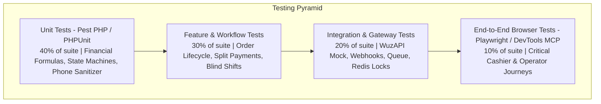
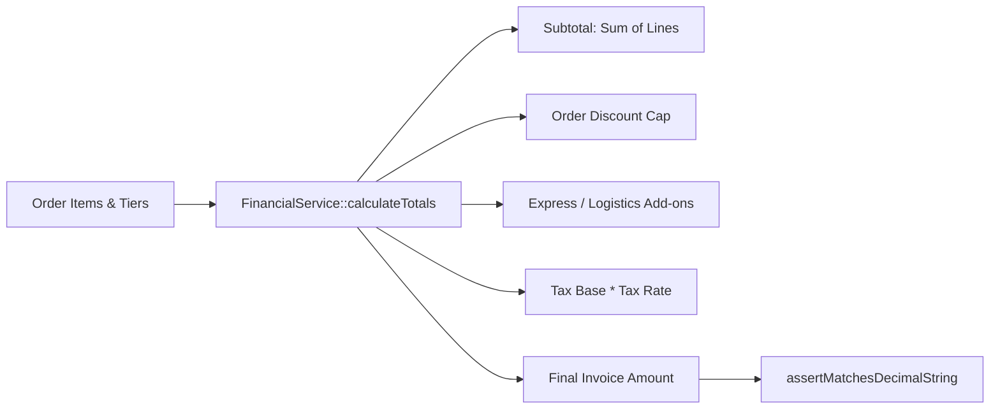
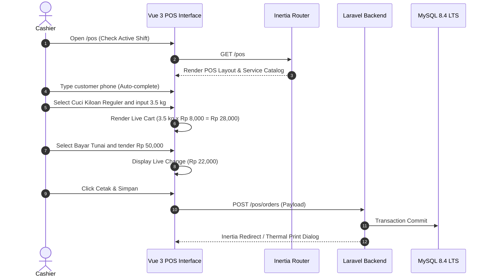

# Comprehensive Quality Assurance & Test Plan

**Project:** LMS Andik Laundry (Single-Store Laundry Management System)  
**Document Version:** 1.0.0  
**Status:** Approved Quality Standard  
**Test Frameworks:** Pest PHP v3 / PHPUnit 11, Playwright / Chrome DevTools MCP, Mockery, Larastan  
**Target Coverage Threshold:** $\ge 85\%$ line coverage across domain services and state machines  

---

## 1. Quality Assurance Strategy & Testing Pyramid

LMS Andik Laundry handles physical garments and daily retail cash. Quality assurance follows a rigorous **Testing Pyramid** designed to validate domain correctness, financial precision, and operational resilience.



### 1.1 Quality Gates & Coverage Targets

| Testing Tier | Scope & Focus | Primary Tools | Minimum Coverage Target |
| :--- | :--- | :--- | :---: |
| **Unit Testing** | Pure business logic, decimal math, state transitions, string sanitizers | Pest PHP 3 / PHPUnit 11 | $95\%$ |
| **Feature Testing** | HTTP endpoints, Form Requests, RBAC policies, database transactions | Laravel TestResponse, RefreshDatabase | $85\%$ |
| **Integration Testing** | Webhook verification, WuzAPI mock client, Redis queue jobs, locks | Pest, Http::fake(), Queue::fake() | $80\%$ |
| **E2E Browser Testing**| POS cashier checkout, blind shift closing modal, operator status bump | Playwright / Chrome DevTools | Key User Journeys |
| **Static Analysis** | Type safety, dead code detection, boundary leaks | PHPStan / Larastan (Level 8) | 0 Errors |

---

## 2. Unit Testing Strategy

Unit tests validate isolated domain classes without database I/O where possible, focusing on mathematical precision, state transition invariants, and formatting edge cases.

### 2.1 Financial Math & Formula Test Suite

Financial calculation unit tests assert against the formal formulas defined in the financial specifications:



#### Test Cases: `FinancialMathTest.php` (Pest PHP)
```php
use App\Services\FinancialService;

describe('Financial Math & Invoicing Calculations', function () {

    it('calculates line item subtotal with minimum weight threshold', function () {
        $service = new FinancialService();

        // Scenario: 1.45 kg laundry on 3.00 kg minimum kiloan service @ Rp 8,000/kg
        $result = $service->calculateLineItem(
            actualQuantity: 1.45,
            minQuantityThreshold: 3.00,
            unitPrice: 8000.00,
            lineDiscount: 0.00
        );

        expect($result->billedQuantity)->toBe('3.00')
            ->and($result->subtotal)->toBe('24000.00');
    });

    it('calculates tiered express surcharge correctly', function () {
        $service = new FinancialService();

        // 5.00 kg @ Rp 8,000 base + Express tier (+Rp 6,000/kg)
        $totals = $service->calculateOrderTotals(
            lines: [
                ['billed_qty' => 5.00, 'unit_price' => 8000.00, 'line_discount' => 0.00]
            ],
            orderDiscountAmount: 5000.00,
            tierSurchargePerKg: 6000.00,
            taxRatePercent: 0.00
        );

        // Subtotal = 40,000; Express Surcharge = 30,000; Discount = 5,000; Final = 65,000
        expect($totals->subtotal)->toBe('40000.00')
            ->and($totals->surcharges)->toBe('30000.00')
            ->and($totals->discount)->toBe('5000.00')
            ->and($totals->finalInvoiceAmount)->toBe('65000.00');
    });

    it('computes change given without negative values', function () {
        $service = new FinancialService();

        // Due Rp 45,000, cash tendered Rp 50,000 -> change Rp 5,000
        expect($service->calculateChange(amountDue: 45000.00, tendered: 50000.00))->toBe('5000.00');

        // Due Rp 45,000, cash tendered Rp 30,000 (partial) -> change Rp 0
        expect($service->calculateChange(amountDue: 45000.00, tendered: 30000.00))->toBe('0.00');
    });

    it('computes cash drawer reconciliation variance accurately', function () {
        $service = new FinancialService();

        // Expected Rp 850,000, Actual Counted Rp 835,000 -> Variance -15,000 (Shortage)
        $variance = $service->calculateShiftVariance(
            expectedDrawerCash: 850000.00,
            actualCountedCash: 835000.00
        );

        expect($variance)->toBe('-15000.00');
    });
});
```

---

### 2.2 Orthogonal State Machine Test Suite

State machine tests enforce transition rules between decoupled `production_status` and `payment_status` finite state machines.

#### Test Cases: `StateMachineTest.php`
```php
use App\Models\Order;
use App\Services\OrderStateMachine;
use App\Exceptions\InvalidStateTransitionException;

describe('Order State Machine Invariants', function () {

    it('permits standard forward production progression', function () {
        $order = Order::factory()->make(['production_status' => 'received']);
        $fsm = new OrderStateMachine($order);

        $fsm->transitionProductionTo('washing');
        expect($order->production_status)->toBe('washing');

        $fsm->transitionProductionTo('drying');
        expect($order->production_status)->toBe('drying');

        $fsm->transitionProductionTo('ironing');
        expect($order->production_status)->toBe('ironing');

        $fsm->transitionProductionTo('ready_for_pickup');
        expect($order->production_status)->toBe('ready_for_pickup');
    });

    it('allows rewash loop from ironing back to washing with reason', function () {
        $order = Order::factory()->make(['production_status' => 'ironing', 'rewash_count' => 0]);
        $fsm = new OrderStateMachine($order);

        $fsm->triggerRewash(reason: 'Noda minyak kerah belum hilang');
        expect($order->production_status)->toBe('washing')
            ->and($order->rewash_count)->toBe(1);
    });

    it('prevents rewash loop exceeding maximum threshold of 2 attempts', function () {
        $order = Order::factory()->make(['production_status' => 'ironing', 'rewash_count' => 2]);
        $fsm = new OrderStateMachine($order);

        expect(fn() => $fsm->triggerRewash('Noda membandel'))
            ->toThrow(InvalidStateTransitionException::class, 'Maksimal 2 kali cuci ulang tercapai.');
    });

    it('enforces counter release guard: blocks completion if unpaid without credit approval', function () {
        $order = Order::factory()->make([
            'production_status' => 'ready_for_pickup',
            'payment_status' => 'unpaid',
            'is_debt_approved' => false,
        ]);
        $fsm = new OrderStateMachine($order);

        expect(fn() => $fsm->transitionProductionTo('completed'))
            ->toThrow(InvalidStateTransitionException::class, 'Pesanan belum lunas');
    });

    it('permits completion if unpaid but authorized credit debt is approved', function () {
        $order = Order::factory()->make([
            'production_status' => 'ready_for_pickup',
            'payment_status' => 'unpaid',
            'is_debt_approved' => true,
            'debtor_name' => 'Budi Santoso',
        ]);
        $fsm = new OrderStateMachine($order);

        $fsm->transitionProductionTo('completed');
        expect($order->production_status)->toBe('completed');
    });
});
```

---

### 2.3 Phone Normalizer & Sanitizer Test Suite

```php
use App\Support\PhoneFormatter;

describe('Phone Number Normalization', function () {

    test('normalizes diverse Indonesian phone formats to canonical E.164 without plus', function ($input, $expected) {
        expect(PhoneFormatter::normalizeToE164($input))->toBe($expected);
    })->with([
        ['081234567890', '6281234567890'],
        ['+6281234567890', '6281234567890'],
        ['6281234567890', '6281234567890'],
        ['0812-3456-7890', '6281234567890'],
        ['+62 812 3456 7890', '6281234567890'],
        ['0857 1122 3344 ', '6285711223344'],
        ['8123456789', '628123456789'],
    ]);
});
```

---

## 3. Feature Testing Strategy

Feature tests simulate complete HTTP requests hitting controllers and database transactions using Laravel's test database.

### 3.1 Order Lifecycle & Split Payment Feature Tests

```php
use App\Models\User;
use App\Models\Customer;
use App\Models\Service;
use App\Models\Order;
use App\Models\Payment;
use Illuminate\Foundation\Testing\RefreshDatabase;

uses(RefreshDatabase::class);

describe('POS Order Intake & Payment Processing', function () {

    it('creates an order with price snapshots and partial down payment', function () {
        $cashier = User::factory()->create(['role' => 'cashier']);
        $customer = Customer::factory()->create();
        $service = Service::factory()->create([
            'name' => 'Cuci Kering Setrika Reguler',
            'unit_type' => 'kg',
            'base_price' => 8000.00,
            'min_weight' => 3.00,
        ]);

        $payload = [
            'customer_id' => $customer->id,
            'service_tier' => 'regular',
            'items' => [
                [
                    'service_id' => $service->id,
                    'quantity' => 2.00, // Below min_weight 3.00 -> billable 3.00 kg
                ]
            ],
            'payment' => [
                'amount' => 10000.00, // Down payment of 10,000 on 24,000 total
                'payment_method' => 'cash',
            ]
        ];

        $response = $this->actingAs($cashier)->postJson('/pos/orders', $payload);

        $response->assertCreated();
        $order = Order::first();

        expect($order->total_amount)->toBe('24000.00')
            ->and($order->payment_status)->toBe('partially_paid')
            ->and($order->production_status)->toBe('received');

        // Verify price snapshot in order_items
        $this->assertDatabaseHas('order_items', [
            'order_id' => $order->id,
            'billed_quantity' => 3.00,
            'unit_price_snapshot' => 8000.00,
            'subtotal_snapshot' => 24000.00,
        ]);

        // Verify payment record
        $this->assertDatabaseHas('payments', [
            'order_id' => $order->id,
            'amount' => 10000.00,
            'payment_method' => 'cash',
            'status' => 'success',
        ]);
    });

    it('settles remaining balance via QRIS on pickup', function () {
        $cashier = User::factory()->create(['role' => 'cashier']);
        $order = Order::factory()->create([
            'total_amount' => 24000.00,
            'payment_status' => 'partially_paid',
            'production_status' => 'ready_for_pickup',
        ]);
        Payment::factory()->create(['order_id' => $order->id, 'amount' => 10000.00]);

        $payload = [
            'amount' => 14000.00,
            'payment_method' => 'qris',
            'reference_number' => 'QRIS-20261113-0992',
        ];

        $response = $this->actingAs($cashier)->postJson("/pos/orders/{$order->id}/payments", $payload);

        $response->assertOk();
        $order->refresh();

        expect($order->payment_status)->toBe('paid');
    });
});
```

---

### 3.2 Cashier Shift Lifecycle Feature Tests

```php
describe('Cashier Shift Blind Count & Audit Protocol', function () {

    it('opens shift with opening float and blocks concurrent shifts for same user', function () {
        $cashier = User::factory()->create(['role' => 'cashier']);

        $response = $this->actingAs($cashier)->postJson('/pos/shifts/open', [
            'opening_float' => 150000.00,
        ]);

        $response->assertCreated();
        $this->assertDatabaseHas('cashier_shifts', [
            'user_id' => $cashier->id,
            'opening_float' => 150000.00,
            'status' => 'open',
        ]);

        // Second attempt to open shift must fail
        $secondResponse = $this->actingAs($cashier)->postJson('/pos/shifts/open', [
            'opening_float' => 100000.00,
        ]);
        $secondResponse->assertStatus(422);
    });

    it('closes shift using blind count and computes shortage variance', function () {
        $cashier = User::factory()->create(['role' => 'cashier']);
        $shift = \App\Models\CashierShift::factory()->create([
            'user_id' => $cashier->id,
            'opening_float' => 100000.00,
            'cash_sales_total' => 400000.00, // Expected drawer: 500,000
            'status' => 'open',
        ]);

        // Cashier counts 4 bills of 100k, 1 bill of 50k, 2 bills of 20k = 490,000 (Shortage Rp 10,000)
        $closePayload = [
            'denominations' => [
                'bill_100k' => 4,
                'bill_50k'  => 1,
                'bill_20k'  => 2,
                'bill_10k'  => 0,
                'bill_5k'   => 0,
                'bill_2k'   => 0,
                'bill_1k'   => 0,
                'coins'     => 0,
            ],
            'notes' => 'Uang kembalian kurang sepuluh ribu',
        ];

        $response = $this->actingAs($cashier)->postJson("/pos/shifts/{$shift->id}/close", $closePayload);

        $response->assertOk();
        $shift->refresh();

        expect($shift->status)->toBe('closed')
            ->and($shift->actual_cash_counted)->toBe('490000.00')
            ->and($shift->expected_drawer_cash)->toBe('500000.00')
            ->and($shift->cash_variance)->toBe('-10000.00');
    });
});
```

---

### 3.3 RBAC Authorization Barrier Tests

```php
describe('Role-Based Authorization Barriers', function () {

    it('blocks operator from accessing financial reports', function () {
        $operator = User::factory()->create(['role' => 'operator']);

        $response = $this->actingAs($operator)->get('/reports/financial');
        $response->assertForbidden();
    });

    it('blocks cashier from viewing store net profit analytics', function () {
        $cashier = User::factory()->create(['role' => 'cashier']);

        $response = $this->actingAs($cashier)->get('/reports/profit-loss');
        $response->assertForbidden();
    });

    it('allows owner to access financial profit reports', function () {
        $owner = User::factory()->create(['role' => 'owner']);

        $response = $this->actingAs($owner)->get('/reports/financial');
        $response->assertOk();
    });

    it('prevents cashier from canceling an in-progress order without owner authorization', function () {
        $cashier = User::factory()->create(['role' => 'cashier']);
        $order = Order::factory()->create(['production_status' => 'washing']);

        $response = $this->actingAs($cashier)->postJson("/pos/orders/{$order->id}/cancel", [
            'reason' => 'Customer changed mind',
        ]);

        $response->assertForbidden();
    });
});
```

---

## 4. Integration Testing Strategy

Integration tests verify interactions with external boundaries: WuzAPI HTTP client, Webhook HMAC signature middleware, and asynchronous Redis queue workers.

### 4.1 WuzAPI Gateway Mock & Notification Job Tests

```php
use App\Jobs\SendWhatsAppNotificationJob;
use App\Services\WuzapiGateway;
use Illuminate\Support\Facades\Http;
use Illuminate\Support\Facades\Queue;

describe('WhatsApp Notification Queue & Gateway Integration', function () {

    it('dispatches HTTP call to WuzAPI and logs message ID on success', function () {
        Http::fake([
            'http://127.0.0.1:8080/chat/send/text' => Http::response([
                'code' => 200,
                'success' => true,
                'data' => [
                    'id' => 'LMS-WA-20261113-0001',
                    'details' => 'Message sent',
                ]
            ], 200),
        ]);

        $gateway = app(WuzapiGateway::class);
        $response = $gateway->sendTextMessage(
            phone: '6281234567890',
            message: 'Halo Budi, cucian siap diambil.'
        );

        expect($response->isSuccessful())->toBeTrue()
            ->and($response->getMessageId())->toBe('LMS-WA-20261113-0001');

        Http::assertSent(function ($request) {
            return $request->url() === 'http://127.0.0.1:8080/chat/send/text'
                && $request['Phone'] === '6281234567890'
                && $request->hasHeader('Token');
        });
    });

    it('enforces atomic lock to prevent duplicate notification dispatch', function () {
        $order = Order::factory()->create();

        // Simulate concurrent dispatch of same status notification
        $job1 = new SendWhatsAppNotificationJob($order->id, 'ready_for_pickup');
        $job2 = new SendWhatsAppNotificationJob($order->id, 'ready_for_pickup');

        // First job executes and acquires lock
        // Second job detects lock and terminates gracefully without calling HTTP
    });
});
```

---

### 4.2 Webhook Cryptographic Verification Tests

```php
describe('WuzAPI Webhook HMAC Signature Middleware', function () {

    it('accepts incoming webhook with valid HMAC-SHA256 signature', function () {
        $secret = 'test_secret_key_32_characters_long_1234';
        config(['services.wuzapi.hmac_secret' => $secret]);

        $payload = json_encode([
            'type' => 'ReadReceipt',
            'event' => [
                'MessageIDs' => ['LMS-WA-20261113-0001'],
                'Type' => 'delivered',
            ]
        ]);

        $signature = hash_hmac('sha256', $payload, $secret);

        $response = $this->call(
            method: 'POST',
            uri: '/api/webhooks/wuzapi',
            headers: [
                'x-hmac-signature' => $signature,
                'Content-Type' => 'application/json',
            ],
            content: $payload
        );

        $response->assertOk();
    });

    it('rejects incoming webhook with tampered body or invalid signature with 401', function () {
        $secret = 'test_secret_key_32_characters_long_1234';
        config(['services.wuzapi.hmac_secret' => $secret]);

        $payload = json_encode(['type' => 'FakeEvent']);
        $invalidSignature = 'abcdef0123456789abcdef0123456789abcdef0123456789abcdef0123456789';

        $response = $this->call(
            method: 'POST',
            uri: '/api/webhooks/wuzapi',
            headers: [
                'x-hmac-signature' => $invalidSignature,
                'Content-Type' => 'application/json',
            ],
            content: $payload
        );

        $response->assertStatus(401);
    });
});
```

---

## 5. End-to-End (E2E) Browser Testing Strategy

E2E testing automates critical user journeys on the compiled Vue 3 / Inertia frontend using Playwright and Chrome DevTools MCP.



### 5.1 Critical E2E Test Scenarios

1. **E2E-01: Cashier Fast Order Entry & Receipt Generation**
   - **Precondition:** Cashier logged in with open shift.
   - **Steps:**
     1. Navigate to `/pos`.
     2. Search existing customer by phone `081234567890` or create new inline.
     3. Select service "Cuci Komplit Reguler", input weight `4.20 kg`.
     4. Select scent "Sakura".
     5. Select full payment via Cash, enter tender `Rp 50,000`.
     6. Verify change displayed is `Rp 16,400` (assuming Rp 33,600 total).
     7. Submit order.
   - **Assertion:** Order appears in intake queue; receipt thermal preview triggers; WhatsApp job queued.

2. **E2E-02: Blind Count Shift Closing Journey**
   - **Precondition:** Shift open with active transactions.
   - **Steps:**
     1. Click "Tutup Shift" in POS navigation.
     2. Verify expected total is **hidden** from the modal screen.
     3. Fill denomination inputs: 5x 100k, 2x 50k, 5x 10k.
     4. Click "Konfirmasi & Tutup Shift".
   - **Assertion:** Shift transitions to `closed`; printable Z-Report modal displays calculated variance; cashier redirected to login.

3. **E2E-03: Production Operator Status Bump & Rewash Flag**
   - **Precondition:** Operator logged in.
   - **Steps:**
     1. Navigate to `/production/station`.
     2. Click "Mulai Cuci" on Order #101 -> badge changes to `Washing`.
     3. Click "Mulai Pengeringan" -> badge changes to `Drying`.
     4. On Ironing stage, click "Cuci Ulang", select reason "Noda Minyak".
   - **Assertion:** Order returns to `Washing` drum queue with rewash badge `[Cuci Ulang 1x]`.

---

## 6. Edge Case & Failure Testing Matrix

| # | Edge Case Scenario | Trigger Condition | Expected System Behavior & Test Assertion |
|---|:---|:---|:---|
| **EC-01** | Sub-minimum weight kiloan intake | Customer brings 1.25 kg on 3.00 kg minimum service. | Billed weight locked at `3.00 kg`; subtotal billed at minimum fee; actual weight recorded as `1.25 kg` for washer capacity metrics. |
| **EC-02** | Rapid double-click checkout | Cashier double-taps "Bayar & Simpan" in < 300ms. | Frontend disables button upon first click; backend idempotency lock prevents duplicate order record creation. |
| **EC-03** | Split tender overpayment | Order Rp 60,000; paid Rp 40,000 QRIS + Rp 50,000 Cash. | QRIS settles Rp 40,000; Cash records Rp 20,000; Cash change computed as Rp 30,000; Order marked `paid`. |
| **EC-04** | Master catalog price change during checkout | Owner increases price in catalog while cashier has item in active cart. | Backend Form Request calculates snapshot based on catalog at checkout time, or freezes client cart draft; once committed, price is permanently immutable. |
| **EC-05** | WuzAPI gateway offline / timeout | Queue worker attempts to dispatch WhatsApp message while companion phone is offline. | Job catches `ConnectionException`, marks log as `pending_retry`, backs off exponentially (30s, 60s, 120s); circuit breaker trips after 5 failures and notifies POS UI to use `wa.me` manual fallback. |
| **EC-06** | Read receipt disabled on customer phone | Customer receives notification but has disabled "blue ticks" in WhatsApp privacy settings. | System logs status as `Dispatched` or `Delivered`; never hangs or blocks production/completion workflows awaiting `read` receipt. |
| **EC-07** | Shift blind count cash deficit | Cashier drawer physical count is Rp 25,000 less than expected cash. | Shift closes cleanly; `cash_variance = -25000.00`; variance audit alert created for Owner dashboard; Z-Report highlights deficit in red. |
| **EC-08** | Unpaid order counter pickup attempt | Customer requests laundry handover but refuses or is unable to pay. | Release guard prevents status transition to `completed`; modal prompts for Owner PIN override to convert into recorded customer debt (`Piutang`). |
| **EC-09** | Order cancellation with prior down payment | Order canceled after customer paid Rp 20,000 deposit. | Order marked `canceled`; system generates `refund_record` of Rp 20,000; drawer expected cash decremented; audit log captures reason and authorizer. |
| **EC-10** | Malformed customer phone number | Customer enters `0812-ABC-7890` or `12345`. | Server-side Form Request validation rejects input with message: "Nomor WhatsApp tidak valid (minimal 10 digit angka)." |

---

## 7. Test Data Fixtures & Seeders

### 7.1 Database Seeders Structure

- **`DatabaseSeeder.php`**: Master orchestrator running sub-seeders in deterministic order.
- **`RoleAndUserSeeder.php`**: Creates standard test accounts (`owner@andiklaundry.test`, `cashier@andiklaundry.test`, `operator@andiklaundry.test`).
- **`ServiceCatalogSeeder.php`**: Seeds standard Indonesian laundry services:
  - *Cuci Komplit Reguler* (Kiloan, 3kg min, Rp 8,000/kg, 48h)
  - *Cuci Kering Lipat* (Kiloan, 3kg min, Rp 6,000/kg, 48h)
  - *Setrika Uap Reguler* (Kiloan, 3kg min, Rp 5,000/kg, 48h)
  - *Bedcover King* (Satuan, Rp 35,000/pcs, 72h)
  - *Jas Pria* (Satuan, Rp 40,000/pcs, 72h)
- **`PerfumeVariantSeeder.php`**: Seeds fragrances (*Sakura, Lavender, Ocean Fresh, Snappy, Non-Parfum*).
- **`SampleOrderSeeder.php`**: Seeds realistic transaction states (received, washing, drying, ironing, ready, completed) with split payments.

---

## 8. Continuous Integration & Automation Pipeline

### 8.1 GitHub Actions Workflow: `.github/workflows/ci.yml`

```yaml
name: LMS CI Pipeline

on:
  push:
    branches: [ main, develop ]
  pull_request:
    branches: [ main ]

jobs:
  backend-quality:
    name: Backend Lint, Static Analysis & Tests
    runs-on: ubuntu-24.04

    services:
      mysql:
        image: mysql:8.4
        env:
          MYSQL_ROOT_PASSWORD: root
          MYSQL_DATABASE: lms_test
        ports:
          - 3306:3306
        options: --health-cmd="mysqladmin ping" --health-interval=10s --health-timeout=5s --health-retries=3

      redis:
        image: redis:7-alpine
        ports:
          - 6379:6379

    steps:
      - name: Checkout code
        uses: actions/checkout@v4

      - name: Setup PHP runtime
        uses: shivammathur/setup-php@v2
        with:
          php-version: '8.3'
          extensions: mbstring, pdo, pdo_mysql, redis, bcmath, gd
          coverage: pcov

      - name: Install Composer dependencies
        run: composer install --prefer-dist --no-interaction --no-progress

      - name: Code Style Check (Laravel Pint)
        run: ./vendor/bin/pint --test

      - name: Static Analysis (Larastan)
        run: ./vendor/bin/phpstan analyse --memory-limit=2G

      - name: Run Pest / PHPUnit Test Suite
        env:
          DB_CONNECTION: mysql
          DB_HOST: 127.0.0.1
          DB_PORT: 3306
          DB_DATABASE: lms_test
          DB_USERNAME: root
          DB_PASSWORD: root
          REDIS_HOST: 127.0.0.1
        run: ./vendor/bin/pest --parallel --coverage --min=85

  frontend-quality:
    name: Frontend Lint & Build
    runs-on: ubuntu-24.04

    steps:
      - name: Checkout code
        uses: actions/checkout@v4

      - name: Setup Node.js
        uses: actions/setup-node@v4
        with:
          node-version: '24'
          cache: 'npm'

      - name: Install NPM dependencies
        run: npm ci

      - name: Lint Frontend (ESLint)
        run: npm run lint

      - name: Compile Production Assets (Vite)
        run: npm run build
```

---

## 9. QA Acceptance Verification Sign-Off

Prior to deploying any milestone to staging or production, the QA lead must verify:
- [ ] 100% of unit tests pass with zero failures.
- [ ] Line coverage across `app/Services/` exceeds $85\%$.
- [ ] Larastan static analysis reports 0 errors at Level 8.
- [ ] Blind count cash reconciliation verified to produce correct variance on positive, negative, and zero discrepancies.
- [ ] Webhook HMAC verification rejects forged signatures and empty payloads.
- [ ] Playwright E2E test suite executes end-to-end POS order intake without browser console errors.
