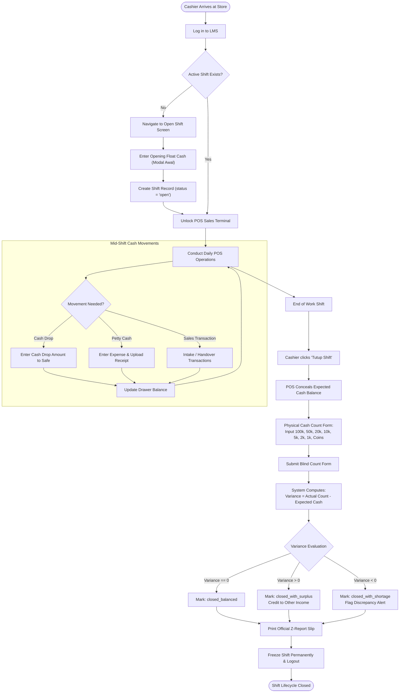
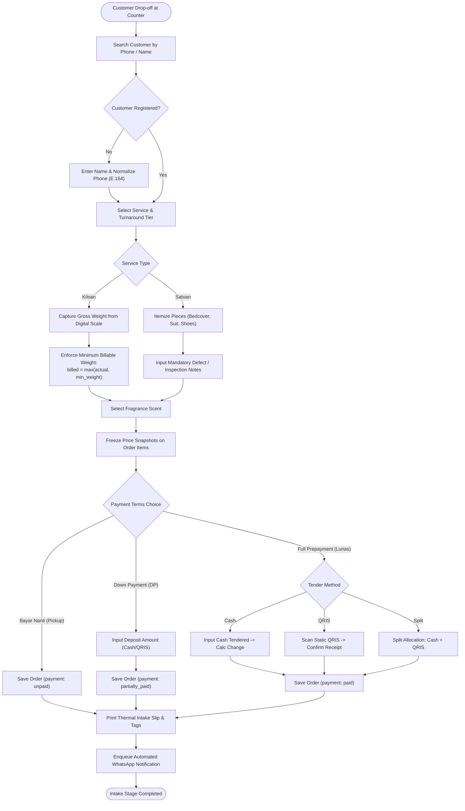
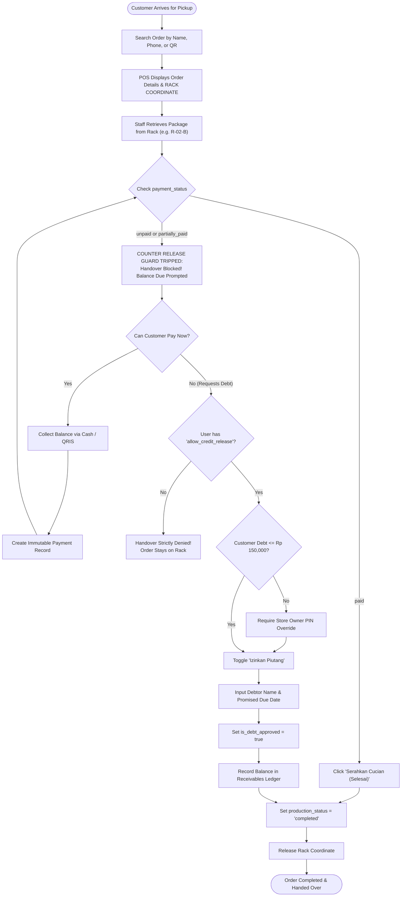
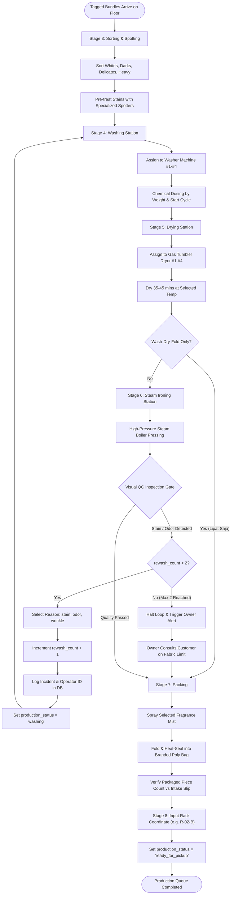
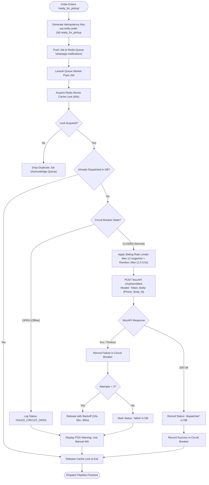
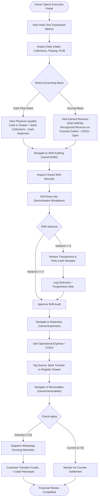

# End-to-End User Flows & Operational Journeys
## Laundry Management System (LMS-AndikLaundry)

**Document Version:** 1.0.0  
**Status:** Approved for Implementation (Phase 0 Planning Milestone)  
**Date:** 2026-11-13  
**Target Platform:** Single-Store Monolithic Web Application (Laravel 13, Inertia.js 3, Vue 3, Tailwind CSS 4, MySQL 8.4 LTS)  
**Scope:** Complete Step-by-Step Operational Journeys & Mermaid Flowcharts  

---

## 1. Overview & System Actor Profiles

LMS-AndikLaundry is engineered as a unified, single-store system tailored specifically for a **home-based business managed by the owner and family (usaha rumahan yang dikelola keluarga)**:

```
┌─────────────────────────────────────────────────────────────────────────────┐
│                      Family-Run System Actor Architecture                   │
├─────────────────────────────────────────┬───────────────────────────────────┤
│       STORE OWNER & CASHIER             │     FAMILY OPERATOR / ASSISTANT   │
│     (Pemilik & Kasir Utama)             │     (Anggota Keluarga / Operator) │
├─────────────────────────────────────────┼───────────────────────────────────┤
│ • POS Order Intake & Digital Scale      │ • Garment Tagging & Washing       │
│ • Scent Selection & Item Inspection     │ • Drying & Steam Ironing QC Gate  │
│ • Split Payments (Cash & QRIS)          │ • Rewash Loop Trigger             │
│ • Customer Handover & Flexible Piutang  │ • Rack Staging Allocation         │
│ • Direct Daily Expense Logging          │ • Packaging & Pickup Prep         │
│ • Daily Cash Recap (Rekap Kas Harian)   │ • 1-Click Jump to POS if helping  │
│ • Analytics Dashboard & Pricing Admin   │                                   │
└─────────────────────────────────────────┴───────────────────────────────────┘
```

The system features **unified navigation**: the Owner/Cashier can jump instantly between **POS Kasir (`/pos`)**, **Antrean Cuci (`/production/station`)**, **Buku Kas / Pengeluaran**, and **Dashboard (`/dashboard`)** without logging out or switching user accounts.

---

## 2. Cashier & Counter Operational Journeys

### Flow 1.1: Direct POS Intake & Digital Scale Weighing (Always Ready)
- **Objective:** Process walk-in customer drop-offs immediately in under 45 seconds with automated scale capture, minimum billable threshold enforcement, piece inspection, and fragrance selection.
- **Preconditions:** Store is open; POS terminal is active. No artificial shift opening ceremony or float lock is required.

```
[ Customer Lookup / Register ]
              │
              ▼
    [ Service Selection ]
              │
              ├─────────────────────────────────────────┐
              ▼                                         ▼
   (Kiloan Wash Bundle)                       (Satuan / Dry Cleaning)
  • Scale weight captured (`DECIMAL(8,2)`)   • Piece count and category selection
  • Apply minimum billable weight rule       • Input pre-existing defect notes
              │                                         │
              └────────────────────┬────────────────────┘
                                   │
                                   ▼
                       [ Fragrance Selection ]
                                   │
                                   ▼
                       [ Order Summary & Review ]
                                   │
                                   ▼
                     [ Proceed to Payment Choice ]
```

1. **Step 1 (Customer Lookup / Registration):**
   - Owner/Cashier enters customer WhatsApp number or name.
   - If existing: Customer profile, loyalty history, and any outstanding debt alerts load instantly.
   - If new: Inline registration opens. Enters Customer Name and Phone Number. System normalizes phone to E.164 (`628...`).
2. **Step 2 (Service Tier Selection):** Selects service tier: "Cuci Komplit Reguler" (48-72h), "Kilat" (24h), "Express" (6-8h), or "Flash" (2-3h).
3. **Step 3 (Measurement & Weighing):**
   - *For Kiloan:* Places laundry bundle on scale. Actual scale weight is captured (e.g. `1.65 kg`). System automatically applies the minimum threshold (e.g. `min_weight = 3.00 kg`), setting `actual_quantity = 1.65` and `billed_quantity = 3.00`.
   - *For Satuan:* Selects discrete items (e.g., "Bedcover King", "Jas Pria"). If garments have tears, missing buttons, or stains, enters notes into `item_condition_notes`.
4. **Step 4 (Fragrance Selection):** Selects customer fragrance preference: Lavender, Sakura, Ocean Fresh, Snappy, or Non-Parfum.
5. **Step 5 (Line-Item Price Freezing):** System calculates line item subtotals, creating immutable snapshots (`unit_price_snapshot`, `discount_snapshot`, `subtotal_snapshot`).
6. **Step 6 (Intake Slip Printing):** Confirms order. Thermal printer emits 58mm/80mm intake slip with tracking QR code. System enqueues automated WhatsApp "Nota Diterima" notification (with instant manual `wa.me` fallback link).

---

### Flow 1.3: Multi-Tender Split Payment & Down Payment Handling
- **Objective:** Support partial down payments (DP) and split-tender settlements (Cash + QRIS).
- **Preconditions:** Active order on checkout screen.

```
[ Checkout Modal ]
        │
        ├──> [ Option A: Pay Upon Pickup (Bayar Nanti) ] ──> Order marked unpaid
        │
        ├──> [ Option B: Full Payment / Lunas Depan ]
        │          │
        │          ├── Tender Method: Cash ────> Input cash -> Calculate change
        │          ├── Tender Method: QRIS ────> Scan static QRIS -> Verify receipt
        │          └── Tender Method: Split ───> Multi-tender breakdown
        │
        └──> [ Option C: Partial Down Payment (DP) ] ──> Balance due upon pickup
```

1. **Step 1 (Payment Modal Selection):** Cashier presents invoice total (e.g., Rp 75,000) and selects settlement mode:
   - Full Settlement (Lunas).
   - Partial Down Payment (e.g., Rp 30,000 DP).
   - Pay Upon Pickup (Rp 0 paid now; order saved as `unpaid`).
2. **Step 2 (Split-Tender Allocation):**
   - If customer requests split payment: Cashier selects "Split Tender".
   - Cashier enters Payment 1: `Method: QRIS, Amount: Rp 50,000`. Customer scans static QRIS counter code. Cashier verifies bank notification on store phone and clicks "Confirm QRIS".
   - Cashier enters Payment 2: `Method: Cash, Amount Tendered: Rp 30,000`. System applies Rp 25,000 to remaining balance and calculates `Cash Change = Rp 5,000`.
3. **Step 3 (Immutable Payment Ledgers):** System writes two separate `payment_records` entries (QRIS Rp 50,000 and Cash Rp 25,000). Net cash in shift drawer increases by Rp 25,000.
4. **Step 4 (Status Derivation):** Payment state machine deterministically updates `payment_status` to `'paid'`. Cashier hands receipt and change to customer.

---

### Flow 1.4: Counter Order Lookup, Pickup & Release Guard
- **Objective:** Guarantee that no laundry bundle leaves the store without complete financial settlement or authorized credit approval.
- **Preconditions:** Customer arrives at counter to pick up finished laundry.

```
[ Customer Arrives at Counter ]
               │
               ▼
   [ Search Order in POS ] ──(By Name, Phone, or Scanned QR)
               │
               ▼
[ POS Displays Order Detail & RACK COORDINATE (e.g. R-02-B) ]
               │
               ▼
      Check payment_status
        /              \
      PAID            UNPAID / PARTIALLY PAID
      /                  \
[ Retrieve Bundle ]    [ Display Debt Warning: Rp XX.XXX ]
[ Fast Handover   ]              │
[ Order Completed ]    [ Customer Settlement Choice ]
                         /                            \
                   [ Pay Now ]                 [ Bayar Nanti (Piutang) ]
                       /                                \
             [ Record Payment ]             [ Owner Confirms Due Date ]
             [ Status: paid   ]             [ Set is_debt_approved = true ]
             [ Handover Done  ]             [ Handover with Debt Ledger   ]
```

1. **Step 1 (Counter Search):** Customer gives name, phone number, or presents digital WhatsApp receipt. Owner/Cashier scans barcode or searches name in POS search bar.
2. **Step 2 (Rack Coordinate Lookup):** Order record displays in POS with large bold coordinate: **RAK: R-02-B**. The bundle is retrieved immediately.
3. **Step 3 (Handover Verification):**
   - *If `payment_status == 'paid'`*: Owner/Cashier clicks "Serahkan Cucian". System sets `production_status = 'completed'`. Order lifecycle closes.
   - *If `payment_status != 'paid'`*: System displays a clear status notice: `Tagihan Belum Lunas: Rp XX.XXX`.
4. **Step 4 (Balance Settlement or Direct Debt Approval):**
   - *Settlement Path:* Customer pays outstanding balance (Cash/QRIS/Transfer). Owner logs payment. Status updates to `paid`. Handover proceeds.
   - *Credit Approval Path (Piutang):* If customer is a trusted neighbor or requests to pay later, Owner clicks "Serahkan (Catat Piutang)". Owner confirms due date (`due_date`, default 7 days). System sets `is_debt_approved = true`, transitions production to `completed`, and records balance in the Customer Receivables Ledger without needing a manager PIN.

---

### Flow 1.5: Operational Expense Management (Pencatatan Biaya Toko)
- **Objective:** Track store purchases (LPG gas, soap/detergent, softener, plastic packaging) directly to maintain accurate daily take-home earnings.
- **Preconditions:** Store expense incurred.

```
[ Click "Catat Pengeluaran" ]
              │
              ▼
    [ Input Expense Modal ]
  • Nominal (Rp)
  • Kategori (Gas LPG, Deterjen, Plastik, Listrik/Air, Lainnya)
  • Keterangan (e.g. "Beli 2 tabung LPG 3kg")
  • Metode Pembayaran (Tunai Laci / Transfer)
  • Foto Bukti / Nota (Opsional)
              │
              ▼
[ System writes expenses record ]
[ Deducts from Daily Net Cash in real-time ]
```

1. **Expense Entry:** When buying supplies (e.g., Rp 44,000 for two 3kg LPG cylinders), Owner/Cashier clicks "Catat Pengeluaran".
2. **Details:** Enters amount (Rp 44,000), selects category ("Bahan Baku (Gas LPG)"), inputs note ("Beli 2 tabung LPG 3kg Toko Bu Joko"), and selects payment method ("Kas Tunai").
3. **Real-Time Update:** System logs the record and immediately adjusts the Daily Cash Summary net cash balance.

---

### Flow 1.6: Daily Cash Recap (Rekap Kas Harian)
- **Objective:** Provide a transparent, stress-free summary of daily sales, incoming payments, store expenses, and net cash on hand.
- **Preconditions:** End of day or anytime during operating hours.

```
[ Open "Rekap Kas Harian" ]
              │
              ▼
[ Real-Time Financial Summary Display ]
  • Total Kas Masuk Tunai
  • Total Pembayaran QRIS & Transfer
  • Total Pengeluaran Operasional
  • Sisa Kas Bersih Tunai Hari Ini (Uang di Laci/Dompet)
  • Rekap Piutang Baru & Pelunasan Piutang
              │
              ├──────────────────────────────────┐
              ▼                                  ▼
   [ Print Daily Summary Slip ]       [ Optional Physical Count ]
   (Thermal 58mm/80mm Ringkasan)      (Check drawer bills/coins)
```

1. **Step 1 (View Daily Recap):** Owner opens "Rekap Kas Harian" from POS or Dashboard.
2. **Step 2 (Transparent Review):** System displays:
   - Total Cash Intake from Orders & Piutang settlements.
   - Total Digital Payments (QRIS / Bank Transfer).
   - Total Expenses logged today.
   - Sisa Kas Bersih Tunai = Total Kas Tunai - Total Pengeluaran Kas Tunai.
3. **Step 3 (Optional Count & Print):** Owner can verify the physical cash in the drawer using the quick denomination calculator and print a daily summary slip on the 58mm/80mm thermal receipt printer.

---

### Flow 1.7: POS Manual WhatsApp Deep-Link Fallback
- **Objective:** Guarantee customer communication continuity when automated WuzAPI gateway is offline.
- **Preconditions:** Gateway disconnected or network circuit breaker OPEN.

```
[ POS Detects Gateway Disconnect / Circuit Breaker OPEN ]
                           │
                           ▼
     [ Orange Banner: ⚠️ Gateway WhatsApp Sedang Offline ]
                           │
                           ▼
       [ Cashier views Order Screen or Checkout Complete ]
                           │
                           ▼
          [ Click "📲 Kirim Manual via WhatsApp" ]
                           │
                           ├────────────────────────────┐
                           ▼                            ▼
               [ Open https://wa.me/... ]       [ Click "Salin Teks" ]
               (New Tab: WhatsApp Web/App)      (Copy to Clipboard)
                           │                            │
                           └─────────────┬──────────────┘
                                         │
                                         ▼
                 [ System Logs Manual Dispatch in DB ]
                 [ Cashier Sends Message with 1 Click ]
```

1. **Step 1 (Failure Detection):** Gateway health check trips circuit breaker after consecutive failures.
2. **Step 2 (UI Mode Switch):** POS replaces the automated status badge with an orange warning: `Gateway WA Offline - Gunakan Kirim Manual`.
3. **Step 3 (One-Click Deep Link):** Cashier clicks `[ 📲 Kirim Manual via WhatsApp ]`.
4. **Step 4 (Tab Launch):** Browser opens new tab executing `https://wa.me/{phone_e164}?text={url_encoded_message}`. WhatsApp Web or Desktop app opens with complete, pre-filled, personalized receipt message.
5. **Step 5 (Audit Log):** System logs a record in `whatsapp_message_logs` with `is_manual_fallback = true` and `status = 'manual_sent'`.

---

## 3. Production Operator User Flows & Step-by-Step Journeys

### Flow 2.1: Intake Tagging & Barcode Verification
- **Objective:** Attach waterproof tags to garments and verify order integrity before wet processing.
- **Preconditions:** Order created at intake counter.
1. Operator inspects physical order bag against intake thermal slip.
2. Operator attaches thermal waterproof pin tags to garment hems or laundry wash net.
3. Operator scans tag QR code on workshop tablet to confirm order arrival on the production floor.

---

### Flow 2.2: Batch Sorting & Pre-Treatment Spotting
- **Objective:** Prevent color bleeding and treat heavy stains before washing.
- **Preconditions:** Order tagged; waiting in sorting queue.
1. Operator separates garments by color (whites vs darks) and fabric weight.
2. Operator inspects collars, cuffs, and stubborn spots.
3. Operator applies targeted chemical spotters (degreaser for food oil, sour for rust, protein remover for blood).
4. *Exception Branch (Fabric Discrepancy):* If operator finds unrecorded severe damage (e.g. burn hole or large tear), operator marks order as `hold_for_customer_confirmation` and alerts cashier to call customer.

---

### Flow 2.3: Washing Station Queue & Machine Assignment
- **Objective:** Track machine capacity and wash cycle progress.
- **Preconditions:** Sorted laundry batch ready.
1. Operator selects order on visual production board and clicks "Mulai Cuci (Washing)".
2. Operator selects physical machine: `Washer #1`, `Washer #2`, `Washer #3`, or `Washer #4`.
3. Operator measures chemical dosage based on billable weight.
4. System sets `production_status = 'washing'` and logs start timestamp.

---

### Flow 2.4: Drying Station & Gas Tumbler Management
- **Objective:** Extract moisture safely using gas tumbler dryers.
- **Preconditions:** Washing cycle completed.
1. Operator unloads spin-extracted garments from washer and transfers into Gas Dryer (`Dryer #1` to `#4`).
2. Operator selects temperature program (Low Heat 50°C for synthetics, High Heat 70°C for cottons).
3. Operator clicks "Mulai Pengeringan (Drying)" on tablet. System sets `production_status = 'drying'`.
4. Upon timer completion, operator tests moisture level. Once 100% dry, garments move to steam ironing table.
   *(Note: Wash-Dry-Fold / Cuci Kering Lipat orders bypass ironing and go directly to packing).*

---

### Flow 2.5: Steam Boiler Ironing Station & Quality Inspection (QC Gate)
- **Objective:** Press garments to professional standard and catch residual stains before packaging.
- **Preconditions:** Dry laundry ready at ironing table.
1. Operator presses garments with high-pressure steam boiler irons.
2. **Quality Gate:** Operator inspects each garment under bright workbench task lighting.
   - If clean and crisp: Operator passes garment to Stage 7 (Packing).
   - If residual stain or sour odor detected: Operator triggers **Flow 2.6 (Rewash Loop)**.

---

### Flow 2.6: Production Rewash Loop Execution
- **Objective:** Route stained garments back for re-washing without corrupting order status or cashier billing.
- **Preconditions:** Garment in `ironing` stage fails quality inspection.

```
[ Garment Fails Ironing Quality Check ]
                   │
                   ▼
  [ Operator clicks "Kirim Ulang Cuci" ]
                   │
                   ▼
       Check current rewash_count
        /                      \
   rewash_count < 2       rewash_count >= 2
      /                          \
[ Select Reason Code ]    [ Halt Automatic Rewash ]
• Noda Masih Ada          [ Prompt: Batas 2x Tercapai ]
• Bau Apek                [ Escalate to Store Owner ]
• Kusut Parah             [ Owner Contacts Customer ]
      │
      ▼
[ Increment rewash_count by 1 ]
[ Set production_status = 'washing' ]
[ Log rewash incident in DB ]
[ Return garments to washer drum ]
```

1. **Step 1 (Rewash Trigger):** Operator clicks "Kirim Ulang Cuci (Rewash)" on tablet.
2. **Step 2 (Safety Check):**
   - If `rewash_count < 2`: System prompts operator to select reason code (`stain_detected`, `odor_remaining`, `wrinkle_quality_fail`) and enter descriptive notes.
   - If `rewash_count >= 2`: System blocks automatic rewash, alerting operator that maximum chemical wash cycles reached. Store Owner is notified to inspect persistent stain.
3. **Step 3 (Status Transition):** System increments `rewash_count`, transitions `production_status` back to `'washing'`, and places order at the top of the washer queue. Order retains original invoice and payment status.

---

### Flow 2.7: Packaging, Fragrance Application & Staging Rack Assignment
- **Objective:** Finalize order packaging, store in physical shelf coordinate, and trigger customer WhatsApp notification.
- **Preconditions:** Ironing completed and passed QC inspection.

```
[ Ironing Passed ] ──> [ Spray Selected Scent ] ──> [ Fold & Pack in Branded Bag ]
                                                              │
                                                              ▼
                                                   [ Verify Piece Count ]
                                                              │
                                                              ▼
                                               [ Input Rack Code (e.g. R-02-B) ]
                                                              │
                                                              ▼
                                             [ Click "Masuk Rak & Siap Ambil" ]
                                                              │
                                                              ▼
                                            [ Status: ready_for_pickup ]
                                            [ Enqueue Automated WhatsApp Notification ]
```

1. **Step 1 (Perfuming):** Operator applies pneumatic spray mist of selected customer perfume (e.g. Sakura).
2. **Step 2 (Folding & Sealing):** Garments folded uniformly and sealed in branded plastic poly bag.
3. **Step 3 (Piece Count Check):** Operator confirms packaged piece count matches intake slip.
4. **Step 4 (Rack Staging):** Operator places sealed bundle onto shelf coordinate `R-02-B`.
5. **Step 5 (System Confirmation):** Operator inputs `R-02-B` into system and clicks "Masuk Rak & Siap Ambil". System updates `production_status` to `'ready_for_pickup'` and dispatches asynchronous customer WhatsApp notification.

---

## 4. Store Owner User Flows & Step-by-Step Journeys

### Flow 3.1: Executive Sales & Profit Analytics Review
- **Objective:** Monitor daily store turnover, cash liquidity, and earned operating profit.
- **Preconditions:** Authenticated as `role: owner`.
1. Owner opens dashboard at `/owner/dashboard`.
2. Real-time metric cards display:
   - Today's Intake Weight (kg) & Order Count.
   - Cash Collected Today vs QRIS / Bank Transfer Collections.
   - Outstanding Customer Debt (Piutang Usaha).
   - Estimated Net Operating Profit.
3. **Accrual vs Cash Toggle:** Owner toggles between Cash Flow Basis (actual funds received) and Accrual Basis (revenue recognized on finished laundry per SAK EMKM).

---

### Flow 3.2: Cashier Shift Variance & Drawer Reconciliation Auditing
- **Objective:** Audit cashier shift closing records and investigate cash register variances.
- **Preconditions:** Cashier shift closed by cashier.
1. Owner navigates to `/owner/shifts`.
2. Shift list displays cashier names, opening float, cash sales, expenses, expected cash, actual counted cash, and variance.
3. If a shift exhibits variance (e.g. `-Rp 15,000` Shortage or `+Rp 4,000` Surplus), owner clicks shift to inspect:
   - Full denomination breakdown table submitted by cashier.
   - Itemized list of all cash transactions, drops, and petty cash receipts.
4. Owner marks shift as `Audited & Approved` or logs payroll deduction note.

---

### Flow 3.3: Operational Expense Logging & COGS Tracking
- **Objective:** Record store expenditures to maintain accurate profit and loss statements.
- **Preconditions:** Store invoice or supply receipt received.
1. Owner navigates to `/owner/expenses`.
2. Owner clicks "Tambah Pengeluaran".
3. Form fields:
   - Expense Category: COGS/Bahan Baku (Detergent, Softener, Packaging), Utilities (PLN Electricity, PDAM Water, Gas LPG), Payroll, General/Admin (Kios Rent).
   - Amount: `DECIMAL(12,2)`.
   - Payment Source: `Bank Transfer (Rekening Owner)` or `Kas Toko (Drawer Cash)`.
   - Description & Receipt Attachment: Photo upload.
4. System updates store financial ledger; P&L statement recalculates operating profit automatically.

---

### Flow 3.4: Master Catalog & Pricing Adjustment
- **Objective:** Adjust service prices or minimum weights without corrupting past orders.
- **Preconditions:** Master price update needed.
1. Owner navigates to `/owner/catalog`.
2. Owner edits service item (e.g. changing "Cuci Komplit Reguler" from Rp 7,000 to Rp 8,000/kg, or updating minimum billable weight from 3.00 kg to 3.50 kg).
3. Owner clicks "Simpan Perubahan".
4. Master catalog updates immediately for all future orders. Past orders retain their snapshotted prices and historical reports remain 100% stable.

---

### Flow 3.5: Customer Debt (Piutang) Monitoring & Collection
- **Objective:** Track outstanding customer receivables and trigger payment reminders.
- **Preconditions:** Orders completed under authorized debt approval.
1. Owner navigates to `/owner/receivables`.
2. Ledger displays aging brackets: Current (0-7 days), Overdue (8-14 days), Delinquent (>14 days).
3. For overdue accounts, owner clicks `[ Kirim Pengingat Tagihan ]`. System generates WhatsApp dunning message with remaining balance and store QRIS image.
4. When customer settles debt via transfer, owner clicks `[ Catat Pelunasan Piutang ]`, selecting Bank Transfer and zeroing the debt balance.

---

### Flow 3.6: WhatsApp Gateway Session Management & QR Pairing
- **Objective:** Pair store WhatsApp phone number with WuzAPI companion container.
- **Preconditions:** WuzAPI container running; store smartphone available.
1. Owner navigates to `/owner/settings/whatsapp`.
2. System checks gateway health via `GET /session/status`.
3. If unlinked or revoked: Owner clicks "Hubungkan WhatsApp (Scan QR)".
4. WuzAPI generates base64 QR code rendered on the dashboard screen.
5. Owner opens WhatsApp on store smartphone -> Linked Devices -> Link a Device -> Scans QR code.
6. Status indicator turns green: `Connected & Logged In`. WebSocket notifications resume automatically.

---

## 5. Comprehensive Mermaid Flowcharts

### Diagram 1: Cashier Shift Lifecycle


---

### Diagram 2: POS Order Intake & Payment Processing


---

### Diagram 3: Counter Handover & Release Guard Flow


---

### Diagram 4: Production Queue, Quality Inspection & Rewash Loop


---

### Diagram 5: Rack Staging & Automated WhatsApp Dispatch Pipeline


---

### Diagram 6: Owner Financial Review & Cash Reconciliation Flow


---

## 6. Verification & Implementation Traceability Matrix

Every user journey and flow defined in this document maps directly to the implementing system components:

| Flow ID | Journey Name | Primary Actor | Target Route / Controller | Key Database Entities |
|:---|:---|:---|:---|:---|
| **Flow 1.1** | Shift Opening & Float | Cashier | `POST /shifts/open` (`ShiftController@open`) | `cashier_shifts`, `shift_cash_movements` |
| **Flow 1.2** | POS Scale Intake | Cashier | `POST /orders` (`OrderController@store`) | `orders`, `order_items`, `customers` |
| **Flow 1.3** | Split Payments | Cashier | `POST /orders/{id}/payments` (`PaymentController@store`) | `payment_records`, `orders` |
| **Flow 1.4** | Release Guard & Pickup | Cashier | `POST /orders/{id}/release` (`OrderController@release`) | `orders`, `customer_debts` |
| **Flow 1.5** | Cash Drops & Petty Cash | Cashier | `POST /shifts/movements` (`ShiftController@addMovement`)| `shift_cash_movements`, `expenses` |
| **Flow 1.6** | Blind Count Shift Close | Cashier | `POST /shifts/close` (`ShiftController@close`) | `cashier_shifts`, `audit_logs` |
| **Flow 1.7** | Manual WA Fallback | Cashier | `POST /whatsapp/manual-log` (`WhatsAppController@logManual`)| `whatsapp_message_logs` |
| **Flow 2.1-2.4**| Production Machine Queue| Operator | `POST /production/status` (`ProductionController@update`) | `orders`, `production_logs` |
| **Flow 2.5-2.6**| Ironing QC & Rewash | Operator | `POST /production/rewash` (`ProductionController@rewash`)| `orders`, `order_rewash_logs` |
| **Flow 2.7** | Rack Staging & WhatsApp | Operator | `POST /production/stage-rack` (`ProductionController@stage`) | `orders`, `whatsapp_message_logs` |
| **Flow 3.1-3.2**| Executive Shift Audit | Owner | `GET /owner/shifts/{id}` (`OwnerShiftController@show`) | `cashier_shifts`, `payment_records` |
| **Flow 3.3** | Expense & COGS Entry | Owner | `POST /expenses` (`ExpenseController@store`) | `expenses`, `shift_cash_movements` |
| **Flow 3.4** | Master Catalog Pricing | Owner | `PUT /catalog/{id}` (`CatalogController@update`) | `services`, `pricing_tiers` |
| **Flow 3.5** | Customer Debt Monitoring| Owner | `GET /owner/receivables` (`ReceivablesController@index`) | `customer_debts`, `customers` |
| **Flow 3.6** | WhatsApp QR Pairing | Owner | `GET /session/qr` (`WhatsAppSessionController@qr`) | `wuzapi_instances` |
