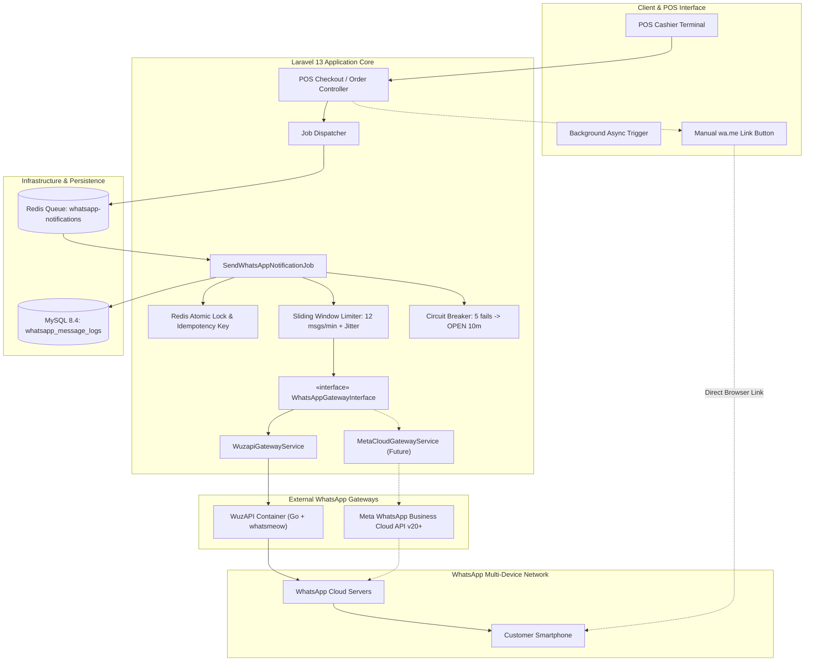
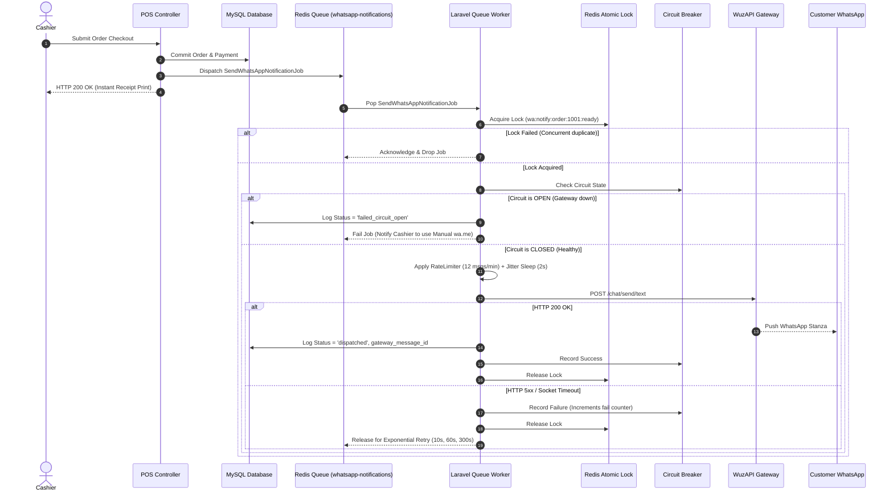

# WhatsApp Gateway & Notification Architecture Specification

**Document Version:** 1.0.0  
**Project:** Laundry Management System (LMS Andik Laundry)  
**Status:** Approved Architecture Specification  
**Classification:** Phase 0 Discovery & Planning Deliverable  
**Date:** 2026-11-13  

---

## 1. Executive Summary & Architecture Overview

Customer notification in modern retail laundry operations is a mission-critical touchpoint. Customers require immediate digital receipts upon intake, real-time alerts when their clothing is ready for collection, and automated payment receipts. In Indonesia, WhatsApp is the dominant communication channel with near-100% penetration among retail consumers.

This document specifies the end-to-end architecture for WhatsApp notification capabilities in LMS Andik Laundry:
1. **Asynchronous Decoupling:** POS checkout and production operations are strictly decoupled from external network requests via Laravel Redis queues, guaranteeing sub-second cashier responsiveness.
2. **Gateway Evaluation:** An objective, 8-dimension comparative evaluation of **WuzAPI** (self-hosted Go + whatsmeow REST API) versus the **Meta WhatsApp Business Cloud API**, establishing WuzAPI as the MVP choice alongside an anti-ban resilience framework.
3. **Resilience & Anti-Ban Engineering:** Strict rate limiting (max 12 messages/minute), randomized anti-heuristic jitter (1.5–3.5s), atomic idempotency locking, and an automated circuit breaker.
4. **Security:** Cryptographic HMAC-SHA256 signature verification over raw request body streams for incoming webhooks.
5. **Fail-Safe Manual Fallback:** A POS Cashier UI integration providing one-click `https://wa.me/{phone}?text={encoded}` deep links when external gateways or internet connections are interrupted.



---

## 2. Gateway Evaluation & Comparative Trade-Off Analysis

LMS Andik Laundry evaluates two architectural gateway pathways:
- **Option A:** **WuzAPI** (Self-hosted Go REST service utilizing `@tulir/whatsmeow` to act as an authorized companion device via WhatsApp Web multi-device protocol).
- **Option B:** **Meta WhatsApp Business Cloud API** (Official Meta Graph API v20+ enterprise gateway hosted directly on Meta infrastructure).

### 2.1 Comparative Trade-Off Matrix

| Evaluation Dimension | Option A: WuzAPI (Self-Hosted Go + whatsmeow) | Option B: Meta WhatsApp Business Cloud API | Impact on LMS Andik Laundry |
|:---|:---|:---|:---|
| **1. Financial Cost** | **Zero per-message fees.** Free open-source software. Runs on the store's shared application VPS (~$5–$10/month total infrastructure). | **Pay-per-conversation.** Utility messages in Indonesia cost ~Rp 300 to Rp 450 per 24-hour conversation window. 1,500 monthly transactions = Rp 450,000–Rp 675,000/month recurring cost. | **WuzAPI wins decisively on cost.** Significant financial savings for a single-store retail laundry. |
| **2. Account Ban Risk** | **Moderate to High.** Operates on reverse-engineered WhatsApp Web protocol. Violates Meta ToS. Risk of automated suspension if flagged by spam heuristics or rapid burst dispatching. | **Zero Ban Risk.** 100% official, compliant, and authorized by Meta. Automated tier and quality rating management. | **Meta Cloud API wins on safety.** WuzAPI mandates strict anti-ban throttles, jitter, and warm-up policies. |
| **3. Maintenance Overhead** | **Moderate.** Requires maintaining a lightweight Docker container, monitoring WebSocket health, keeping the companion smartphone charged/connected, and occasional QR re-pairing. | **Minimal.** Zero local container or companion smartphone maintenance. Completely managed by Meta with 99.9% uptime SLA. | **Meta Cloud API wins on maintenance.** WuzAPI requires local operator attention if session drops. |
| **4. Message Formatting & Agility** | **Complete Flexibility.** Arbitrary markdown, dynamic line items, customized emojis, and table layouts rendered directly via Laravel templates. | **Strictly Constrained.** Outside 24h user-initiated window, messages must strictly use pre-registered and approved templates. No dynamic layout alterations. | **WuzAPI wins on flexibility.** Store owner can tweak invoice wording instantly without waiting for approvals. |
| **5. Template Approvals** | **Zero Approvals.** Instant deployment of new message templates. Zero review latency. | **Mandatory Pre-Approval.** Every single notification template must be submitted to Meta Business Manager for review (5 mins to 24 hours approval delay). | **WuzAPI wins on release speed.** |
| **6. Onboarding Friction** | **Zero Legal Paperwork.** Spin up Docker container, scan QR code from existing store phone in 30 seconds. Uses the store's familiar phone number immediately. | **High Administrative Friction.** Requires Facebook Business Manager verification, Indonesian legal entity registration (NIB/SIUP), and a dedicated unlinked phone number. | **WuzAPI wins for MVP.** Enables immediate Day 1 deployment for an independent single-store owner. |
| **7. Session Longevity** | **Fragile.** Session can expire if companion phone remains offline > 14 days, user unlinks device in mobile app, or WhatsApp updates cryptographic handshakes. | **Permanent.** System User permanent access tokens never expire and operate independently of physical hardware. | **Meta Cloud API wins on enterprise reliability.** |
| **8. Delivery Status Reliability** | **Best-Effort.** API 200 OK only confirms socket transmission. Read receipts are suppressed if customer disables blue ticks in privacy settings. | **Guaranteed & Complete.** Webhooks provide enterprise-grade delivery tracking (`sent`, `delivered`, `read`, `failed`) with specific error codes. | **Meta Cloud API wins on auditability.** |

### 2.2 Strategic Recommendation
- **MVP Selection (Phase 0 through Phase 3):** Implement **WuzAPI** as the primary automated notification gateway. This eliminates recurring message costs, allows immediate QR pairing using the store's existing smartphone, and bypasses the lengthy corporate verification process required by Meta.
- **Architectural Guardrails for WuzAPI:**
  1. Isolate dispatches behind a sliding window rate limiter (max 12 messages/min) with randomized micro-sleep jitter (1.5s–3.5s).
  2. Implement atomic idempotency keys to eliminate double-sending.
  3. Deploy an automated Circuit Breaker to detect WebSocket drops and halt queue pile-ups.
  4. Integrate a universal **Manual WhatsApp Link Fallback** (`https://wa.me/`) in the POS Cashier interface for uninterrupted continuity.
- **Future Migration Path:** Abstract all messaging methods behind `WhatsAppGatewayInterface`. When business volume scales or if Meta enforces stricter protocol blocks, switching to Meta Cloud API in Phase 7 requires creating `MetaCloudGatewayService` and changing one configuration binding in `AppServiceProvider`, with zero modifications to core laundry domain logic.

---

## 3. WuzAPI Detailed Technical Specification

WuzAPI (`asternic/wuzapi`) is an open-source REST gateway written in Go that interfaces with WhatsApp's multi-device network via `@tulir/whatsmeow`.

### 3.1 Architecture & Resource Footprint
- **Protocol:** Implements the binary WebSocket WhatsApp Web companion protocol (Noise protocol handshake, Protobuf stanzas, Curve25519 end-to-end encryption).
- **Footprint:** Runs inside a lightweight Docker container consuming under 100MB of RAM. Requires no headless browser (Puppeteer/Chromium) or Android emulator.
- **Companion Limit:** Acts as one of the 4 allowed linked companion devices per WhatsApp account.

### 3.2 Dual-Tier Authentication Scheme
1. **Master Admin Token (`WUZAPI_ADMIN_TOKEN`):**
   - Configured via environment variable upon container startup.
   - Authorizes administrative endpoints (`/admin/*`) for creating and managing WhatsApp session instances.
   - Passed via header: `Authorization: Bearer <WUZAPI_ADMIN_TOKEN>`.
2. **User / Instance Token:**
   - Generated during user creation (`POST /admin/users`).
   - Represents the isolated session instance for Andik Laundry's phone number.
   - Required for all standard session, messaging, and webhook routes.
   - Passed via header: `Token: <user_token>` or `Authorization: Bearer <user_token>`.

### 3.3 Exact REST Endpoints & Schemas

#### A. Administrative Routes (`/admin/*`)
- **`POST /admin/users`**: Register instance for LMS.
  - *Headers:* `Authorization: Bearer <WUZAPI_ADMIN_TOKEN>`, `Content-Type: application/json`
  - *Request Body:*
    ```json
    {
      "name": "AndikLaundry_Store1",
      "token": "wuzapi_secret_user_token_andik_2026",
      "webhook": "https://lms.andiklaundry.com/api/webhooks/wuzapi",
      "events": "Message,ReadReceipt"
    }
    ```
  - *Response (200 OK):*
    ```json
    {
      "code": 200,
      "success": true,
      "data": {
        "id": 1,
        "name": "AndikLaundry_Store1",
        "token": "wuzapi_secret_user_token_andik_2026"
      }
    }
    ```
- **`GET /admin/users`**: List all registered instances.
- **`DELETE /admin/users/{id}/full`**: Terminates session, unlinks companion device, purges SQLite/Postgres keys, and deletes instance.

#### B. Session Lifecycle Routes (`/session/*`)
- **`POST /session/connect`**: Connects session to WhatsApp WebSocket.
  - *Headers:* `Token: <user_token>`, `Content-Type: application/json`
  - *Request Body:* `{"subscribe": ["Message", "ReadReceipt"]}`
  - *Response (200 OK):*
    ```json
    {
      "code": 200,
      "success": true,
      "data": {
        "details": "Connected!",
        "jid": "6281234567890.0:1@s.whatsapp.net",
        "webhook": "https://lms.andiklaundry.com/api/webhooks/wuzapi"
      }
    }
    ```
  - *Note:* If the session is unlinked, `jid` returns `""`, indicating that QR scanning is required.
- **`GET /session/qr`**: Retrieve QR code for companion device pairing.
  - *Headers:* `Token: <user_token>`
  - *Response (200 OK):*
    ```json
    {
      "code": 200,
      "success": true,
      "data": {
        "qr": "data:image/png;base64,iVBORw0KGgoAAAANSUhEUgAAAMgAAADICAYAAACt..."
      }
    }
    ```
  - *Flow:* Cashier or Owner opens Owner Settings > WhatsApp Gateway in the LMS UI. The Vue component renders the base64 image; the owner scans it via WhatsApp > Linked Devices.
- **`POST /session/pairphone`**: Alternative pairing via 8-digit mobile pairing code.
  - *Request Body:* `{"Phone": "6281234567890"}`
  - *Response (200 OK):* `{"code": 200, "success": true, "data": {"linking_code": "ABCD-1234"}}`
- **`GET /session/status`**: Verify connection and authentication health.
  - *Headers:* `Token: <user_token>`
  - *Response (200 OK):*
    ```json
    {
      "code": 200,
      "success": true,
      "data": {
        "connected": true,
        "loggedIn": true
      }
    }
    ```
- **`POST /session/disconnect`**: Closes socket without deleting session authentication keys.
- **`POST /session/logout`**: Unlinks device from WhatsApp network and deletes local credentials.

#### C. Message Sending Routes (`/chat/*`)
- **`POST /chat/send/text`**: Send formatted text notification.
  - *Headers:* `Token: <user_token>`, `Content-Type: application/json`
  - *Request Body:*
    ```json
    {
      "Phone": "6281234567890",
      "Body": "*ANDIK LAUNDRY*\nHalo Budi Santoso,\nPesanan *ORD-20261113-0001* telah SELESAI dan siap diambil.\nTotal Tagihan: Rp 45.000\nTerima kasih!",
      "Id": "LMS-WA-20261113-0001"
    }
    ```
  - *Parameters:*
    - `Phone`: E.164 digits without `+` or spaces (e.g. `6281234567890`).
    - `Body`: Text payload supporting WhatsApp Markdown (`*bold*`, `_italic_`, `~strike~`, ````code````).
    - `Id` *(Optional)*: Client-supplied tracking ID matching the internal idempotency key.
  - *Response (200 OK):*
    ```json
    {
      "code": 200,
      "success": true,
      "data": {
        "id": "LMS-WA-20261113-0001",
        "details": "Message sent"
      }
    }
    ```
- **`POST /chat/send/image`**: Send graphic receipt or garment condition photo.
  - *Request Body:* `{"Phone": "6281234567890", "Caption": "Nota Pembayaran", "Image": "data:image/jpeg;base64,..."}`
- **`POST /chat/send/document`**: Send PDF thermal receipt.
  - *Request Body:* `{"Phone": "6281234567890", "FileName": "Nota-1001.pdf", "Document": "data:application/pdf;base64,..."}`

### 3.4 Session Persistence & Storage Architecture
WuzAPI delegates session storage to `whatsmeow`'s SQL store drivers:
1. **SQLite (Default & Recommended for Single Store):**
   - Enabled by default when no external database variables are defined.
   - Stores session keys, pre-keys, and signal protocol identities in SQLite files inside `/app/dbdata/`.
   - **Persistent Volume Requirement:** Docker must mount a host directory:
     ```yaml
     volumes:
       - ./wuzapi_data:/app/dbdata
     ```
2. **PostgreSQL (Alternative for Centralized Database Management):**
   - Configured via environment variables: `DB_HOST`, `DB_PORT`, `DB_USER`, `DB_PASSWORD`, `DB_NAME`, `DB_SSLMODE`.
   - Stores binary keys in tables `whatsmeow_device`, `whatsmeow_identity_keys`.

### 3.5 Webhook HMAC-SHA256 Verification & Payload Schemas

#### A. HMAC Configuration
To authenticate callbacks from WuzAPI, a minimum 32-character shared secret is set via:
- `POST /session/hmac/config`
- Request Body: `{"hmac_key": "c3f81e9b2d7a4f5c6e8b0a1d3f5e7a9b8c2d1e4f6a8b0c2d4e6f8a0b2c4d6e8f"}`
- When configured, WuzAPI attaches the header to all outbound webhook POST requests:
  ```http
  x-hmac-signature: 4a2d8e9f... [64 hex characters]
  ```

#### B. Laravel Raw Body Verification Middleware
The signature is calculated over the raw request payload. Decoding or modifying whitespace before verification will invalidate the signature:

```php
namespace App\Http\Middleware;

use Closure;
use Illuminate\Http\Request;
use Symfony\Component\HttpFoundation\Response;

class VerifyWuzapiWebhookSignature
{
    public function handle(Request $request, Closure $next): Response
    {
        $signature = $request->header('x-hmac-signature');
        $secret = config('services.wuzapi.hmac_secret');

        if (!$signature || !$secret) {
            return response()->json(['error' => 'Missing signature or unconfigured HMAC secret'], 401);
        }

        // Must read raw body stream without modification
        $rawPayload = $request->getContent();
        $expectedSignature = hash_hmac('sha256', $rawPayload, $secret);

        if (!hash_equals($expectedSignature, $signature)) {
            return response()->json(['error' => 'Invalid HMAC signature'], 401);
        }

        return $next($request);
    }
}
```

#### C. Webhook Event Payloads
1. **`type: "Message"`** (Customer reply to store):
   ```json
   {
     "token": "wuzapi_secret_user_token_andik_2026",
     "type": "Message",
     "event": {
       "Info": {
         "ID": "3EB06F9067F80BAB89FF",
         "Chat": "6281234567890@s.whatsapp.net",
         "Sender": { "User": "6281234567890", "Server": "s.whatsapp.net" },
         "IsGroup": false,
         "IsFromMe": false,
         "Timestamp": "2026-11-13T10:15:30Z"
       },
       "Message": {
         "conversation": "Halo, apakah cucian No Nota ORD-1001 sudah bisa diambil?"
       }
     }
   }
   ```
2. **`type: "ReadReceipt"`** (Delivery or Read confirmation):
   ```json
   {
     "token": "wuzapi_secret_user_token_andik_2026",
     "type": "ReadReceipt",
     "event": {
       "MessageIDs": ["LMS-WA-20261113-0001"],
       "Source": {
         "Chat": "6281234567890@s.whatsapp.net",
         "Sender": { "User": "6281234567890", "Server": "s.whatsapp.net" },
         "IsFromMe": true
       },
       "Timestamp": "2026-11-13T10:16:02Z",
       "Type": "delivered"
     }
   }
   ```
   *(Allowed `Type` values: `delivered`, `read`, `read-self`, `played`, `inactive`).*

### 3.6 Protocol Delivery Receipt Limitations
1. **Transmission vs Physical Delivery:** An HTTP 200 response from `/chat/send/text` confirms **only** that WuzAPI encrypted the Protobuf stanza and pushed it to WhatsApp's WebSocket. It does **not** guarantee delivery to the customer's device.
2. **Read Receipt Privacy Suppression:** When a recipient disables "Read Receipts" (blue ticks) in WhatsApp privacy settings, WhatsApp servers **never emit a `read` stanza**. A webhook listener will wait indefinitely for a blue tick that cannot arrive.
3. **Receipt Drops on Disconnection:** If the host drops its network connection while messages are in flight, receipt stanzas arriving during the outage may not be retransmitted upon reconnection.
4. **LMS Architectural Invariant:** LMS Andik Laundry logs messages as `dispatched` upon receiving HTTP 200 from WuzAPI. Transitions to `delivered` or `read` occur opportunistically via webhooks. Under no circumstances should order completion, cashier workflow, or customer release be gated on delivery receipts.

---

## 4. Meta WhatsApp Business Cloud API (v20+) Specification

### 4.1 Architecture & Endpoints
- **Base URL:** `https://graph.facebook.com/v20.0/{phone-number-id}/messages`
- **Authentication:** `Authorization: Bearer <System_User_Permanent_Token>`
- **Infrastructure:** Hosted globally by Meta. No local companion smartphone or local container needed.

### 4.2 24-Hour Customer Care Window & Mandatory Template Rule
1. **User-Initiated Window:** If a customer initiates a conversation, the store may send free-form text and rich media within 24 hours of the customer's last message.
2. **Business-Initiated Window:** All LMS order lifecycle notifications (intake, ready for pickup, payment receipt) are business-initiated.
   - **Enforcement:** Free-form text outside the 24-hour window is **strictly rejected** with error code `131047`.
   - **Requirement:** The business must send pre-approved **Message Templates** (`type: "template"`) registered under Meta's `UTILITY` category.

### 4.3 Template Payload Example (`laundry_order_ready`)
```json
{
  "messaging_product": "whatsapp",
  "recipient_type": "individual",
  "to": "6281234567890",
  "type": "template",
  "template": {
    "name": "laundry_order_ready",
    "language": { "code": "id" },
    "components": [
      {
        "type": "body",
        "parameters": [
          { "type": "text", "text": "Budi Santoso" },
          { "type": "text", "text": "ORD-20261113-0001" },
          { "type": "text", "text": "Rp 45.000" }
        ]
      }
    ]
  }
}
```

### 4.4 Webhook Handshake & Signature Verification
1. **`GET` Challenge Handshake:**
   - Meta sends `GET /api/webhooks/meta-whatsapp?hub.mode=subscribe&hub.challenge=1158201444&hub.verify_token=andik_lms_meta_verify_token_2026`.
   - Laravel verifies `hub.verify_token` against `config('services.meta.verify_token')` and echoes the plaintext `hub.challenge`.
2. **`POST` Payload Verification (`X-Hub-Signature-256`):**
   ```php
   $signature = str_replace('sha256=', '', $request->header('X-Hub-Signature-256'));
   $expected = hash_hmac('sha256', $request->getContent(), config('services.meta.app_secret'));
   if (!hash_equals($expected, $signature)) {
       abort(401, 'Invalid signature');
   }
   ```

---

## 5. Laravel Asynchronous Queue & Resilience Architecture



### 5.1 Queue Configuration & Job Definition
- **Queue Name:** Dedicated `whatsapp-notifications` queue to avoid blocking background reports or exports.
- **Supervisor Configuration:**
  ```ini
  [program:lms-wa-worker]
  command=php /var/www/lms/artisan queue:work redis --queue=whatsapp-notifications --tries=3 --timeout=30 --backoff=10,60,300
  autostart=true
  autorestart=true
  user=www-data
  numprocs=2
  ```

### 5.2 Atomic Idempotency Architecture
To guarantee that network retries or cashier double-clicks never send duplicate messages to customers:
1. **Deterministic Idempotency Key Format:**
   ```text
   wa:notify:{entity_type}:{entity_id}:{event_type}
   Example: wa:notify:order:1042:ready_for_pickup
   ```
2. **Database Logging Schema (`whatsapp_message_logs`):**
   ```sql
   CREATE TABLE whatsapp_message_logs (
       id BIGINT UNSIGNED AUTO_INCREMENT PRIMARY KEY,
       idempotency_key VARCHAR(191) NOT NULL UNIQUE,
       order_id BIGINT UNSIGNED NULL,
       customer_phone VARCHAR(20) NOT NULL,
       message_type ENUM('order_created', 'order_ready', 'payment_received', 'manual_fallback') NOT NULL,
       message_body TEXT NOT NULL,
       gateway_message_id VARCHAR(191) NULL,
       status ENUM('queued', 'dispatched', 'delivered', 'failed', 'manual_sent') NOT NULL DEFAULT 'queued',
       error_details TEXT NULL,
       is_manual_fallback BOOLEAN NOT NULL DEFAULT FALSE,
       dispatched_at TIMESTAMP NULL,
       created_at TIMESTAMP NULL,
       updated_at TIMESTAMP NULL,
       INDEX idx_phone (customer_phone),
       INDEX idx_status (status),
       FOREIGN KEY (order_id) REFERENCES orders(id) ON DELETE SET NULL
   ) ENGINE=InnoDB DEFAULT CHARSET=utf8mb4 COLLATE=utf8mb4_unicode_ci;
   ```
3. **Execution Guard in Job:**
   ```php
   public function handle(WhatsAppGatewayInterface $gateway): void
   {
       $lockKey = "lock:{$this->idempotencyKey}";
       $lock = Cache::lock($lockKey, 60);

       if (!$lock->get()) {
           Log::warning("Duplicate notification prevented: {$this->idempotencyKey}");
           return;
       }

       try {
           // Check if already dispatched
           $existing = WhatsAppMessageLog::where('idempotency_key', $this->idempotencyKey)
               ->whereIn('status', ['dispatched', 'delivered'])
               ->first();

           if ($existing) {
               return;
           }

           if (!CircuitBreaker::isAvailable('whatsapp_gateway')) {
               $this->markAsFailedCircuitOpen();
               return;
           }

           // Anti-ban random micro-sleep jitter (1.5 - 3.5s)
           usleep(random_int(1500000, 3500000));

           $response = $gateway->sendText($this->phone, $this->messageBody, $this->idempotencyKey);
           $this->markAsDispatched($response->messageId);
           CircuitBreaker::recordSuccess('whatsapp_gateway');

       } catch (\Throwable $e) {
           CircuitBreaker::recordFailure('whatsapp_gateway');
           throw $e; // Triggers Laravel retry backoff
       } finally {
           $lock->release();
       }
   }
   ```

### 5.3 Anti-Ban Rate Limiting & Sliding Window
To prevent automated spam detection on WhatsApp servers:
- **Sliding Window:** Maximum 12 messages per minute across the entire application.
- **Random Jitter:** 1.5s to 3.5s micro-delay injected prior to socket dispatch.
```php
use Illuminate\Support\Facades\RateLimiter;
use Illuminate\Queue\Middleware\RateLimited;

RateLimiter::for('whatsapp_gateway', function (object $job) {
    return Limit::perMinute(12)->by('single_store_gateway');
});
```

### 5.4 Circuit Breaker Specification
- **Failure Threshold:** 5 consecutive connection errors or HTTP 5xx responses.
- **State Behavior:**
  - `CLOSED`: Normal operation. All jobs process through WuzAPI.
  - `OPEN`: When 5 consecutive failures occur, circuit trips to OPEN for 10 minutes.
    - Jobs fail fast without making outbound network calls.
    - POS Cashier displays warning banner: `⚠️ Gateway WA Offline - Gunakan Kirim Manual`.
  - `HALF-OPEN`: After 10 minutes, exactly 1 test probe job is permitted through using an atomic Redis probe lock (`Cache::lock('wa_cb_probe', 15)`) to prevent concurrent queue workers from overwhelming an unstable gateway. If the probe succeeds, the circuit state resets to `CLOSED`; if failed, the 10-minute timeout resets.

---

## 6. Manual WhatsApp Link Fallback Design

### 6.1 Fallback Rationale
If the gateway container stops, the store companion phone battery dies, or the internet connection drops, customer communication must not halt. The POS Cashier interface features a universal one-click manual fallback link.

### 6.2 Universal URI Protocol
```text
https://wa.me/{phone_number_e164}?text={url_encoded_message}
```
This link opens WhatsApp Web in the cashier's browser, WhatsApp Desktop, or the mobile WhatsApp app without requiring the customer's phone number to be saved in the cashier's contacts.

### 6.3 Phone Number Normalizer Engine
Indonesian customers provide numbers in various formats (`0812-3456-7890`, `+62 812 3456 7890`, `81234567890`). All phone inputs are normalized to strict E.164 digits:

```php
namespace App\Services\WhatsApp;

class PhoneNormalizer
{
    public static function toE164(string $phone): string
    {
        // Strip all non-numeric characters
        $digits = preg_replace('/\D+/', '', $phone);

        // Strip international '00' dialing prefix if present
        if (str_starts_with($digits, '00')) {
            $digits = substr($digits, 2);
        }

        // Convert leading '0' to Indonesian country code '62'
        if (str_starts_with($digits, '0')) {
            $digits = '62' . substr($digits, 1);
        }

        // Prepend '62' if customer omitted both '0' and country code
        if (str_starts_with($digits, '8')) {
            $digits = '62' . $digits;
        }

        // Strip redundant '0' immediately following '62' (e.g. 620812... -> 62812...)
        if (str_starts_with($digits, '620')) {
            $digits = '62' . substr($digits, 3);
        }

        // Validate standard Indonesian mobile length (10 to 15 digits)
        if (strlen($digits) < 10 || strlen($digits) > 15) {
            throw new \InvalidArgumentException("Nomor telepon tidak valid: {$phone}");
        }

        return $digits;
    }
}
```

### 6.4 Pre-Filled Notification Templates

#### Template 1: Order Intake / Nota Diterima (`order_created`)
```text
*ANDIK LAUNDRY - NOTA PEMBAYARAN*
No. Nota: *{{order_number}}*
Tanggal: {{date}}
Pelanggan: {{customer_name}}

Detail Layanan:
{{items_list}}

Total Tagihan: *{{total_amount}}*
Status Pembayaran: *{{payment_status}}*
Estimasi Selesai: *{{estimated_completion}}*

Terima kasih telah mempercayakan cucian Anda di Andik Laundry!
Simpan nota digital ini untuk bukti pengambilan.
```

#### Template 2: Ready for Pickup / Cucian Selesai (`order_ready`)
```text
*ANDIK LAUNDRY - CUCIAN SELESAI*
Halo Kak *{{customer_name}}*,
Cucian dengan No. Nota *{{order_number}}* telah *SELESAI* disetrika & dipacking rapi!

Sisa Pembayaran: *{{remaining_balance}}*
Status: Siap diambil di outlet Andik Laundry.
Lokasi Rak: *{{rack_location}}*

Jam Operasional: 07.00 - 21.00 WIB.
Silakan tunjukkan pesan ini atau sebutkan No. Nota saat pengambilan. Terima kasih!
```

#### Template 3: Payment Confirmation / Pelunasan (`payment_received`)
```text
*ANDIK LAUNDRY - BUKTI PEMBAYARAN*
No. Nota: *{{order_number}}*
Pelanggan: {{customer_name}}
Jumlah Dibayar: *{{amount_paid}}*
Metode: *{{payment_method}}*
Sisa Tagihan: *Rp 0 (LUNAS)*

Terima kasih atas pembayaran Anda! Cucian Anda diproses dengan standar higienis Andik Laundry.
```

### 6.5 POS Cashier UI Integration
1. **Order Success & Order Detail Modal (Vue 3 / Inertia):**
   - **Gateway Online (Normal):** Displays a green badge `[ ✅ WA Otomatis Terkirim ]` with an optional `[ 🔄 Kirim Ulang WA ]` button.
   - **Gateway Offline (Circuit Breaker Tripped or Worker Failed):**
     - Displays an amber warning banner: `⚠️ Gateway WA Sedang Offline`.
     - Displays a prominent action button: `[ 📲 Kirim Manual via WhatsApp ]`.
2. **Behavior on Click:**
   - Opens the generated `https://wa.me/{phone}?text={encoded}` link in a new browser tab.
   - Calls the backend to log `whatsapp_message_logs` with `is_manual_fallback = true` and `status = 'manual_sent'`.
   - Includes a secondary `[ 📋 Salin Teks ]` button to copy message text to clipboard if browser popup blockers prevent new tabs.

---

## 7. Verification & Operational Guidelines

1. **HMAC Signature Math Validation:**
   ```bash
   php -r '$secret = "test_secret_32_chars_123456789012"; $payload = "{\"test\":true}"; echo hash_hmac("sha256", $payload, $secret);'
   ```
   *Expected result: 64-character lowercase hex string.*
2. **Phone Normalizer Validation Matrix:**
   - Input `081234567890` $\rightarrow$ Output `6281234567890`
   - Input `+6281234567890` $\rightarrow$ Output `6281234567890`
   - Input `81234567890` $\rightarrow$ Output `6281234567890`
   - Input `0812-3456-7890` $\rightarrow$ Output `6281234567890`
   - Input `12345` $\rightarrow$ Throws `InvalidArgumentException`
3. **Queue Health Monitoring:**
   - Failed jobs are directed to the `failed_jobs` table.
   - Owner settings page shows real-time WuzAPI connection status (`connected: true/false`, `loggedIn: true/false`).
